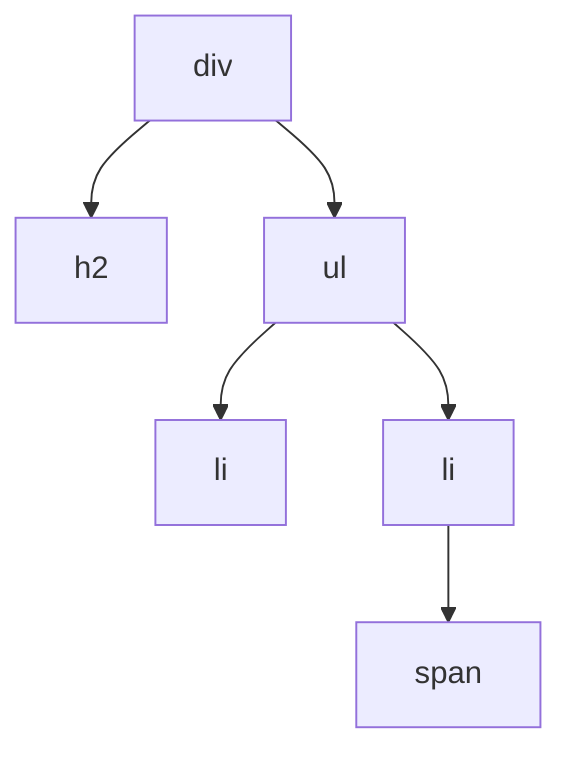

## Tags und Elemente

```alltag
text: Im Lager des Fischwagens steht auf jeder Kiste, was drin ist, vorne ein Etikett, hinten ein Etikett. Was dazwischen liegt, gehört in die Kiste. Genau so sieht HTML aus, die Sprache, in der der Inhalt einer Webseite steht.
zeichnung: kisten
```

HTML besteht aus **Elementen**. Ein Element beginnt mit einem **Starttag** wie `<p>` und endet mit dem passenden **Endtag** `</p>`, das zusätzlich einen Schrägstrich trägt. Dazwischen steht der Inhalt. Der Name im Tag sagt, was für ein Element es ist:

- `<h1>` ist die Hauptüberschrift, `<h2>` eine Überschrift darunter
- `<p>` ist ein Absatz (vom englischen paragraph)
- `<strong>` hebt etwas stark hervor, `<em>` betont es (meist schräg)

Wie die Elemente aussehen, legt zuerst der Browser selbst fest: Überschriften groß und fett, Absätze mit etwas Abstand. Unsere Bühne ist dunkel mit heller Schrift. Im Beispiel gibt es noch keine einzige Regel, nur einen Kommentar; dazu gleich mehr.

```beispiel
id: ohne-regeln
html: |
  <h1>Zum frostigen Hering</h1>
  <h2>Heute frisch</h2>
  <p>Hering mit <strong>extra</strong> viel Eis.</p>
code: |
  /* Noch keine Regeln: so zeigt der Browser HTML von sich aus */
vorhersage:
  art: auswahl
  frage: Welcher Text erscheint am größten?
  optionen:
    - text: Zum frostigen Hering
      richtig: true
      erklaerung: Richtig. h1 ist die Hauptüberschrift, der Browser macht sie am größten.
    - text: Heute frisch
      erklaerung: h2 ist eine Stufe kleiner als h1.
    - text: Alle gleich groß, es gibt ja noch keine Regeln
      erklaerung: Auch ohne eigene Regeln hat der Browser eine Grundeinstellung, und darin sind Überschriften groß.
```

```frage
frageart: auswahl
id: endtag
text: Welches ist das Endtag eines Absatzes?
optionen:
  - text: "</p>"
    richtig: true
    erklaerung: Genau, mit Schrägstrich vor dem Namen.
  - text: "<p>"
    erklaerung: Das ist das Starttag. Das Endtag hat einen Schrägstrich.
  - text: "<p/>"
    erklaerung: Der Schrägstrich steht vorne, gleich nach der spitzen Klammer.
als_code: true
```

## Verschachtelt

Elemente dürfen in anderen Elementen stecken, wie kleine Kisten in großen. Das äußere heißt **Elternelement**, die inneren seine **Kinder**. Zwei Elemente ohne eigene Bedeutung helfen beim Ordnen:

- `<div>` ist ein Kasten, der eine ganze Zeile einnimmt und andere Elemente zusammenfasst
- `<span>` ist ein Kasten mitten im Text, nur so breit wie sein Inhalt

Für Listen gibt es `<ul>` (ungeordnet, mit Punkten) und `<ol>` (nummeriert); jeder Eintrag ist ein `<li>`. Eingerückt wird nur, damit Menschen die Verschachtelung besser sehen, dem Browser ist es egal.



```beispiel
id: liste
html: |
  <div>
    <h2>Speisekarte</h2>
    <ul>
      <li>Hering</li>
      <li>Makrele <span>neu</span></li>
    </ul>
  </div>
code: |
  /* Auch hier noch ohne Regeln */
vorhersage:
  art: auswahl
  frage: Wie zeigt der Browser die Liste?
  optionen:
    - text: Zwei Zeilen untereinander, jede mit einem Punkt davor; neu steht in derselben Zeile wie Makrele
      richtig: true
      erklaerung: Richtig. Jedes li ist ein Eintrag mit Punkt, und span bleibt mitten im Text.
    - text: Hering und Makrele in einer Zeile, neu in einer eigenen Zeile darunter
      erklaerung: Jedes li beginnt eine neue Zeile. span dagegen bleibt im Text stehen.
    - text: Zwei nummerierte Zeilen, 1. Hering und 2. Makrele neu
      erklaerung: Nummern gibt es bei ol. ul zeigt Punkte.
```

```frage
frageart: fehlerstelle
id: falsch-geschlossen
text: Hier ist beim Schließen etwas durcheinandergeraten. In welcher Zeile?
code: |
  <div>
    <p>Hering mit <strong>Eis</p></strong>
    <p>Makrele</p>
  </div>
zeile: 2
erklaerung: Genau. strong steckt in p, also muss erst strong zu und dann p, wie bei Kisten in Kisten.
hinweis: Was innen aufgeht, muss innen auch wieder zu.
```

## Die erste Regel

Jetzt kommt CSS ins Spiel, die Sprache für das Aussehen. CSS besteht aus **Regeln**. Eine Regel sagt: Diese Elemente sollen so aussehen.

- vorne steht der **Selektor**, er wählt aus, für welche Elemente die Regel gilt; der Name eines Elements wie `p` wählt alle Absätze
- in geschweiften Klammern folgen die **Angaben**, je eine **Eigenschaft**, ein Doppelpunkt, ein **Wert** und ein Semikolon

`color` ist die Schriftfarbe. Als Wert gehen fürs Erste englische Farbnamen wie `orange`, `tomato`, `gold`, `skyblue` oder `white`.

```beispiel
id: erste-regel
html: |
  <h1>Zum frostigen Hering</h1>
  <p>Hering mit Eis.</p>
  <p>Makrele mit noch mehr Eis.</p>
code: |
  p {
    color: orange;
  }
vorhersage:
  art: auswahl
  optionen:
    - text: Beide Absätze werden orange, die Überschrift bleibt hell
      richtig: true
      erklaerung: Richtig. Der Selektor p wählt alle Absätze, die Überschrift ist kein p.
    - text: Nur der erste Absatz wird orange
      erklaerung: Der Selektor p gilt für jeden Absatz, nicht nur für den ersten.
    - text: Alles wird orange, auch die Überschrift
      erklaerung: Die Überschrift ist ein h1-Element. Für sie bräuchte es eine Regel mit dem Selektor h1.
```

```frage
frageart: luecke
id: luecke-regel
text: Die Überschriften sollen gold werden. Ergänze Selektor und Eigenschaft.
code: |
  ___ {
    ___: gold;
  }
antworten: [["h1"], ["color"]]
erklaerung: Richtig. h1 wählt die Überschrift, color färbt ihre Schrift.
hinweis: Der Selektor ist der Name des Elements, die Schriftfarbe heißt color.
```

```merke
text: "Eine Regel: `selektor { eigenschaft: wert; }`. Der Name eines Elements als Selektor wählt alle Elemente dieser Art."
```

## Hintergrund

`background-color` färbt den Hintergrund eines Elements, also die ganze Fläche seines Kastens. Eine Regel darf mehrere Angaben haben, eine je Zeile, jede mit Semikolon. Und es darf mehrere Regeln geben, eine unter der anderen. Wer die ganze Bühne färben will, nimmt `body`: das Element, in dem alles Sichtbare steckt.

```beispiel
id: hintergrund
html: |
  <h1>Zum frostigen Hering</h1>
  <p>Hering mit Eis.</p>
code: |
  body {
    background-color: navy;
  }
  h1 {
    color: navy;
    background-color: gold;
  }
vorhersage:
  art: auswahl
  optionen:
    - text: Die Bühne wird dunkelblau, die Überschrift steht dunkelblau auf einem goldenen Streifen über die ganze Breite
      richtig: true
      erklaerung: Richtig. h1 nimmt die ganze Breite ein, darum wird der goldene Hintergrund ein Streifen.
    - text: Die Bühne wird dunkelblau, nur die Buchstaben der Überschrift bekommen goldene Kästchen
      erklaerung: Der Hintergrund gehört zum Kasten des Elements, und der Kasten von h1 ist so breit wie die Bühne.
    - text: Die Überschrift ist unsichtbar, dunkelblau auf dunkelblau
      erklaerung: Hinter der Überschrift liegt ihr eigener Hintergrund, und der ist gold.
```

```frage
frageart: ordnen
id: ordnen-regel
text: Bring die Zeilen in Reihenfolge, damit die Absätze weiße Schrift auf rotem Grund bekommen.
zeilen:
  - p {
  - '  color: white;'
  - '  background-color: tomato;'
  - '}'
erklaerung: Richtig. Erst der Selektor mit der öffnenden Klammer, dann die Angaben, am Ende die schließende Klammer.
hinweis: Die geschweiften Klammern umschließen die Angaben.
```

```falle
titel: Semikolon vergessen
text: "Fehlt nach einer Angabe das Semikolon, liest der Browser die nächste Zeile als Teil des Werts: `color: white` und darunter `background-color: tomato;` wird zu einem einzigen kaputten Wert. Beide Angaben fallen dann weg, ohne Fehlermeldung."
```

## Kommentare

Ein Kommentar ist eine Notiz für Menschen, der Browser überliest ihn. In CSS steht er zwischen `/*` und `*/`, in HTML zwischen `<!--` und `-->`. Praktisch zum Ausprobieren: Eine Angabe im Kommentar ist abgeschaltet, ohne dass man sie löschen muss.

```beispiel
id: kommentar
html: |
  <!-- Das Schild über dem Fischwagen -->
  <h1>Zum frostigen Hering</h1>
code: |
  h1 {
    color: gold;
    /* background-color: tomato; */
  }
vorhersage:
  art: auswahl
  optionen:
    - text: Eine goldene Überschrift ohne eigenen Hintergrund, der HTML-Kommentar ist nicht zu sehen
      richtig: true
      erklaerung: Richtig. Beide Kommentare überliest der Browser, die Angabe für den Hintergrund also auch.
    - text: Eine goldene Überschrift auf rotem Streifen
      erklaerung: Die Angabe für den Hintergrund steht im Kommentar und ist damit abgeschaltet.
    - text: Über der Überschrift steht der Text Das Schild über dem Fischwagen
      erklaerung: HTML-Kommentare zeigt der Browser nicht an.
```

```frage
frageart: auswahl
id: kommentar-css
text: Welche Zeile ist ein Kommentar in CSS?
als_code: true
optionen:
  - text: "/* nur für Pit */"
    richtig: true
    erklaerung: Richtig, in CSS zwischen /* und */.
  - text: "<!-- nur für Pit -->"
    erklaerung: So sieht ein Kommentar in HTML aus, in CSS geht das nicht.
  - text: "// nur für Pit"
    erklaerung: Das gibt es in JavaScript, in CSS nicht.
```

```augenzwinkern
text: Pit hat einmal das ganze CSS des Fischwagens auskommentiert. Die Webseite sah danach aus wie 1995, und die Kundschaft fand es gemütlich.
```
