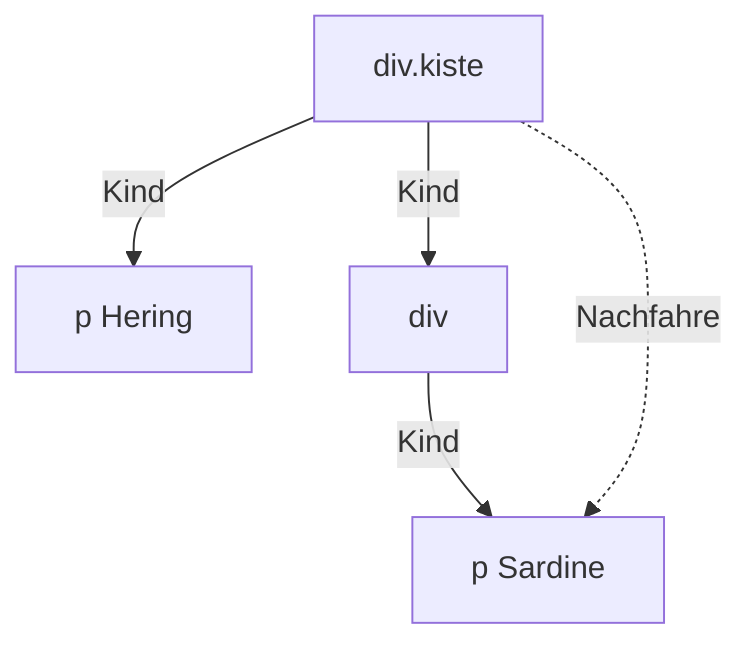

## Irgendwo darin: das Leerzeichen

```alltag
text: Pit sucht im Lager "alle Heringe in der blauen Kiste". Ob die Heringe direkt in der blauen Kiste liegen oder noch in einer kleineren Schachtel darin, ist ihm egal. Hauptsache irgendwo in der blauen Kiste.
zeichnung: taschenlampe
```

Zwei Selektoren mit einem **Leerzeichen** dazwischen heißen: das rechte Element, wenn es **irgendwo** im linken steckt, egal wie tief. `.karte span` wählt jeden span in einem Element mit der Klasse karte. Solche Elemente heißen **Nachfahren**, wie bei einer Familie: Kinder, Enkel, Urenkel.

```beispiel
id: nachfahre
html: |
  <div class="karte">
    <p>Hering <span>4,50</span></p>
  </div>
  <p>Draußen: <span>gratis Luft</span></p>
code: |
  .karte span {
    color: gold;
  }
vorhersage:
  art: auswahl
  optionen:
    - text: Nur 4,50 wird gold, gratis Luft bleibt hell
      richtig: true
      erklaerung: Richtig. Nur der erste span steckt in der Karte, als Enkel über den Absatz.
    - text: Beide span werden gold
      erklaerung: Der zweite span steckt in keinem Element mit der Klasse karte.
    - text: Nichts wird gold, weil der span gar nicht direkt in der Karte steckt
      erklaerung: Das Leerzeichen fragt nur nach irgendwo darin, nicht nach direkt darin.
```

```frage
frageart: auswahl
id: was-trifft
text: "Welche Wörter trifft `ul strong`?"
code: |
  <p><strong>Achtung</strong>, heiß!</p>
  <ul>
    <li><strong>Hering</strong> mit Eis</li>
    <li>Makrele <em>mit <strong>doppelt</strong> Eis</em></li>
  </ul>
optionen:
  - text: Hering und doppelt
    richtig: true
    erklaerung: Richtig. Beide stecken irgendwo in der ul, doppelt sogar drei Ebenen tief.
  - text: Nur Hering
    erklaerung: doppelt steckt tiefer, aber immer noch in der ul. Das Leerzeichen sucht in jeder Tiefe.
  - text: Achtung, Hering und doppelt
    erklaerung: Achtung steht in einem Absatz außerhalb der Liste.
```

## Nur direkt darin: das Größerzeichen

Manchmal soll es nur die **direkten Kinder** treffen, nicht die Enkel. Dafür steht `>` zwischen den Selektoren: `ul > li` wählt nur li, die unmittelbar in einer ul stecken.

```beispiel
id: kind
html: |
  <div class="kiste">
    <p>Hering</p>
    <div>
      <p>Sardine in der Schachtel</p>
    </div>
  </div>
code: |
  .kiste > p {
    background-color: teal;
  }
vorhersage:
  art: auswahl
  optionen:
    - text: Nur Hering bekommt den Hintergrund
      richtig: true
      erklaerung: Richtig. Der zweite Absatz steckt in einem div und ist damit ein Enkel der Kiste.
    - text: Beide Absätze bekommen den Hintergrund
      erklaerung: Das wäre .kiste p mit Leerzeichen. Das Größerzeichen verlangt direkte Kinder.
    - text: Nur Sardine in der Schachtel bekommt den Hintergrund
      erklaerung: 'Andersherum: direkt in der Kiste steckt der erste Absatz.'
```

```frage
frageart: luecke
id: luecke-kind
text: Nur Absätze direkt im Element mit der Klasse info sollen grau werden. Ergänze das Zeichen.
code: |
  .info ___ p {
    color: gray;
  }
antworten: [[">"]]
erklaerung: Richtig, das Größerzeichen wählt direkte Kinder.
hinweis: Das Zeichen zeigt wie ein Pfeil vom Eltern- zum Kindelement.
```



## Mehrere auf einmal: das Komma

Sollen mehrere Selektoren dieselben Angaben bekommen, schreibt man sie mit **Komma** getrennt vor eine Regel. Das spart Wiederholungen: `h1, h2 { color: gold; }` färbt beide Überschriften.

```beispiel
id: gruppe
html: |
  <h1>Fischwagen</h1>
  <h2>Speisekarte</h2>
  <p class="motto">Eiskalt und fangfrisch</p>
  <p>Heute mit Musik.</p>
code: |
  h1, h2, .motto {
    color: gold;
  }
vorhersage:
  art: auswahl
  optionen:
    - text: Beide Überschriften und das Motto werden gold, der letzte Absatz bleibt hell
      richtig: true
      erklaerung: Richtig. Die Regel gilt für jeden der drei Selektoren.
    - text: Nur ein Element wird gold, das, auf das alle drei Selektoren zugleich passen
      erklaerung: Das Komma heißt oder, nicht und. Jedes Element, das zu einem der Selektoren passt, wird gold.
    - text: Alle Absätze werden gold
      erklaerung: Nur der Absatz mit der Klasse motto steht in der Liste.
```

```frage
frageart: auswahl
id: komma-oder-leer
text: "Was ist der Unterschied zwischen `.karte, p` und `.karte p`?"
optionen:
  - text: Mit Komma die Karte und alle Absätze, mit Leerzeichen nur Absätze in der Karte
    richtig: true
    erklaerung: Richtig. Ein kleines Zeichen, ein großer Unterschied.
  - text: Es gibt keinen, beides wählt Absätze in der Karte
    erklaerung: Das Komma trennt zwei unabhängige Selektoren. Das Leerzeichen verbindet sie zu einem.
  - text: Mit Komma nur Absätze in der Karte, mit Leerzeichen die Karte und alle Absätze
    erklaerung: Genau andersherum.
```

## Alles: der Stern

Der **Stern** `*` passt auf jedes Element. Allein färbt `* { color: skyblue; }` alles. Spannender ist er in Kombination: `.karte *` wählt alles, was irgendwo in der Karte steckt.

```beispiel
id: stern
html: |
  <div class="karte">
    <h2>Hering</h2>
    <p>mit <em>viel</em> Eis</p>
  </div>
  <p>Außerhalb der Karte</p>
code: |
  .karte * {
    color: lightgreen;
  }
vorhersage:
  art: auswahl
  optionen:
    - text: Alles in der Karte wird hellgrün, der Absatz darunter bleibt hell
      richtig: true
      erklaerung: Richtig. Überschrift, Absatz und em stecken in der Karte, der letzte Absatz nicht.
    - text: Alles wird hellgrün, auch der letzte Absatz
      erklaerung: Das wäre der Stern allein. .karte davor beschränkt ihn auf das Innere der Karte.
    - text: Nur das Wort viel wird hellgrün, weil es am tiefsten steckt
      erklaerung: Der Stern mit Leerzeichen erreicht jede Tiefe, nicht nur die tiefste.
```

```merke
text: "`a b`: b irgendwo in a. `a > b`: b direkt in a. `a, b`: a und auch b. `*`: jedes Element."
```

```falle
titel: Leerzeichen zu viel
text: "`li .neu` (mit Leerzeichen) sucht Elemente der Klasse neu **in** einem li. `li.neu` (ohne) sucht li, die selbst die Klasse neu tragen. Ein Leerzeichen macht den Unterschied."
```

```augenzwinkern
text: 'Pit hat einmal `* { color: gold; }` geschrieben, um die Preise zu färben. Die Webseite sah danach aus wie eine Schatzkiste, und die Kundschaft hat nach Dukaten gefragt.'
```
