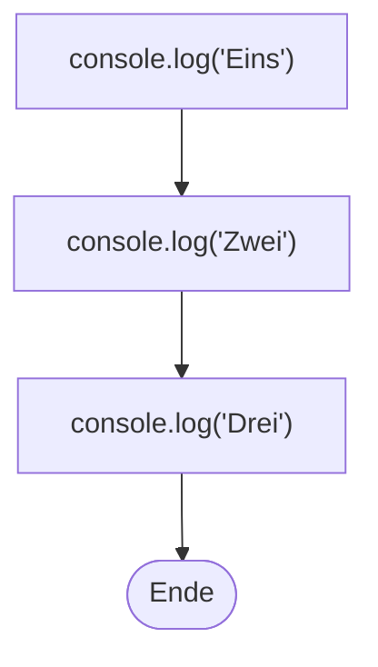

## Die Konsole

```alltag
text: Am Fischwagen hängt eine Anzeigetafel. Wer etwas mitteilen will, schreibt einen Zettel und heftet ihn an, immer unter den letzten. JavaScript hat so eine Tafel, die Konsole, und `console.log` heftet einen Zettel daran.
zeichnung: anzeigetafel
```

JavaScript läuft im Browser und auf Servern. Hier läuft es ohne Webseite drumherum, darum gibt es keine Knöpfe und Fenster, sondern die Konsole: eine Tafel mit Textzeilen. `console.log` schreibt das, was in den runden Klammern steht, als neue Zeile darauf. Das Semikolon am Ende schließt die Anweisung ab, wie ein Punkt einen Satz.

```beispiel
id: hallo-welt
code: |
  console.log("Hallo, Welt!");
vorhersage:
  art: auswahl
  optionen:
    - text: Hallo, Welt!
      richtig: true
      erklaerung: Genau. Auf der Tafel steht nur der Text, ohne Klammern, ohne Anführungszeichen, ohne Semikolon.
    - text: console.log("Hallo, Welt!");
      erklaerung: Der Befehl selbst kommt nicht auf die Tafel, nur das, was in den Klammern steht.
    - text: '"Hallo, Welt!"'
      erklaerung: Die Anführungszeichen zeigen nur, wo der Text anfängt und aufhört. Sie selbst erscheinen nicht.
```

```merke
text: "`console.log(...)` schreibt, was in den Klammern steht, als neue Zeile in die Konsole. Jede Anweisung endet mit einem Semikolon `;`."
```

```frage
frageart: auswahl
id: was-macht-log
text: Was macht `console.log`?
optionen:
  - text: Es schreibt eine Zeile in die Konsole.
    richtig: true
    erklaerung: Richtig. log heißt Protokoll, die Konsole ist das Protokoll deines Programms.
  - text: Es speichert eine Datei auf der Festplatte.
    erklaerung: Dateien kommen hier gar nicht vor. console.log zeigt nur an, sofort.
  - text: Es schaltet die Konsole ein.
    erklaerung: Die Konsole ist immer da. console.log schreibt etwas hinein.
```

## Text braucht Anführungszeichen

Text heißt beim Programmieren auch Zeichenkette oder String. Damit JavaScript weiß, wo ein Text anfängt und aufhört, steht er in Anführungszeichen. Doppelte `"` und einfache `'` gehen beide, solange vorn und hinten dieselben stehen. Es gibt noch eine dritte Sorte, die schrägen Backticks, aber die heben wir uns für Kapitel 4 auf.

```beispiel
id: zwei-gruesse
code: |
  console.log("Guten Morgen");
  console.log('Gute Nacht');
vorhersage:
  art: auswahl
  optionen:
    - text: |-
        Guten Morgen
        Gute Nacht
      richtig: true
      erklaerung: Richtig. Beide Arten von Anführungszeichen funktionieren, und jedes console.log schreibt eine neue Zeile.
    - text: Guten Morgen Gute Nacht
      erklaerung: Zwei console.log, zwei Zeilen. Jeder Zettel kommt unter den letzten.
    - text: |-
        Guten Morgen
        Fehler
      erklaerung: Einfache Anführungszeichen sind genauso gut wie doppelte, solange vorn und hinten dieselben stehen.
```

```falle
titel: Anführungszeichen vergessen
text: "Ohne Anführungszeichen hält JavaScript ein Wort für einen Namen und sucht ihn. Gibt es den Namen nicht, bricht das Programm ab mit `ReferenceError: Walross is not defined`, auf Deutsch: Walross ist nicht festgelegt."
```

```frage
frageart: fehlerstelle
id: fehler-anfuehrung
text: Dieses Programm soll drei Tiere ausgeben, bricht aber ab. In welcher Zeile steckt der Fehler?
code: |
  console.log("Pinguin");
  console.log(Walross);
  console.log("Möwe");
zeile: 2
erklaerung: Genau. Walross steht ohne Anführungszeichen; JavaScript sucht einen Namen Walross und findet keinen.
hinweise:
  1: Pinguin steht ordentlich zwischen Anführungszeichen.
  3: Die Möwe ist in Ordnung, schau weiter oben.
hinweis: Schau auf die Anführungszeichen.
```

## Zahlen ohne Anführungszeichen

Zahlen schreibst du ohne Anführungszeichen. Kommazahlen bekommen einen Punkt statt eines Kommas, wie im Englischen: `3.5` statt `3,5`. Und JavaScript lässt überflüssige Nullen hinter dem Komma weg.

```beispiel
id: zahlen
code: |
  console.log(42);
  console.log(3.50);
  console.log("42");
vorhersage:
  art: auswahl
  optionen:
    - text: |-
        42
        3.5
        42
      richtig: true
      erklaerung: Richtig. 3.50 und 3.5 sind dieselbe Zahl, die Null am Ende fällt weg. Die Zahl 42 und der Text "42" sehen gleich aus, sind für JavaScript aber zwei verschiedene Dinge; das wird beim Rechnen wichtig.
    - text: |-
        42
        3.50
        "42"
      erklaerung: Die Null am Ende einer Kommazahl lässt JavaScript weg, und Anführungszeichen erscheinen nie in der Ausgabe.
    - text: |-
        42
        3,5
        42
      erklaerung: JavaScript schreibt Kommazahlen immer mit Punkt.
```

```frage
frageart: auswahl
id: kommazahl
text: Wie schreibst du dreieinhalb in JavaScript?
als_code: true
optionen:
  - text: '3.5'
    richtig: true
    erklaerung: Richtig, mit Punkt.
  - text: '3,5'
    erklaerung: Das Komma hat eine andere Aufgabe, es trennt Werte, wie du gleich siehst.
  - text: '"3,5"'
    erklaerung: Das wäre Text, keine Zahl. Damit lässt sich nicht rechnen.
```

## Mehrere Werte, leere Zeilen

JavaScript arbeitet ein Programm von oben nach unten ab, Anweisung für Anweisung. In ein `console.log` passen auch mehrere Werte, durch Kommas getrennt; in der Ausgabe steht dann je ein Leerzeichen dazwischen. Ein leeres `console.log()` hängt einen leeren Zettel an: eine leere Zeile.



```beispiel
id: mehrere-werte
code: |
  console.log("Pit", "Pia", "Paul");
  console.log("Fische:", 3);
  console.log();
  console.log("Satt!");
vorhersage:
  art: eintippen
  erklaerung: "Die Kommas trennen die Werte, in der Ausgabe stehen Leerzeichen. Das leere `console.log()` gibt eine leere Zeile aus."
```

```frage
frageart: ordnen
id: reihenfolge-rakete
text: Die Rakete soll von drei herunterzählen und dann starten. Bring die Zeilen in die richtige Reihenfolge.
zeilen:
  - console.log(3);
  - console.log(2);
  - console.log(1);
  - console.log("Start!");
erklaerung: Richtig. JavaScript liest von oben nach unten, also steht der Countdown in der Reihenfolge, in der er erscheinen soll.
hinweis: Was zuerst in der Konsole stehen soll, steht ganz oben.
```

## Kommentare für Menschen

Manchmal willst du im Code etwas für Menschen notieren, etwa warum eine Zeile da steht. Dafür gibt es Kommentare: Hinter `//` überliest JavaScript den Rest der Zeile. Was zwischen `/*` und `*/` steht, überliest es ganz, auch über mehrere Zeilen. Praktisch ist das auch zum Ausprobieren: Eine Zeile mit `//` davor ist wie abgeschaltet.

```beispiel
id: kommentare
code: |
  // Begrüßung am Fischwagen
  console.log("Moin!");
  // console.log("Heute alles umsonst!");
  console.log("Heringsbrötchen"); // der Klassiker
  /* Ab hier
     die Getränke */
  console.log("Limonade");
vorhersage:
  art: auswahl
  optionen:
    - text: |-
        Moin!
        Heringsbrötchen
        Limonade
      richtig: true
      erklaerung: Richtig. Alles hinter // und alles zwischen /* und */ überliest JavaScript, auch das verlockende Angebot in Zeile 3.
    - text: |-
        Moin!
        Heute alles umsonst!
        Heringsbrötchen
        Limonade
      erklaerung: Zeile 3 beginnt mit //, sie ist ein Kommentar und läuft nicht. Der Fischwagen ist gerettet.
    - text: |-
        Begrüßung am Fischwagen
        Moin!
        Heringsbrötchen der Klassiker
        Limonade
      erklaerung: Kommentare sind nur für Menschen, die den Code lesen. In der Konsole erscheinen sie nie.
```

```merke
text: "`// ...` macht den Rest der Zeile zum Kommentar, `/* ... */` alles dazwischen. Kommentare überliest JavaScript; sie erklären Menschen, was der Code tut."
```

```frage
frageart: luecke
id: luecke-kommentar
text: Ergänze das Zeichen, damit die zweite Zeile ein Kommentar ist und nichts ausgibt.
code: |
  console.log("Fisch");
  ___ console.log("Kein Fisch");
antworten: [["//"]]
erklaerung: Genau, zwei Schrägstriche machen den Rest der Zeile zum Kommentar.
hinweis: Zwei gleiche Zeichen am Anfang der Zeile.
```

```augenzwinkern
text: Glückwunsch, dein Programm kann jetzt reden. Und mit Kommentaren sogar hinter seinem eigenen Rücken flüstern.
```
