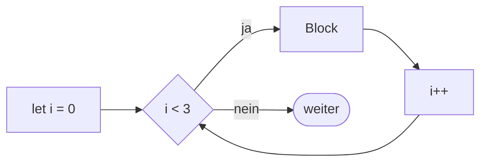

## Die Zählschleife

```alltag
text: Pit steigt die Eistreppe zum Ausguck hinauf. Er weiß, wo er anfängt (unten), wann er aufhört (oben) und wie er weiterkommt (eine Stufe pro Schritt). Diese drei Angaben hat auch die for-Schleife, alle in einer Zeile.
zeichnung: treppe
```

Die for-Schleife fasst zusammen, was bei while auf drei Stellen verteilt ist: `for (start; bedingung; schritt) { ... }`. Der Start läuft einmal am Anfang, vor jedem Durchgang wird die Bedingung geprüft, und nach jedem Durchgang kommt der Schritt. Der Zählername heißt traditionell `i`, und gezählt wird in JavaScript meist ab 0.



```beispiel
id: stufen
code: |
  for (let i = 0; i < 3; i++) {
    console.log("Stufe", i);
  }
  console.log("Oben!");
vorhersage:
  art: auswahl
  optionen:
    - text: |-
        Stufe 0
        Stufe 1
        Stufe 2
        Oben!
      richtig: true
      erklaerung: Richtig. i beginnt bei 0, und bei i gleich 3 stimmt i < 3 nicht mehr. Drei Durchgänge, 0 bis 2.
    - text: |-
        Stufe 1
        Stufe 2
        Stufe 3
        Oben!
      erklaerung: Der Start ist let i = 0, also beginnt es mit Stufe 0.
    - text: |-
        Stufe 0
        Stufe 1
        Stufe 2
        Stufe 3
        Oben!
      erklaerung: Bei i gleich 3 ist i < 3 falsch, da ist schon Schluss.
```

```merke
text: "`for (let i = 0; i < n; i++) { ... }` läuft genau n-mal, mit i von 0 bis n - 1. Start, Bedingung und Schritt stehen getrennt durch Semikolons in den runden Klammern."
```

```frage
frageart: luecke
id: luecke-for
text: Ergänze die Bedingung, damit die Schleife genau fünfmal läuft, für i von 0 bis 4.
code: |
  for (let i = 0; ___; i++) {
    console.log("Fisch");
  }
antworten: [["i < 5", "i<5", "i <= 4", "i<=4"]]
erklaerung: Richtig. i < 5 lässt 0, 1, 2, 3 und 4 durch.
hinweis: Solange i kleiner als ... ist.
```

## Anders zählen

Start, Bedingung und Schritt sind frei wählbar. Man kann bei 1 anfangen, in Zweierschritten springen oder rückwärts zählen. Der Zähler ist ein ganz normaler Name, mit dem man im Block rechnen kann.

```beispiel
id: anders
code: |
  for (let i = 1; i <= 3; i++) {
    console.log(`${i} x 7 = ${i * 7}`);
  }
  for (let i = 10; i > 0; i -= 4) {
    console.log("Rückwärts:", i);
  }
vorhersage:
  art: eintippen
  erklaerung: "Die erste Schleife zählt 1, 2, 3 und rechnet jeweils mal 7. Die zweite beginnt bei 10 und zieht je 4 ab: 10, 6, 2; bei -2 stimmt i > 0 nicht mehr."
```

```frage
frageart: auswahl
id: gerade-zahlen
text: Welche Schleife gibt 0, 2, 4, 6 und 8 aus?
als_code: true
optionen:
  - text: for (let i = 0; i < 10; i += 2)
    richtig: true
    erklaerung: Richtig. Start 0, Zweierschritte, Schluss vor 10.
  - text: for (let i = 0; i < 10; i++)
    erklaerung: Das zählt in Einerschritten von 0 bis 9.
  - text: for (let i = 2; i <= 8; i += 2)
    erklaerung: Fast, aber die 0 fehlt; die Schleife beginnt bei 2.
```

## Zeichen für Zeichen mit for ... of

Um alle Zeichen eines Textes nacheinander zu bekommen, braucht man keinen Zähler. `for (const zeichen of text) { ... }` gibt dir in jedem Durchgang das nächste Zeichen. Im nächsten Kapitel funktioniert das genauso mit Listen.

```beispiel
id: buchstaben
code: |
  const fisch = "Lachs";
  let rueckwaerts = "";
  for (const z of fisch) {
    rueckwaerts = z + rueckwaerts;
  }
  console.log(rueckwaerts);
vorhersage:
  art: auswahl
  optionen:
    - text: shcaL
      richtig: true
      erklaerung: Richtig. Jedes neue Zeichen kommt vorn dran, so dreht sich der Text um. Spiel es ab und sieh zu, wie rueckwaerts wächst.
    - text: Lachs
      erklaerung: Das neue Zeichen wird vorn angeklebt, z + rueckwaerts, nicht hinten.
    - text: L
      erklaerung: for ... of geht durch alle Zeichen, nicht nur das erste.
```

```falle
titel: in statt of
text: "`for (const z in text)` sieht fast gleich aus, liefert aber die Nummern der Zeichen statt der Zeichen selbst, und zwar als Text: \"0\", \"1\", \"2\". Für die Zeichen nimm immer `of`."
```

## Überspringen mit continue

`continue` bricht nur den aktuellen Durchgang ab und springt direkt zum nächsten. Bei for kommt vorher noch der Schritt. So filterst du einzelne Fälle heraus, ohne alles in ein else zu packen.

```beispiel
id: ohne-vokale
code: |
  let kurz = "";
  for (const z of "Heringsbrötchen") {
    if ("aeiouäöü".includes(z)) {
      continue;
    }
    kurz += z;
  }
  console.log(kurz);
vorhersage:
  art: eintippen
  erklaerung: "Bei jedem Vokal springt continue zum nächsten Zeichen, ohne anzukleben. Übrig bleiben die Konsonanten, das H am Anfang ist groß und kein Vokal."
```

## Schleifen in Schleifen

Im Block einer Schleife darf wieder eine Schleife stehen. Die innere läuft dann bei jedem Durchgang der äußeren komplett durch. So entstehen Tabellen und Muster.

```beispiel
id: treppe
code: |
  for (let zeile = 1; zeile <= 3; zeile++) {
    let stufe = "";
    for (let i = 0; i < zeile; i++) {
      stufe += "#";
    }
    console.log(stufe);
  }
vorhersage:
  art: auswahl
  optionen:
    - text: |-
        #
        ##
        ###
      richtig: true
      erklaerung: Richtig. In Zeile 1 läuft die innere Schleife einmal, in Zeile 2 zweimal, in Zeile 3 dreimal.
    - text: |-
        ###
        ###
        ###
      erklaerung: Die innere Schleife läuft nur bis zeile, also jedes Mal etwas weiter.
    - text: '######'
      erklaerung: stufe beginnt in jeder Zeile neu als leerer Text, und jede Zeile wird einzeln ausgegeben.
```

```merke
text: "`for (const z of text)` geht Zeichen für Zeichen durch. `continue` springt zum nächsten Durchgang, `break` beendet die Schleife. Eine Schleife im Block einer anderen läuft bei jedem äußeren Durchgang ganz durch."
```

```frage
frageart: ordnen
id: ordnen-sterne
text: Bring die Zeilen in Reihenfolge, damit fünf Sterne in einer Zeile ausgegeben werden.
zeilen:
  - let reihe = "";
  - for (let i = 0; i < 5; i++) {
  - '  reihe += "*";'
  - '}'
  - console.log(reihe);
erklaerung: Richtig. Erst den leeren Text anlegen, in der Schleife sammeln, danach einmal ausgeben.
hinweis: Ausgegeben wird nach der Schleife, sonst stünden fünf Zeilen da.
```

```augenzwinkern
text: Pit hat die Eistreppe mit for (let i = 0; i <= 100; i++) gebaut. Eine Stufe zu viel. Oben steht er jetzt in der Luft und wundert sich.
```
