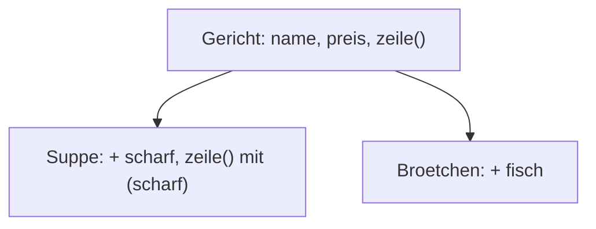

## Ein Bauplan für Objekte

```alltag
text: Pit baut Vogelhäuschen für die Möwen, damit sie seine Fische in Ruhe lassen. Er zeichnet einmal einen Bauplan, danach baut er so viele Häuschen, wie er will. Alle sind gleich gebaut, aber jedes hat eine eigene Farbe und einen eigenen Bewohner. Eine Klasse ist der Bauplan, die Objekte sind die Häuschen.
zeichnung: bauplan
```

`class Name { ... }` beschreibt einen Bauplan. Darin baut `constructor(...)` jedes neue Objekt auf: `this` ist dabei das Objekt, das gerade entsteht, und `this.name = name;` gibt ihm eine Eigenschaft. Gebaut wird mit `new Name(...)`. Klassennamen schreibt man mit großem Anfangsbuchstaben. In der Konsole steht vor dem Objekt der Name seiner Klasse.

```beispiel
id: bauplan
code: |
  class Haeuschen {
    constructor(farbe, bewohner) {
      this.farbe = farbe;
      this.bewohner = bewohner;
    }
  }
  const rot = new Haeuschen("rot", "Möwe Mia");
  const blau = new Haeuschen("blau", "Möwe Max");
  console.log(`${rot.bewohner} wohnt im ${rot.farbe}en Haus`);
  console.log(blau);
vorhersage:
  art: auswahl
  optionen:
    - text: |-
        Möwe Mia wohnt im roten Haus
        Haeuschen { farbe: 'blau', bewohner: 'Möwe Max' }
      richtig: true
      erklaerung: Richtig. Zwei Objekte nach demselben Plan, jedes mit eigenen Werten.
    - text: |-
        Möwe Mia wohnt im roten Haus
        { farbe: 'blau', bewohner: 'Möwe Max' }
      erklaerung: Objekte aus einer Klasse zeigt die Konsole mit dem Klassennamen davor.
    - text: |-
        undefined wohnt im undefineden Haus
        Haeuschen {}
      erklaerung: Der constructor legt mit this.farbe und this.bewohner die Eigenschaften an.
```

```frage
frageart: auswahl
id: was-ist-this
text: Wofür steht `this` im constructor?
optionen:
  - text: Für das Objekt, das gerade gebaut wird
    richtig: true
    erklaerung: Richtig. this.farbe ist die Farbe genau dieses Häuschens.
  - text: Für die Klasse selbst
    erklaerung: Die Klasse ist der Plan; this ist das einzelne Objekt.
  - text: Für das zuletzt gebaute Objekt
    erklaerung: this ist immer das Objekt, mit dem gerade gearbeitet wird.
```

## Methoden

Funktionen in einer Klasse heißen Methoden und werden ohne das Wort function geschrieben. Jedes Objekt kann sie aufrufen, und mit `this` greifen sie auf die Werte genau dieses Objekts zu. Liefert eine Methode `this` zurück, lassen sich Aufrufe hintereinanderhängen.

```beispiel
id: methoden
code: |
  class Konto {
    constructor(name) {
      this.name = name;
      this.stand = 0;
    }
    einzahlen(betrag) {
      this.stand += betrag;
      return this;
    }
    auszug() {
      return `${this.name}: ${this.stand.toFixed(2)} Euro`;
    }
  }
  const pit = new Konto("Pit");
  const pia = new Konto("Pia");
  pit.einzahlen(10).einzahlen(2.5);
  pia.einzahlen(4);
  console.log(pit.auszug());
  console.log(pia.auszug());
vorhersage:
  art: eintippen
  erklaerung: "Jedes Konto hat seinen eigenen stand. Pit zahlt zweimal ein, verkettet, weil einzahlen das Konto zurückgibt; Pia einmal."
```

```merke
text: "`class Name { constructor(a) { this.a = a; } methode() { ... this.a ... } }` ist ein Bauplan, `new Name(1)` baut ein Objekt. `this` ist das Objekt, mit dem gerade gearbeitet wird."
```

## Berechnet und für alle: get und static

Mit `get name() { ... }` sieht eine Methode von außen aus wie eine Eigenschaft: Man schreibt `rechteck.flaeche` ohne Klammern, und jedes Mal wird frisch gerechnet. Mit `static` gehört eine Methode der Klasse selbst statt einem einzelnen Objekt; man ruft sie über den Klassennamen auf.

```beispiel
id: get-static
code: |
  class Scholle {
    constructor(breite, laenge) {
      this.breite = breite;
      this.laenge = laenge;
    }
    get flaeche() {
      return this.breite * this.laenge;
    }
    static quadrat(seite) {
      return new Scholle(seite, seite);
    }
  }
  const s = new Scholle(3, 4);
  console.log(s.flaeche);
  s.breite = 5;
  console.log(s.flaeche);
  console.log(Scholle.quadrat(6).flaeche);
vorhersage:
  art: auswahl
  optionen:
    - text: |-
        12
        20
        36
      richtig: true
      erklaerung: Richtig. flaeche wird bei jedem Lesen neu gerechnet, darum passt sie sich an. quadrat baut über die Klasse eine neue Scholle.
    - text: |-
        12
        12
        36
      erklaerung: Ein get rechnet bei jedem Zugriff neu, mit der aktuellen Breite.
    - text: |-
        [Function: flaeche]
        [Function: flaeche]
        36
      erklaerung: Dank get liest man flaeche wie eine Eigenschaft und bekommt das Ergebnis, nicht die Funktion.
```

```frage
frageart: luecke
id: luecke-new
text: Ergänze das Wort, das ein Objekt nach dem Bauplan baut.
code: |
  class Pinguin {
    constructor(name) {
      this.name = name;
    }
  }
  const pit = ___ Pinguin("Pit");
antworten: [["new"]]
erklaerung: Richtig, new baut nach dem Plan.
hinweis: Dasselbe Wort wie bei Map und Set.
```

## Erben mit extends

`class Suppe extends Gericht` übernimmt alles von Gericht und darf Neues dazulegen oder Vorhandenes ersetzen. Im constructor ruft `super(...)` zuerst den constructor von Gericht auf; in einer Methode holt `super.methode()` die Fassung der Elternklasse.



```beispiel
id: erben
code: |
  class Gericht {
    constructor(name, preis) {
      this.name = name;
      this.preis = preis;
    }
    zeile() {
      return `${this.name}: ${this.preis.toFixed(2)} Euro`;
    }
  }
  class Suppe extends Gericht {
    constructor(name, preis, scharf) {
      super(name, preis);
      this.scharf = scharf;
    }
    zeile() {
      return super.zeile() + (this.scharf ? " (scharf)" : "");
    }
  }
  const karte = [new Gericht("Heringsbrötchen", 2.5), new Suppe("Fischsuppe", 4.5, true)];
  for (const g of karte) {
    console.log(g.zeile());
  }
vorhersage:
  art: auswahl
  optionen:
    - text: |-
        Heringsbrötchen: 2.50 Euro
        Fischsuppe: 4.50 Euro (scharf)
      richtig: true
      erklaerung: Richtig. Jedes Objekt benutzt seine eigene Fassung von zeile, die Suppe ergänzt die des Gerichts.
    - text: |-
        Heringsbrötchen: 2.50 Euro
        Fischsuppe: 4.50 Euro
      erklaerung: Die Suppe hat eine eigene zeile, die noch (scharf) anhängt.
    - text: |-
        Heringsbrötchen: 2.50 Euro
         (scharf)
      erklaerung: super.zeile() liefert erst die Zeile des Gerichts, dann kommt der Zusatz dazu.
```

```falle
titel: this vergessen
text: "In einer Methode ist `stand` ein unbekannter Name, gemeint ist fast immer `this.stand`. Und `super(...)` muss im constructor einer erbenden Klasse vor dem ersten `this` stehen, sonst bricht JavaScript mit einem ReferenceError ab."
```

```frage
frageart: ordnen
id: ordnen-klasse
text: Bring die Zeilen in Reihenfolge, damit ein Zähler gebaut wird, zweimal klickt und 2 ausgibt.
zeilen:
  - class Zaehler {
  - '  constructor() { this.stand = 0; }'
  - '  klick() { this.stand++; }'
  - '}'
  - const z = new Zaehler();
  - z.klick();
  - z.klick();
  - console.log(z.stand);
erklaerung: Richtig. Erst der Plan, dann ein Objekt bauen, klicken und ausgeben.
hinweis: Gebaut werden kann erst, wenn der Plan fertig ist.
```

```augenzwinkern
text: Pit hat eine Klasse Fisch mit der Methode schwimmen geschrieben. Seine Brötchen erben jetzt von Fisch und schwimmen davon. Er überlegt noch, ob das ein Fehler ist.
```
