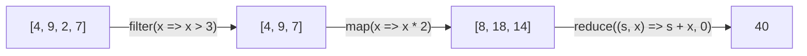

## Kurz geschrieben mit =>

```alltag
text: Am Fließband der Fischfabrik stehen Stationen. Jede bekommt eine kleine Anweisung auf einem Zettel, etwa "mal jeden Fisch blau an" oder "lass nur große durch". Das Band trägt die Fische vorbei, die Station macht ihre Arbeit. Genau so arbeiten map und filter, und die Zettel sind kurze Funktionen.
zeichnung: fliessband
```

Eine Pfeilfunktion ist eine kurze Schreibweise für eine Funktion: `(a, b) => a + b` nimmt a und b und liefert a + b. Steht hinter dem Pfeil nur ein Ausdruck, ist er automatisch der Rückgabewert, ohne return. Bei genau einem Parameter dürfen die Klammern weg: `x => x * 2`. Braucht sie mehrere Zeilen, kommen geschweifte Klammern und ein return. Pfeilfunktionen legt man meist in einen const-Namen.

```beispiel
id: pfeile
code: |
  const doppelt = x => x * 2;
  const plus = (a, b) => a + b;
  const urteil = (fische) => {
    if (fische > 5) {
      return "satt";
    }
    return "hungrig";
  };
  console.log(doppelt(21), plus(2, 3), urteil(7));
vorhersage:
  art: auswahl
  optionen:
    - text: 42 5 satt
      richtig: true
      erklaerung: Richtig. Die ersten beiden liefern ihren Ausdruck direkt, die dritte braucht wegen der Klammern ein return.
    - text: 42 5 undefined
      erklaerung: Die dritte Funktion hat ein return in jedem Weg, also liefert sie satt.
    - text: undefined undefined satt
      erklaerung: Ohne geschweifte Klammern ist der Ausdruck hinter dem Pfeil automatisch der Rückgabewert.
```

```frage
frageart: auswahl
id: gleiche-funktion
text: Welche Pfeilfunktion tut dasselbe wie `function quadrat(x) { return x * x; }`?
als_code: true
optionen:
  - text: const quadrat = x => x * x;
    richtig: true
    erklaerung: Richtig. Ein Parameter, ein Ausdruck, der automatisch zurückkommt.
  - text: 'const quadrat = x => { x * x };'
    erklaerung: Mit geschweiften Klammern braucht es ein return, sonst liefert sie undefined.
  - text: const quadrat = (x * x) => x;
    erklaerung: Links vom Pfeil stehen die Parameter, rechts das Ergebnis.
```

## Funktionen weitergeben

Eine Funktion ist ein Wert und lässt sich darum einer anderen Funktion übergeben. Die ruft sie dann auf, wann sie will. So eine übergebene Funktion heißt Rückruf. Arrays haben dafür `forEach(f)`: Es ruft f für jeden Wert auf, mit dem Wert und seinem Index.

```beispiel
id: rueckruf
code: |
  function zweimal(aufgabe) {
    aufgabe();
    aufgabe();
  }
  zweimal(() => console.log("Fisch!"));
  const gaeste = ["Pia", "Ole"];
  gaeste.forEach((name, i) => console.log(`${i + 1}. ${name}`));
vorhersage:
  art: eintippen
  erklaerung: "zweimal ruft die übergebene Funktion zweimal auf. forEach ruft den Rückruf für jeden Gast auf und gibt ihm Wert und Index mit."
```

## Umbauen, auswählen, zusammenfassen

Drei Methoden machen die meisten Schleifen über Arrays überflüssig. Keine von ihnen verändert das Array, alle liefern etwas Neues:

- `map(f)` liefert ein neues Array, in dem jeder Wert durch f(wert) ersetzt ist.
- `filter(f)` liefert ein neues Array mit den Werten, für die f true liefert.
- `reduce(f, start)` fasst alles zu einem Wert zusammen: f bekommt das bisherige Ergebnis und den nächsten Wert und liefert das neue Ergebnis.



```beispiel
id: band
code: |
  const faenge = [4, 9, 2, 7];
  const grosse = faenge.filter(x => x > 3);
  const doppelt = grosse.map(x => x * 2);
  const summe = doppelt.reduce((s, x) => s + x, 0);
  console.log(grosse, doppelt, summe);
  console.log(faenge);
vorhersage:
  art: auswahl
  optionen:
    - text: |-
        [ 4, 9, 7 ] [ 8, 18, 14 ] 40
        [ 4, 9, 2, 7 ]
      richtig: true
      erklaerung: Richtig. filter lässt die 2 nicht durch, map verdoppelt, reduce zählt zusammen. Das Original bleibt, wie es war.
    - text: |-
        [ 4, 9, 7 ] [ 8, 18, 14 ] 40
        [ 8, 18, 14 ]
      erklaerung: map und filter liefern neue Arrays, faenge bleibt unverändert.
    - text: |-
        [ true, true, false, true ] [ 8, 18, 14 ] 40
        [ 4, 9, 2, 7 ]
      erklaerung: filter liefert die Werte selbst, nicht die Antworten der Funktion. Das wäre map(x => x > 3).
```

```merke
text: "`x => ausdruck` ist eine kurze Funktion. `arr.map(f)` baut um, `arr.filter(f)` wählt aus, `arr.reduce((ergebnis, x) => ..., start)` fasst zusammen. Alle drei lassen das Original in Ruhe."
```

```frage
frageart: luecke
id: luecke-filter
text: Ergänze die Methode, damit nur die Namen mit mehr als drei Buchstaben übrig bleiben.
code: |
  const namen = ["Pia", "Ole", "Gustav", "Kim", "Frieda"];
  console.log(namen.___(n => n.length > 3));
antworten: [["filter"]]
erklaerung: Richtig, filter wählt aus.
hinweis: Auswählen heißt auf Englisch filtern.
```

## Suchen, prüfen, sortieren

`find(f)` liefert den ersten Wert, für den f true liefert (oder undefined), `findIndex(f)` seine Stelle (oder -1). `some(f)` fragt, ob es mindestens einen gibt, `every(f)`, ob es alle sind. Und endlich lassen sich Zahlen sortieren: `sort((a, b) => a - b)` bekommt eine Vergleichsfunktion. Ist ihr Ergebnis negativ, kommt a nach vorn, ist es positiv, b. Mit `b - a` wird absteigend sortiert.

```beispiel
id: suchen
code: |
  const kunden = [
    { name: "Pia", umsatz: 12.5 },
    { name: "Ole", umsatz: 31 },
    { name: "Ida", umsatz: 8 },
  ];
  console.log(kunden.find(k => k.umsatz > 20).name);
  console.log(kunden.some(k => k.umsatz > 50), kunden.every(k => k.umsatz > 5));
  const rangliste = kunden.slice().sort((a, b) => b.umsatz - a.umsatz);
  console.log(rangliste.map(k => k.name).join(", "));
  console.log([10, 9, 1, 25].sort((a, b) => a - b));
vorhersage:
  art: auswahl
  optionen:
    - text: |-
        Ole
        false true
        Ole, Pia, Ida
        [ 1, 9, 10, 25 ]
      richtig: true
      erklaerung: Richtig. Ole ist der erste über 20, keiner liegt über 50, alle über 5. Absteigend nach Umsatz, und die Zahlen endlich in der richtigen Reihenfolge.
    - text: |-
        Ole
        false true
        Ida, Pia, Ole
        [ 1, 9, 10, 25 ]
      erklaerung: b.umsatz - a.umsatz sortiert absteigend, der größte Umsatz zuerst.
    - text: |-
        Ole
        false true
        Ole, Pia, Ida
        [ 1, 10, 25, 9 ]
      erklaerung: Mit der Vergleichsfunktion a - b werden Zahlen als Zahlen verglichen.
```

```falle
titel: Rückruf aufrufen statt übergeben
text: "`gaeste.forEach(begruessen())` ruft begruessen sofort auf und übergibt das Ergebnis, meist undefined. Gemeint ist `gaeste.forEach(begruessen)`, ohne Klammern: die Funktion selbst, die forEach dann aufruft."
```

```frage
frageart: ordnen
id: ordnen-kette
text: Bring die Zeilen in Reihenfolge, damit die Namen der Kunden über 10 Euro alphabetisch ausgegeben werden.
zeilen:
  - 'const kunden = [{ name: "Pia", umsatz: 12 }, { name: "Ida", umsatz: 8 }, { name: "Bo", umsatz: 20 }];'
  - const gute = kunden.filter(k => k.umsatz > 10);
  - const namen = gute.map(k => k.name);
  - console.log(namen.sort().join(", "));
erklaerung: Richtig. Erst auswählen, dann die Namen herausziehen, dann sortieren und verbinden.
hinweis: Ohne Auswahl hätte map auch Ida dabei.
```

```augenzwinkern
text: Pit hat reduce zuerst für eine Diät gehalten. Seitdem fasst er alle Fische zu einem einzigen großen zusammen und nennt ihn Summe.
```
