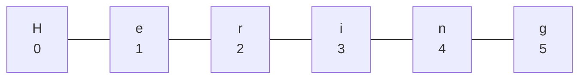

## Text zusammenkleben

```alltag
text: Für das Sommerfest hängt Pit eine Wimpelkette an den Fischwagen. Auf jedem Wimpel steht ein Buchstabe, und die Wimpel sind nummeriert, damit niemand sie vertauscht. Ein Text in JavaScript ist genau so eine Kette, und die Nummerierung beginnt bei 0.
zeichnung: wimpelkette
```

Das Plus kann mehr als rechnen: Zwischen zwei Texten klebt es sie zusammen. Steht auf einer Seite ein Text und auf der anderen eine Zahl, wird die Zahl erst zu Text und dann angeklebt. Leerzeichen fügt `+` nie von selbst ein, die musst du in den Text schreiben.

```beispiel
id: kleben
code: |
  const fisch = "Hering";
  console.log(fisch + "sbrötchen");
  console.log("Preis: " + 2.5 + " Euro");
  console.log("2" + 2);
vorhersage:
  art: auswahl
  optionen:
    - text: |-
        Heringsbrötchen
        Preis: 2.5 Euro
        22
      richtig: true
      erklaerung: Richtig. Text plus Text wird zusammengeklebt, und "2" + 2 ist kein Rechnen, sondern Kleben, weil einer der beiden Text ist.
    - text: |-
        Hering sbrötchen
        Preis: 2.5 Euro
        4
      erklaerung: Das Plus klebt ohne Leerzeichen, und sobald ein Text dabei ist, wird geklebt, nicht gerechnet.
    - text: |-
        Heringsbrötchen
        Preis:2.5Euro
        22
      erklaerung: 'Die Leerzeichen stehen in den Texten, "Preis: " endet mit einem und " Euro" beginnt mit einem.'
```

```falle
titel: Kleben statt rechnen
text: "`\"2\" + 2` ergibt `\"22\"`, nicht 4. Sobald einer der beiden Werte Text ist, klebt das Plus. Bei minus, mal und geteilt versucht JavaScript dagegen zu rechnen: `\"6\" * 2` ist 12. Kapitel 5 zeigt, wie du Text sauber in Zahlen umwandelst."
```

```frage
frageart: auswahl
id: klebe-reihenfolge
text: Was gibt `console.log(1 + 2 + "3");` aus?
als_code: true
optionen:
  - text: '33'
    richtig: true
    erklaerung: Richtig. JavaScript arbeitet von links nach rechts, 1 + 2 ist 3, dann wird "3" angeklebt.
  - text: '123'
    erklaerung: Bis zum Text sind es zwei Zahlen, die werden erst zusammengerechnet.
  - text: '6'
    erklaerung: "\"3\" ist Text, also klebt das letzte Plus."
```

## Vorlagen mit Backticks

Viele Plus und Anführungszeichen werden schnell unübersichtlich. Bequemer sind Vorlagen in Backticks `` ` ``, den schrägen Anführungszeichen (auf der Tastatur rechts neben dem ß, mit Umschalt). In einer Vorlage setzt `${...}` einen Wert ein, und zwischen die geschweiften Klammern darf sogar eine Rechnung.

```beispiel
id: vorlage
code: |
  const kunde = "Pia";
  const anzahl = 3;
  const preis = 2.5;
  console.log(`${kunde} kauft ${anzahl} Brötchen.`);
  console.log(`Das macht ${anzahl * preis} Euro.`);
vorhersage:
  art: auswahl
  optionen:
    - text: |-
        Pia kauft 3 Brötchen.
        Das macht 7.5 Euro.
      richtig: true
      erklaerung: Richtig. Jedes ${...} wird durch seinen Wert ersetzt, auch die Rechnung.
    - text: |-
        ${kunde} kauft ${anzahl} Brötchen.
        Das macht ${anzahl * preis} Euro.
      erklaerung: In Backticks werden die ${...} ersetzt. In normalen Anführungszeichen stünden sie wörtlich da.
    - text: |-
        Pia kauft 3 Brötchen.
        Das macht 3 * 2.5 Euro.
      erklaerung: In ${...} wird gerechnet, eingesetzt wird das Ergebnis.
```

```merke
text: "In Backticks setzt `${wert}` einen Wert in den Text ein: `` `Hallo ${name}!` ``. Leerzeichen und Satzzeichen schreibst du einfach dazu."
```

```frage
frageart: luecke
id: luecke-vorlage
text: Ergänze, damit `Pit hat 4 Fische` herauskommt.
code: |
  const name = "Pit";
  const fische = 4;
  console.log(`${name} hat ___ Fische`);
antworten: [["${fische}"]]
erklaerung: Richtig, ${fische} setzt den Wert ein.
hinweis: Dollar, geschweifte Klammer, Name, geschweifte Klammer.
```

## Zeichen zählen und herauspicken

`text.length` sagt, wie viele Zeichen ein Text hat; Leerzeichen zählen mit. Mit eckigen Klammern holst du ein einzelnes Zeichen: `text[0]` ist das erste, denn gezählt wird ab 0. Das letzte steht darum bei `text.length - 1`, und `text.at(-1)` holt es kürzer. Die Nummer heißt Index.



```beispiel
id: zaehlen
code: |
  const fisch = "Hering";
  console.log(fisch.length);
  console.log(fisch[0]);
  console.log(fisch[2]);
  console.log(fisch[fisch.length - 1]);
  console.log(fisch[10]);
vorhersage:
  art: auswahl
  optionen:
    - text: |-
        6
        H
        r
        g
        undefined
      richtig: true
      erklaerung: Richtig. Sechs Zeichen, Index 0 bis 5. Index 10 gibt es nicht, da kommt undefined heraus, aber kein Abbruch.
    - text: |-
        6
        e
        i
        g
        undefined
      erklaerung: Gezählt wird ab 0, fisch[0] ist das H.
    - text: |-
        6
        H
        r
        g
        Fehler
      erklaerung: Ein Index hinter dem Ende bricht nicht ab; JavaScript antwortet mit undefined, nicht festgelegt.
```

```frage
frageart: auswahl
id: letztes-zeichen
text: Welcher Ausdruck holt das letzte Zeichen von `wort`, egal wie lang es ist?
als_code: true
optionen:
  - text: wort[wort.length - 1]
    richtig: true
    erklaerung: Richtig. Bei sechs Zeichen ist der letzte Index 5, also length minus 1.
  - text: wort[wort.length]
    erklaerung: Da ist schon eins zu weit, der Index beginnt bei 0. Heraus käme undefined.
  - text: wort[-1]
    erklaerung: Negative Zahlen in eckigen Klammern gehen in JavaScript nicht. Dafür gibt es wort.at(-1).
```

## Text verwandeln

Texte bringen viele Methoden mit, die du mit einem Punkt aufrufst: `text.methode(...)`. Sie ändern den Text nie selbst, sondern liefern einen neuen. Hier die wichtigsten:

- `toUpperCase()` und `toLowerCase()`: alles groß oder klein
- `trim()`: Leerzeichen vorn und hinten weg
- `includes(teil)`, `startsWith(teil)`, `endsWith(teil)`: kommt teil vor, vorn, hinten?
- `indexOf(teil)`: an welcher Stelle steht teil (-1, wenn gar nicht)
- `slice(von, bis)`: Ausschnitt von Index von bis vor Index bis
- `replace(alt, neu)` ersetzt das erste Vorkommen, `replaceAll(alt, neu)` alle
- `repeat(n)`: n-mal hintereinander

```beispiel
id: methoden
code: |
  const ruf = "  Frischer Hering, Hering frisch!  ";
  const sauber = ruf.trim();
  console.log(sauber.toUpperCase());
  console.log(sauber.slice(0, 8));
  console.log(sauber.includes("Lachs"));
  console.log(sauber.replaceAll("Hering", "Makrele"));
  console.log("Ahoi".repeat(2));
vorhersage:
  art: eintippen
  erklaerung: "trim entfernt die Leerzeichen außen. slice(0, 8) nimmt die Zeichen 0 bis 7, also Frischer. includes antwortet true oder false, Lachs kommt nicht vor. replaceAll tauscht beide Heringe, und repeat(2) wiederholt."
```

```falle
titel: Text bleibt, wie er ist
text: "`name.toUpperCase();` allein bewirkt nichts Sichtbares: Die Methode liefert einen neuen Text, aber niemand fängt ihn auf. Schreib `name = name.toUpperCase();` (mit let) oder gib das Ergebnis direkt aus. Auch `name[0] = \"K\";` ändert nichts, einzelne Zeichen lassen sich nicht austauschen."
```

```merke
text: "`text.length` zählt die Zeichen, `text[i]` holt eins (ab 0). Methoden wie `toUpperCase()`, `slice(von, bis)`, `includes(teil)` und `replaceAll(alt, neu)` liefern einen neuen Text."
```

```frage
frageart: ordnen
id: ordnen-gruss
text: Aus " pia " soll der Gruß "Moin, PIA!" werden. Bring die Zeilen in Reihenfolge.
zeilen:
  - let name = " pia ";
  - name = name.trim();
  - name = name.toUpperCase();
  - console.log(`Moin, ${name}!`);
erklaerung: Richtig. Erst säubern, dann groß machen, dann in die Vorlage einsetzen.
hinweis: Ausgegeben wird zuletzt.
```

```augenzwinkern
text: Pit hat seinen Wagen einmal mit replaceAll von "Hering" auf "Herring" umgetauft. Seitdem kommen nur noch englische Touristen.
```
