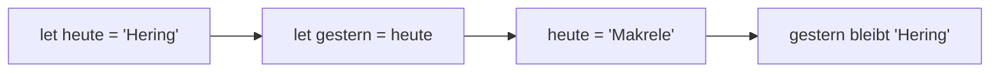

## Ein Name für einen Wert

```alltag
text: Am Fischwagen hängt eine Kreidetafel mit dem Tagesangebot. Morgens steht da Hering, mittags wischt Pit es weg und schreibt Makrele hin. Daneben hängt ein Messingschild mit dem Namen des Wagens, das bleibt für immer. In JavaScript ist `let` die Kreidetafel und `const` das Messingschild.
zeichnung: tafel-und-schild
```

Mit `let name = wert;` legst du einen Namen an und gibst ihm gleich einen Wert. Links vom Gleichheitszeichen steht der Name, rechts der Wert. Danach kannst du den Namen überall schreiben, wo du den Wert brauchst, und zwar ohne Anführungszeichen: Er ist ein Name, kein Text.

```beispiel
id: erster-name
code: |
  let angebot = "Hering";
  console.log(angebot);
vorhersage:
  art: auswahl
  optionen:
    - text: Hering
      richtig: true
      erklaerung: Genau. console.log schaut nach, was hinter dem Namen angebot steht, und gibt das aus.
    - text: angebot
      erklaerung: Ohne Anführungszeichen ist angebot kein Text, sondern ein Name. Ausgegeben wird, was dahinter steht.
    - text: let angebot
      erklaerung: let legt den Namen nur an. Ausgegeben wird der Wert, der dahinter steht.
```

```merke
text: "`=` heißt in JavaScript nicht \"ist gleich\", sondern \"bekommt\": `let angebot = \"Hering\";` liest sich als *angebot bekommt Hering*."
```

```frage
frageart: auswahl
id: was-macht-gleich
text: Was passiert bei `let fische = 3;`?
optionen:
  - text: Es gibt einen neuen Namen fische mit dem Wert 3.
    richtig: true
    erklaerung: Richtig. let legt den Namen an, und von jetzt an steht fische für 3.
  - text: JavaScript prüft, ob fische gleich 3 ist.
    erklaerung: Vergleichen kommt in Kapitel 6 und hat ein eigenes Zeichen. Ein einzelnes = gibt einem Namen einen Wert.
  - text: JavaScript gibt fische und 3 aus.
    erklaerung: Ausgegeben wird nur mit console.log. Die Zeile merkt sich den Wert nur.
```

## Neue Werte mit let

Einem Namen aus `let` kannst du später einen neuen Wert geben. Dann schreibst du kein `let` mehr davor, denn den Namen gibt es ja schon: `angebot = "Makrele";`. Der alte Wert ist danach weggewischt. Spiel das Beispiel in der Werkbank Schritt für Schritt ab und schau dir den Speicher an.

```beispiel
id: neuer-wert
code: |
  let angebot = "Hering";
  console.log("Morgens:", angebot);
  angebot = "Makrele";
  console.log("Mittags:", angebot);
vorhersage:
  art: auswahl
  optionen:
    - text: |-
        Morgens: Hering
        Mittags: Makrele
      richtig: true
      erklaerung: Richtig. In Zeile 3 bekommt angebot einen neuen Wert, ab da steht Makrele auf der Tafel.
    - text: |-
        Morgens: Makrele
        Mittags: Makrele
      erklaerung: JavaScript arbeitet von oben nach unten. In Zeile 2 steht noch Hering auf der Tafel.
    - text: |-
        Morgens: Hering
        Mittags: Hering
      erklaerung: Zeile 3 wischt die Tafel ab und schreibt Makrele hin. Danach steht dort nichts mehr von Hering.
```

```falle
titel: Zweimal let
text: "Jeder Name wird nur einmal mit `let` angelegt. Ein zweites `let angebot = ...` bricht ab mit `SyntaxError: Identifier 'angebot' has already been declared`, auf Deutsch: angebot gibt es schon. Für einen neuen Wert reicht `angebot = ...` ohne let."
```

```frage
frageart: fehlerstelle
id: fehler-doppelt
text: Dieses Programm startet gar nicht erst. Welche Zeile ist schuld?
code: |
  let kunde = "Pia";
  console.log(kunde);
  let kunde = "Paul";
  console.log(kunde);
zeile: 3
erklaerung: Genau. kunde gibt es schon seit Zeile 1, also ohne let schreiben.
hinweis: Welcher Name wird zweimal angelegt?
```

## Für immer mit const

Manche Werte sollen sich nie ändern, etwa der Name des Wagens. Dafür gibt es `const`, das Messingschild. Ein Name aus `const` bekommt genau einmal einen Wert. Versucht das Programm später, ihn zu ändern, bricht es ab. Das klingt streng, ist aber praktisch: Wer den Code liest, weiß sofort, dass dieser Wert bleibt. Viele schreiben darum zuerst `const` und nehmen `let` nur, wenn sich der Wert wirklich ändern soll.

```beispiel
id: konstante
code: |
  const wagen = "Zum frostigen Hering";
  let kunde = "Pia";
  console.log(wagen, "begrüßt", kunde);
  kunde = "Paul";
  console.log(wagen, "begrüßt", kunde);
vorhersage:
  art: auswahl
  optionen:
    - text: |-
        Zum frostigen Hering begrüßt Pia
        Zum frostigen Hering begrüßt Paul
      richtig: true
      erklaerung: Richtig. Der Wagen bleibt, die Kunden wechseln. Darum ist wagen ein const und kunde ein let.
    - text: |-
        Zum frostigen Hering begrüßt Pia
        Zum frostigen Hering begrüßt Pia
      erklaerung: In Zeile 4 bekommt kunde einen neuen Wert, das darf ein let.
    - text: |-
        Zum frostigen Hering begrüßt Pia
        Fehler
      erklaerung: Geändert wird nur kunde, und kunde ist ein let. Das Messingschild wagen bleibt unberührt.
```

```falle
titel: const lässt sich nicht ändern
text: "Nach `const wagen = \"Zum frostigen Hering\";` bricht `wagen = \"Zur flotten Forelle\";` ab mit `TypeError: Assignment to constant variable.`, auf Deutsch: Zuweisung an eine Konstante. Soll sich ein Wert ändern dürfen, nimm `let`."
```

```frage
frageart: luecke
id: luecke-let
text: Der Kontostand ändert sich im Lauf des Tages. Ergänze das passende Wort.
code: |
  ___ kasse = 0;
  kasse = 12;
  console.log(kasse);
antworten: [["let"]]
erklaerung: Richtig. kasse bekommt in Zeile 2 einen neuen Wert, also braucht es let.
hinweis: Kreidetafel oder Messingschild?
```

## Mit Namen weiterarbeiten

Ein Name lässt sich auch rechts vom Gleichheitszeichen benutzen. Dann wird zuerst der Wert dahinter nachgeschlagen und dieser Wert dem neuen Namen gegeben. Hat ein Name noch gar keinen Wert bekommen, steht dahinter `undefined`, auf Deutsch: nicht festgelegt.



```beispiel
id: weitergeben
code: |
  let heute = "Hering";
  let gestern = heute;
  heute = "Makrele";
  console.log("Gestern:", gestern);
  console.log("Heute:", heute);
  let morgen;
  console.log("Morgen:", morgen);
vorhersage:
  art: eintippen
  erklaerung: "In Zeile 2 bekommt gestern den Wert, der in diesem Moment hinter heute steht: Hering. Dass heute danach Makrele wird, ändert gestern nicht mehr. morgen hat keinen Wert bekommen, also steht dort undefined."
```

```merke
text: "`let name = wert;` legt einen Namen an, der sich ändern darf, `name = neu;` gibt ihm einen neuen Wert. `const name = wert;` legt einen Namen an, der seinen Wert behält. Einen Namen legt man nur einmal an."
```

```frage
frageart: auswahl
id: gute-namen
text: Welcher Name ist erlaubt und sagt gut, was dahinter steht?
als_code: true
optionen:
  - text: lieblingsFisch
    richtig: true
    erklaerung: Richtig. In JavaScript klebt man Wörter zusammen und schreibt jedes weitere mit großem Anfangsbuchstaben, wie die Höcker eines Kamels.
  - text: lieblings fisch
    erklaerung: Leerzeichen sind in Namen verboten, JavaScript sähe hier zwei Namen.
  - text: 2fisch
    erklaerung: Namen dürfen Ziffern enthalten, aber nicht mit einer anfangen.
  - text: x
    erklaerung: Erlaubt ist x schon, aber wer den Code liest, rät, was gemeint ist. Sprechende Namen sind besser.
```

```frage
frageart: ordnen
id: ordnen-tausch
text: Pia und Paul sollen ihre Plätze tauschen. Bring die Zeilen in Reihenfolge; die Hilfsvariable merkt sich einen Namen, damit er beim Tausch nicht verloren geht.
zeilen:
  - let vorne = "Pia";
  - let hinten = "Paul";
  - let merker = vorne;
  - vorne = hinten;
  - hinten = merker;
erklaerung: Richtig. Ohne den Merker wäre Pia nach vorne = hinten verloren, beide hießen Paul.
hinweis: Bevor vorne überschrieben wird, muss sich jemand Pia merken.
```

```augenzwinkern
text: Pit hat den Wagen übrigens erst "Wagen1" genannt. Dann kam der zweite Wagen, und er hat das mit den sprechenden Namen gelernt.
```
