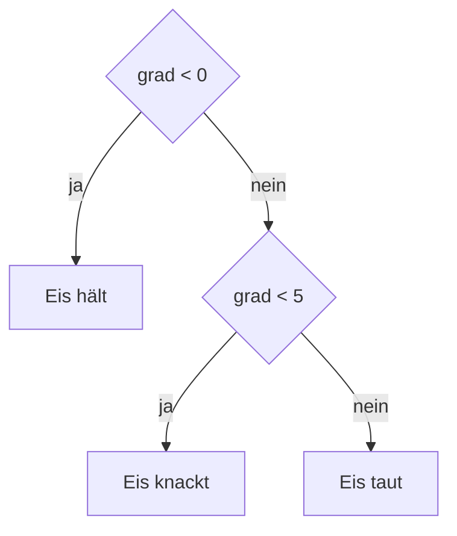

## Nur wenn es stimmt

```alltag
text: Vom Eisberg führen zwei Rutschen hinunter, eine zum Fischwagen, eine zum Wasser. Welche Pit nimmt, hängt von einer Frage ab, Hunger oder nicht. Er nimmt immer genau eine. So entscheidet ein Programm mit if.
zeichnung: rutschen
```

`if (bedingung) { ... }` führt den Code in den geschweiften Klammern nur aus, wenn die Bedingung wahr ist. Sonst springt JavaScript darüber hinweg und macht danach weiter. Den Code im Block rückt man ein, damit man sieht, was dazugehört; JavaScript selbst richtet sich nur nach den Klammern.

```beispiel
id: wenn
code: |
  const summe = 24;
  if (summe >= 20) {
    console.log("Du bekommst einen Stempel!");
    console.log("Danke für den Einkauf.");
  }
  console.log("Tschüss!");
vorhersage:
  art: auswahl
  optionen:
    - text: |-
        Du bekommst einen Stempel!
        Danke für den Einkauf.
        Tschüss!
      richtig: true
      erklaerung: Richtig. 24 >= 20 stimmt, also läuft der Block. Tschüss steht nach dem Block und kommt immer.
    - text: Tschüss!
      erklaerung: Die Bedingung ist wahr, also läuft der Block in den geschweiften Klammern.
    - text: |-
        Du bekommst einen Stempel!
        Danke für den Einkauf.
      erklaerung: Die letzte Zeile steht hinter der schließenden Klammer, sie gehört nicht zum if und läuft immer.
```

```frage
frageart: auswahl
id: was-ist-block
text: Woran erkennt JavaScript, welche Zeilen zum if gehören?
optionen:
  - text: An den geschweiften Klammern
    richtig: true
    erklaerung: Richtig. Alles zwischen { und } gehört dazu. Die Einrückung ist für Menschen.
  - text: An der Einrückung
    erklaerung: Einrücken hilft beim Lesen, aber JavaScript zählt nur die Klammern. In Python wäre es anders.
  - text: An der Leerzeile danach
    erklaerung: Leerzeilen sind JavaScript egal.
```

## Sonst und sonst wenn

Mit `else { ... }` hinter dem if gibt es einen zweiten Weg für den Fall, dass die Bedingung nicht stimmt. Mehr als zwei Wege baut man mit `else if (...)`: JavaScript prüft von oben nach unten und nimmt den ersten Weg, dessen Bedingung stimmt; die übrigen werden gar nicht mehr geprüft.



```beispiel
id: sonst-wenn
code: |
  const grad = 3;
  if (grad < 0) {
    console.log("Eis hält");
  } else if (grad < 5) {
    console.log("Eis knackt");
  } else {
    console.log("Eis taut");
  }
vorhersage:
  art: auswahl
  optionen:
    - text: Eis knackt
      richtig: true
      erklaerung: Richtig. 3 < 0 stimmt nicht, 3 < 5 schon, also der zweite Weg, und dann ist Schluss.
    - text: |-
        Eis knackt
        Eis taut
      erklaerung: Es wird genau ein Weg genommen. Sobald eine Bedingung stimmt, werden die anderen übersprungen.
    - text: Eis taut
      erklaerung: else ist nur dran, wenn keine Bedingung davor stimmt. 3 < 5 stimmt aber.
```

```falle
titel: Reihenfolge zählt
text: "Prüfst du zuerst `grad < 5` und danach `grad < 0`, kommt der zweite Weg nie dran: Alles unter 0 ist auch unter 5 und landet schon im ersten. Die engste Bedingung gehört nach oben."
```

```frage
frageart: fehlerstelle
id: fehler-reihenfolge
text: Bei 95 Punkten soll "Gold" kommen, es kommt aber "Bronze". Welche Zeile steht am falschen Platz?
code: |
  const punkte = 95;
  if (punkte >= 50) {
    console.log("Bronze");
  } else if (punkte >= 90) {
    console.log("Gold");
  }
zeile: 2
erklaerung: Genau. 95 ist auch mindestens 50, also gewinnt die erste Bedingung. Die Prüfung auf 90 muss nach oben.
hinweis: Welche Bedingung ist die weitere?
```

## Kurz entscheiden mit ? und :

Oft geht es nur darum, welcher von zwei Werten genommen wird. Dafür gibt es eine Kurzform: `bedingung ? wennJa : wennNein`. Sie liefert einen Wert, darum passt sie mitten in eine Zuweisung oder in eine Vorlage.

```beispiel
id: kurz
code: |
  const anzahl = 1;
  const wort = anzahl === 1 ? "Fisch" : "Fische";
  console.log(`${anzahl} ${wort}`);
  const mehr = 3;
  console.log(`${mehr} ${mehr === 1 ? "Fisch" : "Fische"}`);
vorhersage:
  art: auswahl
  optionen:
    - text: |-
        1 Fisch
        3 Fische
      richtig: true
      erklaerung: Richtig. Bei 1 die Einzahl, sonst die Mehrzahl, auch direkt in der Vorlage.
    - text: |-
        1 Fische
        3 Fische
      erklaerung: anzahl === 1 stimmt, also wird der Wert vor dem Doppelpunkt genommen.
    - text: |-
        1 true
        3 false
      erklaerung: Die Kurzform liefert nicht die Bedingung, sondern einen der beiden Werte dahinter.
```

```frage
frageart: luecke
id: luecke-kurz
text: Ergänze das fehlende Zeichen, damit bei Regen "Schirm" und sonst "Sonnenbrille" herauskommt.
code: |
  const regen = true;
  console.log(regen ? "Schirm" ___ "Sonnenbrille");
antworten: [[":"]]
erklaerung: Richtig, der Doppelpunkt trennt die beiden Möglichkeiten.
hinweis: Fragezeichen vorn, dann ein zweites Zeichen zwischen den Werten.
```

## Feste Fälle mit switch

Hängt der Weg an genau einem Wert, der feste Möglichkeiten hat, ist `switch` übersichtlich. Jeder `case` nennt einen Wert. JavaScript springt zum passenden case und arbeitet von dort, bis es auf `break` trifft. Passt kein case, geht es bei `default` weiter.

```beispiel
id: wochentag
code: |
  const tag = "Mittwoch";
  switch (tag) {
    case "Montag":
    case "Dienstag":
      console.log("Ruhetag");
      break;
    case "Mittwoch":
      console.log("Matjes zum halben Preis");
      break;
    default:
      console.log("Heringsbrötchen wie immer");
  }
vorhersage:
  art: auswahl
  optionen:
    - text: Matjes zum halben Preis
      richtig: true
      erklaerung: Richtig. Der case Mittwoch passt, und break beendet den switch.
    - text: |-
        Matjes zum halben Preis
        Heringsbrötchen wie immer
      erklaerung: Das break hinter dem Matjes beendet den switch, default kommt nicht mehr dran.
    - text: |-
        Ruhetag
        Matjes zum halben Preis
      erklaerung: Gesprungen wird direkt zum passenden case. Was davor steht, läuft nicht.
```

```falle
titel: break vergessen
text: "Fehlt das `break`, läuft JavaScript einfach in den nächsten case hinein und führt dessen Code mit aus. Bei Montag und Dienstag oben ist das Absicht, beide sollen Ruhetag melden. Sonst ist es fast immer ein Fehler."
```

```merke
text: "`if (b) { ... } else if (c) { ... } else { ... }`: genau ein Weg, der erste, der passt. `b ? x : y` liefert einen von zwei Werten. `switch (wert) { case ...: ... break; default: ... }` für feste Fälle."
```

```frage
frageart: ordnen
id: ordnen-ampel
text: Bring die Zeilen in Reihenfolge, damit die Ampel bei Grün Gehen meldet und sonst Warten.
zeilen:
  - const farbe = "grün";
  - if (farbe === "grün") {
  - '  console.log("Gehen");'
  - '} else {'
  - '  console.log("Warten");'
  - '}'
erklaerung: Richtig. Erst die Farbe, dann der if-Block, else hängt an der schließenden Klammer des if.
hinweis: else steht zwischen den beiden Blöcken.
```

```augenzwinkern
text: Pit hat einmal eine Bedingung mit if (hunger = true) geschrieben. Seitdem hat er immer Hunger, das Programm sagt es ja.
```
