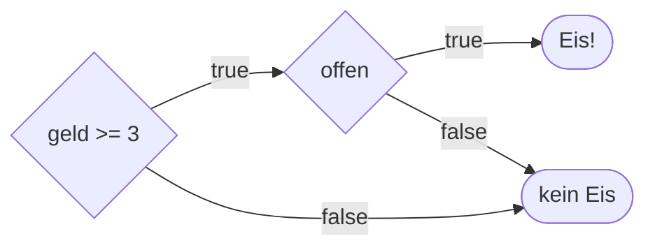

## true und false

```alltag
text: Pit legt zwei Fische auf die Waage. Die Waage sagt nicht, wie schwer sie sind, sondern nur eins von zwei Dingen, links schwerer oder nicht. Ein Vergleich in JavaScript ist so eine Waage, und ihre Antwort ist true (wahr) oder false (falsch).
zeichnung: waage
```

`5 > 3` ist keine Anweisung, sondern eine Frage, und die Antwort ist ein Wahrheitswert: `true` oder `false`. Wahrheitswerte kann man ausgeben, einem Namen geben oder weiterverwenden. Die Vergleiche sind `<` (kleiner), `>` (größer), `<=` (kleiner oder gleich) und `>=` (größer oder gleich).

```beispiel
id: vergleiche
code: |
  const hering = 250;
  const makrele = 400;
  console.log(hering > makrele);
  console.log(hering < makrele);
  const schwer = makrele >= 400;
  console.log(schwer);
vorhersage:
  art: auswahl
  optionen:
    - text: |-
        false
        true
        true
      richtig: true
      erklaerung: Richtig. 250 ist nicht größer als 400, aber kleiner; und 400 >= 400 stimmt, weil auch gleich zählt.
    - text: |-
        false
        true
        false
      erklaerung: ">= heißt größer oder gleich. 400 ist gleich 400, also true."
    - text: |-
        250
        400
        400
      erklaerung: Ein Vergleich liefert keine Zahl, sondern eine Antwort, true oder false.
```

```frage
frageart: auswahl
id: was-liefert-vergleich
text: Was für ein Wert ist `3 < 7`?
optionen:
  - text: Der Wahrheitswert true
    richtig: true
    erklaerung: Richtig, 3 ist kleiner als 7, also true.
  - text: Die Zahl 4
    erklaerung: Ein Vergleich rechnet nicht, er antwortet mit true oder false.
  - text: Der Text "3 < 7"
    erklaerung: Ohne Anführungszeichen ist es kein Text, sondern eine Frage an JavaScript.
```

## Gleich ist ===

Ein einzelnes `=` gibt einem Namen einen Wert, das kennst du. Zum Vergleichen auf Gleichheit nimmt JavaScript drei: `===`. Ungleich heißt `!==`. Bei Texten zählt jedes Zeichen, auch groß und klein, und ein Text ist nie gleich einer Zahl.

```beispiel
id: gleich
code: |
  const passwort = "Hering";
  console.log(passwort === "Hering");
  console.log(passwort === "hering");
  console.log(passwort.toLowerCase() === "hering");
  console.log(3 === "3");
  console.log(passwort !== "Lachs");
vorhersage:
  art: auswahl
  optionen:
    - text: |-
        true
        false
        true
        false
        true
      richtig: true
      erklaerung: Richtig. Großes H und kleines h sind verschieden, toLowerCase gleicht das aus. Die Zahl 3 und der Text "3" sind nicht dasselbe. Und Hering ist ungleich Lachs.
    - text: |-
        true
        true
        true
        true
        true
      erklaerung: === ist streng. Groß und klein zählen, und Text ist nie gleich einer Zahl.
    - text: |-
        true
        false
        true
        false
        false
      erklaerung: "!== fragt nach ungleich, und Hering ist ungleich Lachs: true."
```

```falle
titel: Der lockere Vergleich ==
text: "Es gibt auch `==` mit zwei Zeichen. Es wandelt vorher um und findet darum `3 == \"3\"` wahr, aber auch `0 == \"\"`. Solche Überraschungen will niemand; nimm immer `===` und `!==`. Und ein einzelnes `=` in einer Bedingung vergleicht gar nicht, es weist zu."
```

```falle
titel: Text vergleicht nach dem Alphabet
text: "Texte werden Zeichen für Zeichen verglichen, wie im Telefonbuch: `\"Apfel\" < \"Birne\"` ist true. Aber auch `\"10\" < \"9\"` ist true, weil das Zeichen 1 vor dem Zeichen 9 kommt. Eingaben aus prompt darum erst mit Number umwandeln, dann vergleichen."
```

```frage
frageart: luecke
id: luecke-gleich
text: Ergänze den Vergleich, damit true herauskommt, wenn der Kunde Pia heißt.
code: |
  const kunde = "Pia";
  console.log(kunde ___ "Pia");
antworten: [["==="]]
erklaerung: Richtig, drei Gleichheitszeichen für den strengen Vergleich.
hinweis: Eins weist zu, drei vergleichen.
```

## Verknüpfen mit &&, || und !

Oft hängt eine Antwort an mehreren Bedingungen. `a && b` (und) ist nur wahr, wenn beide wahr sind. `a || b` (oder) ist wahr, wenn mindestens eine wahr ist. `!a` (nicht) dreht die Antwort um. Klammern helfen, wenn es mehr wird.



```beispiel
id: verknuepfen
code: |
  const geld = 5;
  const offen = true;
  const regen = false;
  console.log(geld >= 3 && offen);
  console.log(geld >= 10 || offen);
  console.log(!regen);
  console.log(offen && !regen && geld > 6);
vorhersage:
  art: eintippen
  erklaerung: "5 >= 3 und offen sind beide wahr: true. Bei oder reicht offen: true. Nicht regen ist true. Die letzte Zeile scheitert an geld > 6, und bei und reicht ein false für false."
```

```merke
text: "`&&`: beide müssen stimmen. `||`: eins reicht. `!`: dreht um. Vergleiche: `===`, `!==`, `<`, `>`, `<=`, `>=`, und nie `==`."
```

```frage
frageart: auswahl
id: wochenende
text: Welcher Ausdruck ist genau am Samstag und am Sonntag wahr?
als_code: true
optionen:
  - text: tag === "Samstag" || tag === "Sonntag"
    richtig: true
    erklaerung: Richtig. Einer der beiden Tage reicht, also oder.
  - text: tag === "Samstag" && tag === "Sonntag"
    erklaerung: Ein Tag kann nicht zugleich Samstag und Sonntag sein, das ist nie wahr.
  - text: tag === "Samstag" || "Sonntag"
    erklaerung: Rechts vom || steht nur der Text "Sonntag", kein Vergleich. Jeder Teil braucht seinen eigenen Vergleich.
```

## Was sonst als wahr gilt

JavaScript nimmt es mit Wahrheit großzügig: Jeder Wert kann als wahr oder falsch gelten. Falsch sind genau `false`, `0`, `""` (leerer Text), `null`, `undefined` und `NaN`; alles andere gilt als wahr, auch `"0"` und `" "`. `Boolean(wert)` zeigt, wie ein Wert gemeint ist. Praktisch ist das mit `||`: Es liefert den ersten Wert, der als wahr gilt, und so setzt man einen Ersatz, wenn keine Antwort kommt.

```beispiel
id: ersatz
code: |
  console.log(Boolean(""), Boolean("0"), Boolean(0));
  const antwort = prompt("Name? ");
  const name = antwort || "Gast";
  console.log(`Moin, ${name}!`);
vorhersage:
  art: auswahl
  frage: Der Kunde drückt nur Enter, die Antwort ist also der leere Text. Was erscheint?
  optionen:
    - text: |-
        false true false
        Name? Moin, Gast!
      richtig: true
      erklaerung: Richtig. Der leere Text gilt als falsch, "0" als wahr, weil es nicht leer ist. Und || springt beim leeren Text zum Ersatz.
    - text: |-
        false false false
        Name? Moin, Gast!
      erklaerung: "\"0\" ist ein Text mit einem Zeichen darin, und jeder nicht leere Text gilt als wahr."
    - text: |-
        false true false
        Name? Moin, !
      erklaerung: Der leere Text gilt als falsch, darum nimmt || den Ersatz Gast.
eingabe: [""]
```

```frage
frageart: ordnen
id: ordnen-tuer
text: Bring die Zeilen in Reihenfolge, damit am Ende steht, ob Pia ins Kino darf (ab 6 Jahren und mit Karte).
zeilen:
  - const alter = 7;
  - const karte = true;
  - const darf = alter >= 6 && karte;
  - console.log("Darf rein:", darf);
erklaerung: Richtig. Erst die Werte, dann die Bedingung, dann die Ausgabe.
hinweis: Ein Name muss angelegt sein, bevor man ihn benutzt.
```

```augenzwinkern
text: Pit hat seinem Wagen ein Schild gegeben, Offen === true. Seitdem fragen Kunden, warum da drei Gleichheitszeichen stehen.
```
