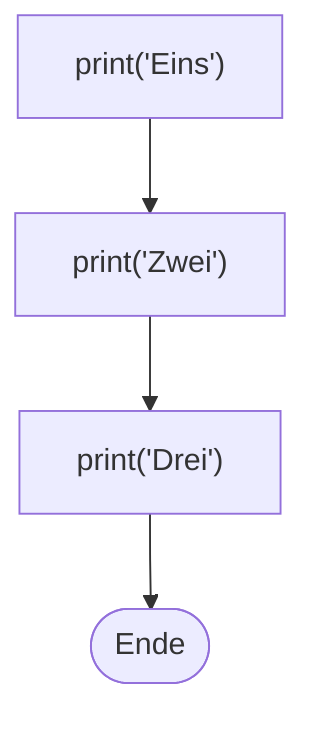

## Der Computer redet mit dir

```alltag
text: Ein Papagei plappert nach, was man ihm vorsagt, Wort für Wort, ohne zu fragen, ob es Sinn ergibt. Python hat so einen Papagei eingebaut. Er heißt `print`, und er sagt genau das, was du ihm in die Klammern legst.
zeichnung: papagei
```

Ein Programm ist eine Liste von Anweisungen, die der Computer der Reihe nach ausführt. Die erste Anweisung, die du kennenlernst, ist `print`: sie bringt etwas auf den Bildschirm. Was ausgegeben werden soll, steht in runden Klammern dahinter.

```beispiel
id: hallo-welt
code: |
  print("Hallo, Welt!")
vorhersage:
  art: auswahl
  optionen:
    - text: Hallo, Welt!
      richtig: true
      erklaerung: Genau. print gibt den Text aus, ohne Klammern und ohne Anführungszeichen.
    - text: print("Hallo, Welt!")
      erklaerung: Der Papagei sagt nicht seinen eigenen Namen. Ausgegeben wird nur, was in den Klammern steht.
    - text: '"Hallo, Welt!"'
      erklaerung: Die Anführungszeichen zeigen nur, wo der Text anfängt und aufhört. Sie selbst erscheinen nicht.
```

```merke
text: "`print(...)` gibt aus, was in den Klammern steht. Jedes `print` beginnt eine neue Zeile."
```

```frage
frageart: auswahl
id: was-macht-print
text: Was macht `print`?
optionen:
  - text: Es zeigt etwas auf dem Bildschirm an.
    richtig: true
    erklaerung: Richtig. Mit dem Drucker hat es nichts zu tun, der Name stammt aus der Zeit, als Computer noch auf Papier antworteten.
  - text: Es schickt etwas an den Drucker.
    erklaerung: Der Name täuscht. Früher antworteten Computer auf Papier, heute landet alles auf dem Bildschirm.
  - text: Es speichert Text für später.
    erklaerung: Speichern kommt im nächsten Kapitel. print zeigt nur an, sofort.
```

## Text braucht Anführungszeichen

Text heißt beim Programmieren auch Zeichenkette. Damit Python weiß, wo ein Text anfängt und aufhört, steht er in Anführungszeichen. Ob doppelte `"` oder einfache `'`, ist egal, solange vorn und hinten dieselben stehen.

```beispiel
id: zwei-gruesse
code: |
  print("Guten Morgen")
  print('Gute Nacht')
vorhersage:
  art: auswahl
  optionen:
    - text: |-
        Guten Morgen
        Gute Nacht
      richtig: true
      erklaerung: Richtig. Beide Arten von Anführungszeichen funktionieren, und jedes print beginnt eine neue Zeile.
    - text: Guten Morgen Gute Nacht
      erklaerung: Zwei print, zwei Zeilen. Jedes print beginnt eine neue Zeile.
    - text: |-
        Guten Morgen
        Fehler
      erklaerung: Einfache Anführungszeichen sind genauso gut wie doppelte, solange vorn und hinten dieselben stehen.
```

```falle
titel: Anführungszeichen vergessen
text: "Ohne Anführungszeichen hält Python ein Wort für einen Namen, den es nicht kennt, und meldet `NameError`."
```

```frage
frageart: fehlerstelle
id: fehler-anfuehrung
text: Dieses Programm soll drei Tiere ausgeben, bricht aber ab. In welcher Zeile steckt der Fehler?
code: |
  print("Pinguin")
  print(Walross)
  print("Möwe")
zeile: 2
erklaerung: Genau. Walross steht ohne Anführungszeichen; Python sucht einen Namen Walross und findet keinen.
hinweise:
  1: Pinguin steht ordentlich zwischen Anführungszeichen.
  3: Die Möwe ist in Ordnung, schau weiter oben.
hinweis: Schau auf die Anführungszeichen.
```

## Zahlen ohne Anführungszeichen

Zahlen schreibst du ohne Anführungszeichen. Kommazahlen bekommen einen Punkt statt eines Kommas, so wie es im Englischen üblich ist: `3.5` statt `3,5`.

```beispiel
id: zahlen
code: |
  print(42)
  print(3.5)
  print("42")
vorhersage:
  art: auswahl
  optionen:
    - text: |-
        42
        3.5
        42
      richtig: true
      erklaerung: Richtig. Auf dem Bildschirm sehen die Zahl 42 und der Text "42" gleich aus. Für Python sind es zwei verschiedene Dinge, das wird beim Rechnen wichtig.
    - text: |-
        42
        3,5
        "42"
      erklaerung: Python schreibt Kommazahlen mit Punkt, und die Anführungszeichen erscheinen nie in der Ausgabe.
    - text: |-
        42
        3.5
        Fehler
      erklaerung: Text darf auch aus Ziffern bestehen. "42" ist erlaubt, nur eben Text und keine Zahl.
```

```frage
frageart: auswahl
id: kommazahl
text: Wie schreibst du dreieinhalb in Python?
als_code: true
optionen:
  - text: '3.5'
    richtig: true
    erklaerung: Richtig, mit Punkt.
  - text: '3,5'
    erklaerung: Das Komma hat in Python eine andere Aufgabe; es trennt Werte, wie du gleich siehst.
  - text: '"3,5"'
    erklaerung: Das wäre Text, keine Zahl. Damit lässt sich nicht rechnen.
```

## Mehrere Werte, mehrere Zeilen

Python arbeitet ein Programm von oben nach unten ab, Zeile für Zeile. In ein `print` passen auch mehrere Werte: durch Kommas getrennt, und in der Ausgabe steht dann je ein Leerzeichen dazwischen.



```beispiel
id: mehrere-werte
code: |
  print("Pit", "Pia", "Paul")
  print("Fische:", 3)
  print()
  print("Satt!")
vorhersage:
  art: eintippen
  erklaerung: "Die Kommas trennen die Werte, in der Ausgabe stehen Leerzeichen. Ein leeres `print()` gibt eine leere Zeile aus."
```

```frage
frageart: ordnen
id: reihenfolge-rakete
text: Die Rakete soll von drei herunterzählen und dann starten. Bring die Zeilen in die richtige Reihenfolge.
zeilen:
  - print(3)
  - print(2)
  - print(1)
  - print("Start!")
erklaerung: Richtig. Python liest von oben nach unten, also steht der Countdown in der Reihenfolge, in der er erscheinen soll.
hinweis: Was zuerst auf dem Bildschirm stehen soll, steht ganz oben.
```

```augenzwinkern
text: Glückwunsch, dein Computer kann jetzt mehr sagen als ein Papagei. Zumindest schneller.
```
