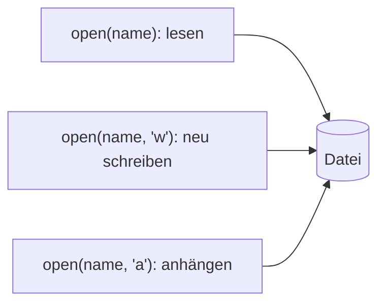

## Ins Logbuch schreiben

```alltag
text: Was der Kapitän im Kopf hat, ist nach dem Schlafen vielleicht weg. Was im Logbuch steht, bleibt. Variablen sind der Kopf deines Programms, Dateien sein Logbuch.
zeichnung: logbuch
```

`open("fang.txt", "w")` öffnet eine Datei zum Schreiben; `w` steht für write. Am besten steht das in einem `with`-Block: am Ende des Blocks wird die Datei sicher geschlossen. `write` schreibt Text hinein, aber ohne Zeilenumbruch; den setzt `\n`. Zum Lesen öffnet man ohne zweiten Wert, und `read()` liefert den ganzen Inhalt.

```beispiel
id: schreiben
code: |
  with open("fang.txt", "w") as datei:
      datei.write("Hering\n")
      datei.write("Lachs\n")

  with open("fang.txt") as datei:
      print(datei.read())
vorhersage:
  art: auswahl
  optionen:
    - text: |-
        Hering
        Lachs
      richtig: true
      erklaerung: Richtig. Zwei Zeilen hineingeschrieben, beim Lesen kommen sie genau so wieder heraus.
    - text: HeringLachs
      erklaerung: Das \n am Ende jeder Zeile sorgt für den Umbruch.
    - text: fang.txt
      erklaerung: read liefert den Inhalt der Datei, nicht ihren Namen.
```

```falle
titel: w löscht vorher alles
text: "Der Modus `w` legt die Datei neu an. Stand schon etwas darin, ist es danach weg. Wer etwas dazuschreiben will, nimmt `a` (weiter unten)."
```

```frage
frageart: luecke
id: luecke-schreiben
text: Ergänze, damit die Datei zum Schreiben geöffnet wird.
code: |
  with open("notiz.txt", ___) as datei:
      datei.write("Fisch kaufen\n")
antworten: [['"w"', "'w'"]]
erklaerung: Richtig, w für write.
hinweis: Ein Buchstabe in Anführungszeichen, das englische Wort für "schreiben" beginnt damit.
```

## Zeile für Zeile lesen

Eine geöffnete Datei kann man wie eine Liste mit `for` durchgehen, eine Zeile je Runde. Jede Zeile bringt ihr `\n` am Ende mit; `print` setzt aber selbst noch eins dazu. Darum schneidet man es mit `strip()` ab, das du schon aus Kapitel 4 kennst.

```beispiel
id: zeilen
code: |
  with open("namen.txt", "w") as datei:
      datei.write("Pia\nPit\n")

  with open("namen.txt") as datei:
      for zeile in datei:
          print("Hallo", zeile.strip())
vorhersage:
  art: auswahl
  optionen:
    - text: |-
        Hallo Pia
        Hallo Pit
      richtig: true
      erklaerung: Richtig. Eine Runde je Zeile, strip nimmt den Zeilenumbruch weg.
    - text: Hallo Pia Pit
      erklaerung: for geht die Datei Zeile für Zeile durch, das sind zwei Runden.
    - text: |-
        Hallo Pia

        Hallo Pit
      erklaerung: Ohne strip wäre zwischen den Zeilen je eine Leerzeile; hier wird der Umbruch abgeschnitten.
```

```frage
frageart: auswahl
id: warum-strip
text: Warum steht beim Lesen oft `zeile.strip()`?
optionen:
  - text: Jede Zeile endet mit einem Zeilenumbruch, den man meist nicht haben will
    richtig: true
    erklaerung: Richtig, sonst stört er beim Ausgeben und Vergleichen.
  - text: Ohne strip lässt sich die Datei nicht lesen
    erklaerung: Lesen klappt auch so, nur das \n hängt dann mit dran.
  - text: strip schließt die Datei
    erklaerung: Das Schließen erledigt der with-Block.
```

## Anhängen statt überschreiben

Mit dem Modus `a` (append) kommt neuer Text ans Ende, und was schon da war, bleibt stehen. So wächst ein Logbuch Tag für Tag.



```beispiel
id: anhaengen
code: |
  with open("log.txt", "w") as datei:
      datei.write("Montag: 3 Fische\n")
  with open("log.txt", "a") as datei:
      datei.write("Dienstag: 5 Fische\n")

  with open("log.txt") as datei:
      print(datei.read())
vorhersage:
  art: auswahl
  optionen:
    - text: |-
        Montag: 3 Fische
        Dienstag: 5 Fische
      richtig: true
      erklaerung: Richtig. a hängt an, der Montag bleibt stehen.
    - text: "Dienstag: 5 Fische"
      erklaerung: Das wäre bei w passiert; a lässt den alten Inhalt stehen.
    - text: |-
        Dienstag: 5 Fische
        Montag: 3 Fische
      erklaerung: Angehängt wird ans Ende, nicht vorn.
```

```merke
text: "open(name) liest, open(name, \"w\") schreibt neu, open(name, \"a\") hängt an. Immer in einem with-Block, dann wird die Datei sicher geschlossen."
```

## Zeilen zerlegen mit split

Oft steht in einer Zeile mehr als ein Wert, etwa `Pia;42`. `split(";")` zerlegt den Text an jedem Semikolon und liefert eine Liste der Teile; ohne Wert in den Klammern wird an Leerzeichen zerlegt. Zusammen mit Entpacken liest sich das fast wie ein Satz.

```beispiel
id: zerlegen
code: |
  with open("punkte.txt", "w") as datei:
      datei.write("Pia;42\nPit;17\n")

  punkte = {}
  with open("punkte.txt") as datei:
      for zeile in datei:
          name, zahl = zeile.strip().split(";")
          punkte[name] = int(zahl)
  print(punkte)
  print("Pia Pit Paul".split())
vorhersage:
  art: auswahl
  optionen:
    - text: |-
        {'Pia': 42, 'Pit': 17}
        ['Pia', 'Pit', 'Paul']
      richtig: true
      erklaerung: Richtig. Jede Zeile wird zerlegt, ausgepackt und als Zahl eingetragen; ohne Wert zerlegt split an Leerzeichen.
    - text: |-
        {'Pia': '42', 'Pit': '17'}
        ['Pia', 'Pit', 'Paul']
      erklaerung: Aus der Datei kommt Text, int macht daraus Zahlen.
    - text: |-
        {'Pia;42': 'Pit;17'}
        ['Pia Pit Paul']
      erklaerung: split zerlegt an jedem Semikolon und ohne Wert an jedem Leerzeichen.
```

```falle
titel: Die Datei gibt es nicht
text: "Wer eine Datei liest, die es nicht gibt, bekommt `FileNotFoundError`. Mit try und `except FileNotFoundError:` lässt sich das abfangen, etwa beim ersten Start eines Programms."
```

```frage
frageart: fehlerstelle
id: fehler-datei-fehlt
text: Dieses Programm meldet FileNotFoundError. Welche Zeile?
code: |
  with open("da.txt", "w") as datei:
      datei.write("Hallo\n")
  with open("da.txt") as datei:
      print(datei.read())
  with open("weg.txt") as datei:
      print(datei.read())
zeile: 5
erklaerung: Genau. da.txt wurde vorher geschrieben, weg.txt gibt es nicht.
hinweis: Welche Datei wurde nie angelegt?
```

```augenzwinkern
text: Pinguine führen übrigens sehr ordentlich Logbuch. Leider steht auf jeder Seite nur Fisch, Fisch, Eis, Fisch.
```
