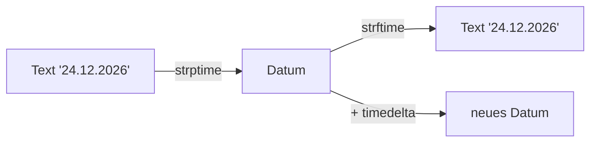

## Ein Datum als Wert

```alltag
text: An einem Abreißkalender steht jeden Tag ein Blatt mit Tag, Monat und Jahr. Wer wissen will, wie viele Blätter es noch bis zum Geburtstag sind, zählt nicht von Hand. Python hat für Kalendertage einen eigenen Wert.
zeichnung: kalender
```

Das Modul datetime bringt `date` mit: `date(2026, 10, 25)` ist der 25. Oktober 2026, immer in der Reihenfolge Jahr, Monat, Tag. Die Teile liest man mit `.year`, `.month` und `.day`. `weekday()` liefert den Wochentag als Zahl: 0 ist Montag, 6 ist Sonntag.

```beispiel
id: datum
code: |
  from datetime import date

  tag = date(2026, 10, 25)
  print(tag)
  print(tag.day, tag.month, tag.year)
  print(tag.weekday())
vorhersage:
  art: auswahl
  optionen:
    - text: |-
        2026-10-25
        25 10 2026
        6
      richtig: true
      erklaerung: Richtig. print zeigt das Datum in der internationalen Schreibweise, und der 25.10.2026 ist ein Sonntag, also 6.
    - text: |-
        25.10.2026
        25 10 2026
        6
      erklaerung: Ohne weitere Angabe schreibt Python Jahr-Monat-Tag mit Bindestrichen.
    - text: |-
        2026-10-25
        25 10 2026
        7
      erklaerung: Gezählt wird ab 0 für Montag; Sonntag ist 6.
```

```frage
frageart: luecke
id: luecke-date
text: Ergänze, damit Heiligabend 2026 entsteht.
code: heiligabend = date(___)
antworten: [["2026, 12, 24", "2026,12,24"]]
erklaerung: Richtig, erst das Jahr, dann Monat und Tag.
hinweis: Die Reihenfolge ist Jahr, Monat, Tag.
```

## Mit Tagen rechnen

`timedelta(days=10)` ist eine Zeitspanne von zehn Tagen. Sie lässt sich zu einem Datum addieren oder davon abziehen; Monatsenden und Schaltjahre erledigt Python. Zieht man zwei Daten voneinander ab, kommt eine Zeitspanne heraus, und `.days` sagt, wie viele Tage es sind.

```beispiel
id: rechnen
code: |
  from datetime import date, timedelta

  heute = date(2026, 10, 25)
  print(heute + timedelta(days=10))
  heiligabend = date(2026, 12, 24)
  print((heiligabend - heute).days, "Tage bis Heiligabend")
vorhersage:
  art: auswahl
  optionen:
    - text: |-
        2026-11-04
        60 Tage bis Heiligabend
      richtig: true
      erklaerung: Richtig. Zehn Tage nach dem 25. Oktober ist der 4. November, Oktober hat 31 Tage.
    - text: |-
        2026-10-35
        60 Tage bis Heiligabend
      erklaerung: Einen 35. Oktober gibt es nicht, Python springt in den November.
    - text: |-
        2026-11-04
        2 Tage bis Heiligabend
      erklaerung: Abgezogen wird das ganze Datum, nicht nur der Monat.
```

```frage
frageart: auswahl
id: schaltjahr
text: Was gibt `print(date(2028, 2, 28) + timedelta(days=1))` aus?
als_code: true
optionen:
  - text: "2028-02-29"
    richtig: true
    erklaerung: Richtig, 2028 ist ein Schaltjahr; Python weiß das.
  - text: "2028-03-01"
    erklaerung: Das wäre richtig in einem Jahr ohne 29. Februar.
  - text: "2028-02-29 00:00:00"
    erklaerung: Ein date hat keine Uhrzeit, nur den Tag.
```

## Deutsch ausgeben mit strftime

`strftime` baut aus einem Datum einen Text nach Vorlage: `%d` ist der Tag, `%m` der Monat, `%Y` das Jahr mit vier Stellen. Bei Uhrzeiten (mit `datetime` statt `date`) kommen `%H` für Stunden und `%M` für Minuten dazu.



```beispiel
id: strftime
code: |
  from datetime import date, datetime

  WOCHENTAGE = ["Montag", "Dienstag", "Mittwoch", "Donnerstag", "Freitag", "Samstag", "Sonntag"]
  tag = date(2026, 12, 24)
  print(tag.strftime("%d.%m.%Y"))
  print(WOCHENTAGE[tag.weekday()])
  start = datetime(2026, 12, 24, 18, 5)
  print(start.strftime("Bescherung um %H:%M Uhr"))
vorhersage:
  art: auswahl
  optionen:
    - text: |-
        24.12.2026
        Donnerstag
        Bescherung um 18:05 Uhr
      richtig: true
      erklaerung: Richtig. weekday liefert 3, und an Stelle 3 der Liste steht Donnerstag.
    - text: |-
        24.12.2026
        Mittwoch
        Bescherung um 18:05 Uhr
      erklaerung: Gezählt wird ab 0; 3 ist das vierte Element, also Donnerstag.
    - text: |-
        24.12.2026
        Donnerstag
        Bescherung um 18:5 Uhr
      erklaerung: "%M schreibt die Minuten immer zweistellig."
```

```falle
titel: Wochentage auf Englisch
text: "`%A` schreibt den Wochentag aus, aber meist auf Englisch. Sicherer ist eine eigene Liste deutscher Namen mit `weekday()` als Index. Und Vorsicht: `%m` ist der Monat, `%M` die Minute."
```

## Aus Text wird ein Datum

Eingaben kommen als Text. `date.fromisoformat("2026-12-24")` liest die internationale Schreibweise. Für andere Schreibweisen gibt es `datetime.strptime(text, "%d.%m.%Y")` mit derselben Vorlage wie bei strftime; `.date()` macht daraus einen reinen Kalendertag. Passt der Text nicht zur Vorlage, kommt ein ValueError.

```beispiel
id: einlesen
code: |
  from datetime import date, datetime

  a = date.fromisoformat("2026-12-24")
  b = datetime.strptime("31.12.2026", "%d.%m.%Y").date()
  print((b - a).days)
vorhersage:
  art: auswahl
  optionen:
    - text: "7"
      richtig: true
      erklaerung: Richtig. Vom 24. bis zum 31. Dezember sind es sieben Tage.
    - text: "-7"
      erklaerung: b ist das spätere Datum, b minus a ist also positiv.
    - text: "7 days, 0:00:00"
      erklaerung: .days holt aus der Zeitspanne nur die Zahl der Tage.
```

```merke
text: "date(jahr, monat, tag) anlegen, + timedelta(days=n) rechnen, (a - b).days Abstand, strftime(\"%d.%m.%Y\") ausgeben, strptime oder fromisoformat einlesen. date.today() liefert den heutigen Tag und ändert sich darum jeden Tag."
```

```frage
frageart: fehlerstelle
id: fehler-vorlage
text: Dieses Programm meldet ValueError. Welche Zeile?
code: |
  from datetime import datetime

  a = datetime.strptime("24.12.2026", "%d.%m.%Y")
  b = datetime.strptime("2026-12-31", "%d.%m.%Y")
  print(b - a)
zeile: 4
erklaerung: Genau. Der Text hat Bindestriche und beginnt mit dem Jahr, die Vorlage erwartet Tag.Monat.Jahr.
hinweis: Vergleiche bei jedem Aufruf den Text mit der Vorlage.
```

```augenzwinkern
text: Für Pinguine ist jeder Tag ein Fischtag. Für Python ist jeder Tag eine Zahl von 0 bis 6.
```
