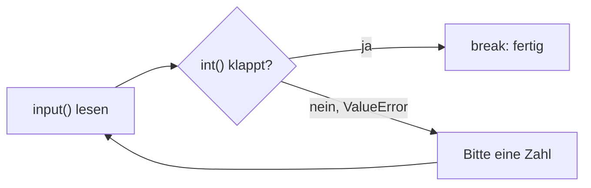

## Das Sicherheitsnetz: try und except

```alltag
text: Unter dem Trapez im Zirkus hängt ein Netz. Rutscht jemand ab, fängt es ihn auf, und die Vorstellung geht weiter. try und except sind so ein Netz für dein Programm.
zeichnung: sicherheitsnetz
```

Bisher hat jeder Fehler das Programm beendet. Code im `try`-Block läuft wie gewohnt; geht dort etwas schief, springt Python sofort in den passenden `except`-Block. Der Rest des try-Blocks wird übersprungen, danach geht es normal weiter.

```beispiel
id: netz
code: |
  text = "zwölf"
  try:
      zahl = int(text)
      print("Zahl:", zahl)
  except ValueError:
      print("Das ist keine Zahl.")
  print("Weiter geht's!")
vorhersage:
  art: auswahl
  optionen:
    - text: |-
        Das ist keine Zahl.
        Weiter geht's!
      richtig: true
      erklaerung: Richtig. int scheitert, print("Zahl:") wird übersprungen, except fängt, dann geht es weiter.
    - text: |-
        Zahl: zwölf
        Weiter geht's!
      erklaerung: int kann "zwölf" nicht umwandeln, also springt Python in den except-Block.
    - text: ValueError
      erklaerung: Ohne Netz wäre das so; hier fängt except den Fehler auf.
```

```frage
frageart: auswahl
id: was-laeuft
text: 'Was passiert mit den Zeilen im try-Block nach der Zeile, die den Fehler auslöst?'
optionen:
  - text: Sie werden übersprungen
    richtig: true
    erklaerung: Richtig, Python springt sofort in den except-Block.
  - text: Sie laufen nach dem except-Block weiter
    erklaerung: Zurück in den try-Block geht es nicht.
  - text: Sie laufen trotzdem, nur ohne Fehler
    erklaerung: Ab dem Fehler ist der try-Block vorbei.
```

## Den richtigen Fehler fangen

Hinter `except` steht die Fehlerart, die gefangen wird: `ValueError` bei falschen Werten, `ZeroDivisionError` beim Teilen durch null, `KeyError` bei fehlenden Schlüsseln. Mehrere `except` hintereinander fangen verschiedene Fehler verschieden. Mit `except ValueError as fehler:` bekommt man zusätzlich die Meldung des Fehlers in die Hand, mehr dazu unten bei raise.

```beispiel
id: fehlerarten
code: |
  for text in ["4", "0", "x"]:
      try:
          print(12 / int(text))
      except ZeroDivisionError:
          print("Durch null geht nicht")
      except ValueError:
          print("Keine Zahl:", text)
vorhersage:
  art: auswahl
  optionen:
    - text: |-
        3.0
        Durch null geht nicht
        Keine Zahl: x
      richtig: true
      erklaerung: Richtig. Jede Runde hat ihr eigenes Netz, und jeder Fehler landet in seinem except.
    - text: |-
        3.0
        Durch null geht nicht
      erklaerung: Auch die dritte Runde läuft; ihr ValueError wird vom zweiten except gefangen.
    - text: |-
        3.0
        Keine Zahl: 0
        Keine Zahl: x
      erklaerung: "int(\"0\") klappt; erst 12 / 0 scheitert, und das ist ein ZeroDivisionError."
```

```falle
titel: Das Netz unter allem
text: "Ein `except` ohne Fehlerart fängt alles, auch Tippfehler im eigenen Code. Dann sucht man ewig, warum nichts passiert. Immer die erwartete Fehlerart hinschreiben."
```

```frage
frageart: luecke
id: luecke-null
text: Ergänze, damit das Teilen durch null gefangen wird.
code: |
  try:
      print(10 / 0)
  except ___:
      print("Geht nicht")
antworten: [["ZeroDivisionError"]]
erklaerung: Richtig, Teilen durch null ist ein ZeroDivisionError.
hinweis: Englisch für "Teilen durch null"-Fehler, in einem Wort.
```

## Nochmal fragen

Bei Eingaben ist das Netz besonders nützlich: statt abzustürzen fragt das Programm einfach noch einmal. Dazu steckt das try in einer Schleife, die erst mit einer gültigen Eingabe endet. Das Beispiel bekommt nacheinander die Eingaben `drei` und `3`.



```beispiel
id: nochmal
eingabe: ["drei", "3"]
code: |
  while True:
      try:
          anzahl = int(input())
          break
      except ValueError:
          print("Bitte eine Zahl!")
  print("Danke,", anzahl, "Fische")
vorhersage:
  art: auswahl
  optionen:
    - text: |-
        Bitte eine Zahl!
        Danke, 3 Fische
      richtig: true
      erklaerung: Richtig. Beim ersten Mal fängt except, beim zweiten klappt int und break beendet die Schleife.
    - text: Danke, 3 Fische
      erklaerung: Die erste Eingabe drei ist keine Ziffer, dafür kommt einmal die Bitte.
    - text: |-
        Bitte eine Zahl!
        Bitte eine Zahl!
        Danke, 3 Fische
      erklaerung: Nur eine der beiden Eingaben ist falsch.
```

```frage
frageart: ordnen
id: ordnen-nochmal
text: Frage so lange nach dem Alter, bis eine Zahl kommt. Bring die Zeilen in Reihenfolge.
zeilen:
  - "while True:"
  - "    try:"
  - "        alter = int(input())"
  - "        break"
  - "    except ValueError:"
  - "        print(\"Nochmal bitte\")"
erklaerung: Richtig, die Schleife umschließt das ganze Netz, break steht hinter der geglückten Umwandlung.
hinweis: break darf erst kommen, wenn int geklappt hat.
```

## Selbst Alarm schlagen: raise

Manchmal ist ein Wert technisch in Ordnung, aber trotzdem falsch, etwa ein Alter von minus drei Jahren. Mit `raise ValueError("Meldung")` löst man dann selbst einen Fehler aus. Die Funktion endet sofort, und wer sie aufruft, kann den Fehler wie jeden anderen fangen.

```beispiel
id: raise
code: |
  def alter_pruefen(alter):
      if alter < 0:
          raise ValueError("Alter kann nicht negativ sein")
      return alter

  for wert in [7, -3]:
      try:
          print("Alter:", alter_pruefen(wert))
      except ValueError as fehler:
          print("Fehler:", fehler)
vorhersage:
  art: auswahl
  optionen:
    - text: |-
        Alter: 7
        Fehler: Alter kann nicht negativ sein
      richtig: true
      erklaerung: Richtig. Bei -3 schlägt raise Alarm, und das except draußen fängt die Meldung.
    - text: |-
        Alter: 7
        Alter: -3
      erklaerung: Bei -3 kommt die Funktion gar nicht bis zum return.
    - text: |-
        Alter: 7
        Fehler: -3
      erklaerung: Ausgegeben wird die Meldung, die raise mitgibt.
```

```merke
text: "try: probieren, except Fehlerart: auffangen, raise: selbst auslösen. Gefangen wird ein Fehler auch dann, wenn er tief in einer aufgerufenen Funktion entsteht."
```

```frage
frageart: fehlerstelle
id: fehler-falsches-netz
text: Dieses Programm bricht trotz try mit KeyError ab. In welcher Zeile entsteht der Fehler?
code: |
  preise = {"Hering": 3}
  try:
      print(preise["Wal"])
  except ValueError:
      print("Gibt es nicht")
zeile: 3
erklaerung: Genau. Ein fehlender Schlüssel ist ein KeyError; das Netz fängt aber nur ValueError.
hinweis: Welche Zeile liest einen Schlüssel, und welche Fehlerart fängt das Netz?
```

```augenzwinkern
text: Ein Programm ohne except ist wie ein Trapezkünstler ohne Netz. Sieht mutig aus, endet aber meistens mit einem lauten Traceback.
```
