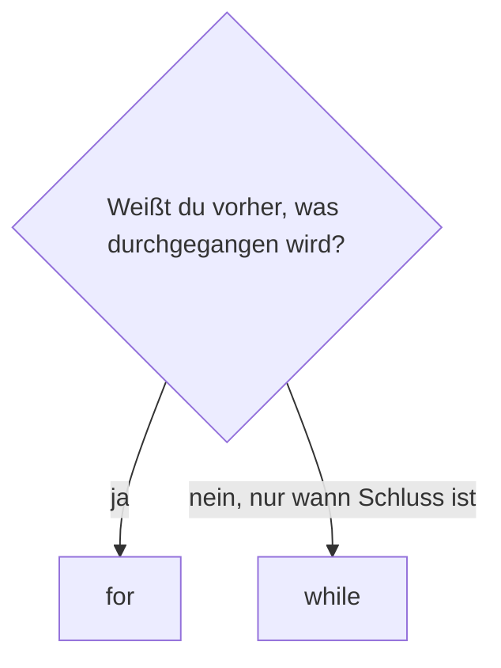

## Für jeden Buchstaben

Mit `while` musstest du selbst zählen. `for` nimmt dir das ab: es geht einen Text Zeichen für Zeichen durch und legt in jeder Runde das nächste Zeichen in den Namen hinter `for`. Der eingerückte Block läuft einmal je Zeichen.

```beispiel
id: buchstaben
code: |
  for buchstabe in "Eis":
      print(buchstabe)
  print("fertig")
vorhersage:
  art: auswahl
  optionen:
    - text: |-
        E
        i
        s
        fertig
      richtig: true
      erklaerung: Richtig. Drei Zeichen, drei Runden; die letzte Zeile ist nicht eingerückt und läuft danach.
    - text: |-
        Eis
        fertig
      erklaerung: for geht Zeichen für Zeichen; in jeder Runde steckt ein einzelner Buchstabe im Namen.
    - text: |-
        E
        fertig
        i
        fertig
        s
        fertig
      erklaerung: fertig ist nicht eingerückt und gehört nicht zur Schleife.
```

```merke
text: "Der Name hinter `for` ist eine ganz normale Variable. In jeder Runde bekommt er das nächste Element, bis keins mehr übrig ist."
```

```frage
frageart: auswahl
id: wie-oft-for
text: Wie oft läuft der Block bei `for z in "Pinguin":`?
optionen:
  - text: 7 Mal
    richtig: true
    erklaerung: Richtig, einmal je Zeichen, und Pinguin hat sieben.
  - text: 1 Mal
    erklaerung: for läuft für jedes Zeichen einzeln.
  - text: 6 Mal
    erklaerung: Gezählt werden alle Zeichen; P-i-n-g-u-i-n sind sieben.
```

## Zählen mit range

```alltag
text: Auf einem Förderband fahren die Pinguine einer nach dem anderen an der Fischausgabe vorbei. Die Maschine muss nicht mitzählen; sie gibt jedem, der vorbeikommt, einen Fisch. Mit `range` baust du dir so ein Förderband aus Zahlen.
zeichnung: foerderband
```

`range(5)` liefert die Zahlen 0, 1, 2, 3, 4: fünf Stück, ab 0, die 5 selbst nicht. `range(2, 6)` geht von 2 bis vor 6. Mit einer dritten Zahl gibst du die Schrittweite an, auch rückwärts.

| Aufruf | liefert |
|---|---|
| `range(4)` | 0, 1, 2, 3 |
| `range(2, 6)` | 2, 3, 4, 5 |
| `range(0, 10, 3)` | 0, 3, 6, 9 |
| `range(3, 0, -1)` | 3, 2, 1 |

```beispiel
id: zaehlen
code: |
  for i in range(3):
      print("Runde", i)
  for fisch in range(1, 4):
      print("Fisch Nummer", fisch)
vorhersage:
  art: auswahl
  optionen:
    - text: |-
        Runde 0
        Runde 1
        Runde 2
        Fisch Nummer 1
        Fisch Nummer 2
        Fisch Nummer 3
      richtig: true
      erklaerung: Richtig. range(3) beginnt bei 0, range(1, 4) bei 1, und das Ende ist nie dabei.
    - text: |-
        Runde 1
        Runde 2
        Runde 3
        Fisch Nummer 1
        Fisch Nummer 2
        Fisch Nummer 3
      erklaerung: range(3) beginnt bei 0, nicht bei 1.
    - text: |-
        Runde 0
        Runde 1
        Runde 2
        Runde 3
        Fisch Nummer 1
        Fisch Nummer 2
        Fisch Nummer 3
        Fisch Nummer 4
      erklaerung: Das Ende gehört nie dazu; range(3) hört bei 2 auf, range(1, 4) bei 3.
```

```falle
titel: Eins daneben
text: "`range(1, 10)` endet bei 9. Wer bis 10 zählen will, schreibt `range(1, 11)`."
```

```frage
frageart: luecke
id: luecke-range
text: Ergänze die Zahl, damit von 1 bis 5 gezählt wird.
code: |
  for i in range(1, ___):
      print(i)
antworten: [["6"]]
erklaerung: Richtig, das Ende ist nicht dabei, also 6.
hinweis: Das Ende gehört nie dazu.
```

## Sammeln in der Schleife

Wie bei `while` beginnen Sammler vor der Schleife und wachsen in jeder Runde. Nur das Weiterzählen übernimmt `for` von selbst. Spiel das Beispiel ab und schau auf `summe`.

```beispiel
id: sammeln
code: |
  summe = 0
  for tag in range(1, 5):
      summe += tag
  print("Fische:", summe)
vorhersage:
  art: eintippen
  erklaerung: "Die Tage 1, 2, 3, 4 werden zusammengezählt: Fische: 10. Das Gleiche wie mit while in Kapitel 8, nur ohne eigenen Zähler."
```

```frage
frageart: ordnen
id: ordnen-vokale
text: Das Programm soll die Vokale in "Pinguin" zählen und am Ende 3 ausgeben. Bring die Zeilen in Reihenfolge.
zeilen:
  - anzahl = 0
  - 'for b in "Pinguin":'
  - '    if b in "aeiou":'
  - "        anzahl += 1"
  - print(anzahl)
erklaerung: Richtig. Zähler vorher, Prüfung in der Schleife, Ausgabe danach.
hinweis: Was in jeder Runde passiert, ist eingerückt; was einmal passiert, nicht.
```

## for oder while?

Beide wiederholen, aber sie passen zu verschiedenen Lagen. `for` nimmst du, wenn klar ist, was durchgegangen wird: jeder Buchstabe, die Zahlen von 1 bis 10. `while` nimmst du, wenn du nicht weißt, wie oft: bis jemand `ende` tippt, bis die Zahl getroffen ist.



```beispiel
id: rueckwaerts
code: |
  for zahl in range(5, 0, -1):
      print(zahl, end=" ")
  print("Los!")
vorhersage:
  art: auswahl
  optionen:
    - text: 5 4 3 2 1 Los!
      richtig: true
      erklaerung: Richtig. Die Schrittweite -1 zählt rückwärts, und end=" " setzt statt eines Zeilenumbruchs ein Leerzeichen.
    - text: |-
        5
        4
        3
        2
        1
        Los!
      erklaerung: Mit end=" " setzt print am Ende ein Leerzeichen statt eines Zeilenumbruchs.
    - text: 5 4 3 2 1 0 Los!
      erklaerung: Das Ende 0 gehört nicht dazu.
```

```frage
frageart: auswahl
id: for-oder-while
text: Was passt besser zu for?
optionen:
  - text: Jede Zahl von 1 bis 100 ausgeben
    richtig: true
    erklaerung: Richtig, hier ist klar, was durchgegangen wird.
  - text: Eingaben lesen, bis jemand ende tippt
    erklaerung: Wie oft das passiert, weiß niemand vorher; das ist ein Fall für while.
  - text: Raten lassen, bis die Zahl stimmt
    erklaerung: Auch hier ist nur klar, wann Schluss ist, nicht wie oft; also while.
```

```augenzwinkern
text: for ist wie ein Förderband. Du stellst es ein, und es liefert brav eins nach dem anderen, ohne jemals zu fragen, warum.
```
