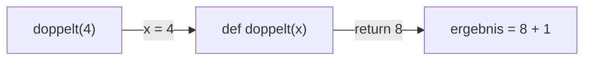

## Ein Name für ein Stück Code

```alltag
text: Ein Rezept schreibt man einmal auf und kocht danach so oft man will. Wer "Fischsuppe" sagt, meint alle Schritte auf der Karte. Eine Funktion ist so ein Rezept für den Computer.
zeichnung: rezeptkarte
```

Mit `def name():` legt man eine Funktion an; der eingerückte Code darunter ist ihr Rezept. Beim Anlegen passiert noch nichts. Erst der Aufruf `name()` führt das Rezept aus, und zwar jedes Mal von vorn.

```beispiel
id: erste-funktion
code: |
  def jubeln():
      print("Hurra!")
      print("Fisch!")

  print("Los geht's")
  jubeln()
  jubeln()
vorhersage:
  art: auswahl
  optionen:
    - text: |-
        Los geht's
        Hurra!
        Fisch!
        Hurra!
        Fisch!
      richtig: true
      erklaerung: Richtig. def merkt sich das Rezept nur; ausgeführt wird es bei jedem der beiden Aufrufe.
    - text: |-
        Hurra!
        Fisch!
        Los geht's
        Hurra!
        Fisch!
        Hurra!
        Fisch!
      erklaerung: Beim def läuft noch nichts, erst beim Aufruf.
    - text: |-
        Los geht's
        Hurra!
        Fisch!
      erklaerung: Zwei Aufrufe, also läuft das Rezept zweimal.
```

```falle
titel: Ohne Klammern kein Aufruf
text: "`jubeln` ohne Klammern nennt nur den Namen der Funktion, ausgeführt wird nichts. Zum Aufrufen gehören immer die Klammern: `jubeln()`."
```

```frage
frageart: auswahl
id: wann-laeuft
text: Wann läuft der eingerückte Code unter `def`?
optionen:
  - text: Bei jedem Aufruf der Funktion
    richtig: true
    erklaerung: Richtig. def legt das Rezept nur ab.
  - text: Sofort, wenn Python die def-Zeile liest
    erklaerung: Dann merkt sich Python nur das Rezept.
  - text: Genau einmal, egal wie oft man aufruft
    erklaerung: Jeder Aufruf führt das Rezept von vorn aus.
```

## Zutaten: Parameter

In die Klammern hinter dem Namen kommen Parameter: Namen für die Werte, die beim Aufruf hineingegeben werden. Beim Aufruf stehen in den Klammern die Werte selbst, der Reihe nach.

```beispiel
id: parameter
code: |
  def gruessen(name, fische):
      print(f"Hallo {name}, hier sind {fische} Fische!")

  gruessen("Pia", 3)
  gruessen("Pit", 5)
vorhersage:
  art: auswahl
  optionen:
    - text: |-
        Hallo Pia, hier sind 3 Fische!
        Hallo Pit, hier sind 5 Fische!
      richtig: true
      erklaerung: Richtig. Beim ersten Aufruf ist name Pia und fische 3, beim zweiten Pit und 5.
    - text: |-
        Hallo name, hier sind fische Fische!
        Hallo name, hier sind fische Fische!
      erklaerung: In den geschweiften Klammern stehen die Namen, ausgegeben werden ihre Werte.
    - text: |-
        Hallo 3, hier sind Pia Fische!
        Hallo 5, hier sind Pit Fische!
      erklaerung: Die Werte kommen der Reihe nach an, der erste in den ersten Parameter.
```

```frage
frageart: luecke
id: luecke-parameter
text: Ergänze den Aufruf, damit "Hallo Paul" ausgegeben wird.
code: |
  def hallo(name):
      print("Hallo", name)

  hallo(___)
antworten: [['"Paul"', "'Paul'"]]
erklaerung: Richtig, der Text "Paul" landet im Parameter name.
hinweis: Ein Text braucht Anführungszeichen.
```

## Ergebnis zurück mit return

Oft soll eine Funktion etwas ausrechnen und das Ergebnis abliefern, statt es nur anzuzeigen. Dafür gibt es `return`: die Funktion endet dort, und der Aufruf steht danach für den zurückgegebenen Wert. Spiel das Beispiel im Ablauf ab: du siehst, wie die Funktion ihren eigenen Rahmen bekommt.



```beispiel
id: rueckgabe
code: |
  def doppelt(x):
      return 2 * x

  ergebnis = doppelt(4) + 1
  print(ergebnis)
  print(doppelt(doppelt(3)))
vorhersage:
  art: auswahl
  optionen:
    - text: |-
        9
        12
      richtig: true
      erklaerung: Richtig. doppelt(4) ist 8, plus 1 macht 9; innen doppelt(3) ist 6, außen davon das Doppelte 12.
    - text: |-
        8
        12
      erklaerung: Mit dem zurückgegebenen Wert wird weitergerechnet, also 8 + 1.
    - text: |-
        9
        6
      erklaerung: Das Ergebnis des inneren Aufrufs geht in den äußeren, es wird zweimal verdoppelt.
```

```merke
text: "print zeigt einen Wert auf dem Bildschirm, return gibt ihn an den Aufrufer zurück. Mit einem zurückgegebenen Wert kann man weiterrechnen."
```

```frage
frageart: ordnen
id: ordnen-funktion
text: Baue eine Funktion, die das Dreifache zurückgibt, und gib das Dreifache von 5 aus.
zeilen:
  - "def dreifach(x):"
  - "    return 3 * x"
  - ergebnis = dreifach(5)
  - print(ergebnis)
erklaerung: Richtig, erst die Funktion anlegen, dann aufrufen, dann ausgeben.
hinweis: Eine Funktion muss angelegt sein, bevor sie aufgerufen wird.
```

## Nichts zurück: None

Eine Funktion ohne `return` liefert trotzdem etwas: den besonderen Wert `None`, Python für "nichts". Das fällt auf, wenn man das Ergebnis einer Funktion benutzt, die nur etwas ausgibt.

```beispiel
id: nichts
code: |
  def melden(x):
      print("Gemeldet:", x)

  antwort = melden(7)
  print(antwort)
vorhersage:
  art: auswahl
  optionen:
    - text: |-
        Gemeldet: 7
        None
      richtig: true
      erklaerung: Richtig. melden gibt etwas aus, gibt aber nichts zurück; antwort bekommt None.
    - text: |-
        Gemeldet: 7
        7
      erklaerung: Ausgegeben ist nicht zurückgegeben; ohne return kommt None zurück.
    - text: "Gemeldet: 7"
      erklaerung: Die zweite Zeile gibt den Wert von antwort aus, und der ist None.
```

```falle
titel: print statt return
text: "Wer in einer Rechenfunktion `print` statt `return` schreibt, sieht zwar die Zahl, bekommt aber None zurück. Spätestens beim Weiterrechnen kommt ein TypeError."
```

```frage
frageart: fehlerstelle
id: fehler-print-statt-return
text: Dieses Programm meldet TypeError. Welche Zeile?
code: |
  def halb(x):
      print(x / 2)

  h = halb(10)
  print(h + 1)
zeile: 5
erklaerung: Genau. halb gibt 5.0 nur aus und liefert None; None + 1 geht nicht. Mit return x / 2 klappt es.
hinweis: Was steckt nach Zeile 4 in h?
```

```augenzwinkern
text: Eine Funktion ohne return ist wie ein Koch, der die Suppe probiert und dann selbst aufisst. Geschmeckt hat es, nur auf dem Teller kommt None an.
```
