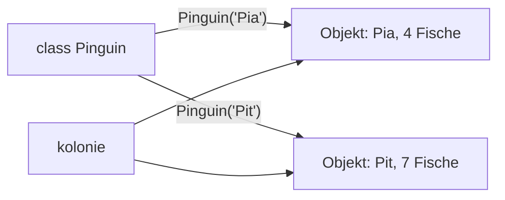

## Bauplan und Exemplare

```alltag
text: Mit einer Ausstechform in Pinguingestalt sticht man so viele Plätzchen aus, wie der Teig hergibt. Alle haben dieselbe Form, aber jedes bekommt seine eigene Verzierung. Die Form ist die Klasse, die Plätzchen sind die Objekte.
zeichnung: ausstechform
```

`class Pinguin:` legt einen Bauplan an. Die besondere Methode `__init__` läuft jedes Mal, wenn ein neues Objekt gebaut wird; ihr erster Parameter `self` ist das neue Objekt selbst. Mit `self.name = name` bekommt es eine Eigenschaft. `Pinguin("Pia")` baut ein Objekt, und mit Punkt kommt man an seine Eigenschaften. Spiel das Beispiel ab und schau ins Speicherbild: zwei Objekte, jedes mit eigenen Eigenschaften.

```beispiel
id: bauplan
code: |
  class Pinguin:
      def __init__(self, name):
          self.name = name
          self.fische = 0

  pia = Pinguin("Pia")
  pit = Pinguin("Pit")
  pia.fische = 3
  print(pia.name, pia.fische)
  print(pit.name, pit.fische)
vorhersage:
  art: auswahl
  optionen:
    - text: |-
        Pia 3
        Pit 0
      richtig: true
      erklaerung: Richtig. Jedes Objekt hat eigene Eigenschaften; Pias Fische ändern Pits nicht.
    - text: |-
        Pia 3
        Pit 3
      erklaerung: pia und pit sind zwei verschiedene Objekte mit je eigenem fische.
    - text: |-
        name 3
        name 0
      erklaerung: Mit Punkt kommt der Wert der Eigenschaft, nicht ihr Name.
```

```frage
frageart: auswahl
id: wie-viele
text: 'Wie viele Pinguin-Objekte gibt es nach `a = Pinguin("A")`, `b = Pinguin("B")` und `c = a`?'
optionen:
  - text: Zwei
    richtig: true
    erklaerung: Richtig. c ist nur ein zweiter Name für dasselbe Objekt wie a.
  - text: Drei
    erklaerung: Gebaut wird nur bei Pinguin(...); c = a zeigt auf ein schon vorhandenes Objekt.
  - text: Eins
    erklaerung: Jeder Aufruf von Pinguin(...) baut ein neues Objekt.
```

## Fähigkeiten: Methoden

Funktionen in einer Klasse heißen Methoden. Auch sie bekommen als ersten Parameter `self` und arbeiten damit an den Eigenschaften genau des Objekts, für das sie aufgerufen werden. Beim Aufruf `pia.fressen(2)` setzt Python `self` selbst ein, man gibt nur die übrigen Werte an.

```beispiel
id: methoden
code: |
  class Pinguin:
      def __init__(self, name):
          self.name = name
          self.fische = 0

      def fressen(self, anzahl):
          self.fische += anzahl

      def ist_satt(self):
          return self.fische >= 5

  pia = Pinguin("Pia")
  pia.fressen(2)
  print(pia.ist_satt())
  pia.fressen(3)
  print(pia.fische, pia.ist_satt())
vorhersage:
  art: auswahl
  optionen:
    - text: |-
        False
        5 True
      richtig: true
      erklaerung: Richtig. Nach 2 Fischen ist Pia noch hungrig, nach 5 satt.
    - text: |-
        False
        3 True
      erklaerung: fressen zählt dazu; 2 plus 3 sind 5.
    - text: |-
        True
        5 True
      erklaerung: Beim ersten Fragen hat Pia erst 2 Fische, das ist weniger als 5.
```

```falle
titel: self vergessen
text: "Fehlt `self` als erster Parameter einer Methode, meldet der Aufruf einen TypeError mit zu vielen Argumenten: Python gibt das Objekt immer mit, und dafür ist dann kein Platz."
```

```frage
frageart: luecke
id: luecke-self
text: Ergänze den fehlenden ersten Parameter der Methode.
code: |
  class Eisbude:
      def __init__(self):
          self.kugeln = 0

      def verkaufen(___, anzahl):
          self.kugeln += anzahl
antworten: [["self"]]
erklaerung: Richtig, jede Methode beginnt mit self.
hinweis: Das Wort, mit dem das Objekt sich selbst meint.
```

## Viele Objekte in einer Liste

Objekte lassen sich wie alle Werte in Listen sammeln. Eine Schleife geht sie dann durch, und für jedes ruft man Methoden auf oder liest Eigenschaften.



```beispiel
id: kolonie
code: |
  class Pinguin:
      def __init__(self, name, fische):
          self.name = name
          self.fische = fische

  kolonie = [Pinguin("Pia", 4), Pinguin("Pit", 7)]
  gesamt = 0
  for p in kolonie:
      gesamt += p.fische
  print(len(kolonie), "Pinguine,", gesamt, "Fische")
vorhersage:
  art: auswahl
  optionen:
    - text: 2 Pinguine, 11 Fische
      richtig: true
      erklaerung: Richtig. Die Schleife liest von jedem Objekt die Fische und zählt sie zusammen.
    - text: 2 Pinguine, 47 Fische
      erklaerung: Gerechnet wird mit Zahlen, nicht mit Text.
    - text: 11 Pinguine, 2 Fische
      erklaerung: len zählt die Objekte in der Liste.
```

```frage
frageart: ordnen
id: ordnen-klasse
text: Baue die Klasse und gib den Namen eines neuen Objekts aus. Bring die Zeilen in Reihenfolge.
zeilen:
  - "class Fisch:"
  - "    def __init__(self, art):"
  - "        self.art = art"
  - hering = Fisch("Hering")
  - print(hering.art)
erklaerung: Richtig, erst der Bauplan, dann das Objekt, dann die Eigenschaft lesen.
hinweis: Ein Objekt lässt sich erst bauen, wenn der Bauplan steht.
```

## Schön ausgeben mit __str__

`print(pia)` zeigt ohne Weiteres nur etwas wie `<Pinguin object at 0x...>`. Wer eine Methode `__str__` schreibt, die einen Text zurückgibt, bestimmt selbst, wie das Objekt bei `print` und in f-Strings aussieht.

```beispiel
id: str
code: |
  class Pinguin:
      def __init__(self, name, fische):
          self.name = name
          self.fische = fische

      def __str__(self):
          return f"{self.name} mit {self.fische} Fischen"

  pia = Pinguin("Pia", 4)
  print(pia)
  print(f"Heute: {pia}")
vorhersage:
  art: auswahl
  optionen:
    - text: |-
        Pia mit 4 Fischen
        Heute: Pia mit 4 Fischen
      richtig: true
      erklaerung: Richtig. print und f-String fragen beide __str__ nach dem Text.
    - text: |-
        Pinguin
        Heute: Pinguin
      erklaerung: Mit __str__ bestimmt das Objekt selbst seinen Text.
    - text: |-
        Pia mit 4 Fischen
        Heute: pia
      erklaerung: Auch im f-String wird __str__ benutzt, nicht der Variablenname.
```

```merke
text: "class Bauplan, __init__ baut, self ist das Objekt selbst, Methoden sind Funktionen in der Klasse, __str__ macht es druckbar."
```

```frage
frageart: fehlerstelle
id: fehler-attribut
text: Dieses Programm meldet AttributeError. Welche Zeile?
code: |
  class Boot:
      def __init__(self, plaetze):
          self.plaetze = plaetze

  boot = Boot(4)
  print(boot.plaetze)
  print(boot.platz)
zeile: 7
erklaerung: Genau. Die Eigenschaft heißt plaetze, eine Eigenschaft platz gibt es nicht.
hinweis: Vergleiche die Namen der Eigenschaften genau.
```

```augenzwinkern
text: Glückwunsch, du hast jetzt einen eigenen Bauplan für Pinguine. Bitte nur so viele bauen, wie du auch mit Fisch versorgen kannst.
```
