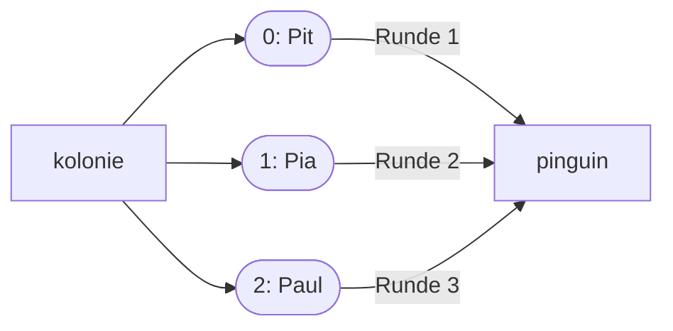

## Viele Werte, ein Name

```alltag
text: Ein Regal mit Fächern hat viele Plätze unter einem Namen. Wer etwas sucht, sagt "drittes Fach von links". Eine Liste ist so ein Regal für Werte, und gezählt wird, wie bei Texten, ab 0.
zeichnung: faecher
```

Eine Liste steht in eckigen Klammern, die Werte durch Kommas getrennt. Sie darf Texte, Zahlen oder beides enthalten. `print` zeigt sie mit Klammern und Anführungszeichen.

```beispiel
id: anlegen
code: |
  kolonie = ["Pit", "Pia", "Paul"]
  fische = [3, 5, 2]
  print(kolonie)
  print(len(fische))
vorhersage:
  art: auswahl
  optionen:
    - text: |-
        ['Pit', 'Pia', 'Paul']
        3
      richtig: true
      erklaerung: Richtig. print zeigt eine Liste so, wie man sie schreiben würde, und len zählt die Elemente.
    - text: |-
        Pit Pia Paul
        3
      erklaerung: Eine ganze Liste zeigt print mit Klammern und Anführungszeichen.
    - text: |-
        ['Pit', 'Pia', 'Paul']
        10
      erklaerung: len zählt die Elemente, es rechnet sie nicht zusammen.
```

```frage
frageart: auswahl
id: wie-viele
text: Wie viele Elemente hat `["Eis", "Fisch", "Eis"]`?
optionen:
  - text: '3'
    richtig: true
    erklaerung: Richtig. Gleiche Werte dürfen mehrfach vorkommen, jedes zählt.
  - text: '2'
    erklaerung: Doppelte Werte zählen in einer Liste jeder für sich.
  - text: '1'
    erklaerung: Jedes durch Komma getrennte Element zählt.
```

## Fächer über den Index

Wie bei Texten holt ein Index in eckigen Klammern ein einzelnes Element; `[0]` ist das erste, `[-1]` das letzte. Anders als Text lässt sich eine Liste verändern: ein Element bekommt mit `=` einen neuen Wert. Spiel das Beispiel ab und schau auf die Fächer.

```beispiel
id: index
code: |
  kolonie = ["Pit", "Pia", "Paul"]
  print(kolonie[0])
  kolonie[1] = "Polly"
  print(kolonie)
  print(kolonie[-1])
vorhersage:
  art: auswahl
  optionen:
    - text: |-
        Pit
        ['Pit', 'Polly', 'Paul']
        Paul
      richtig: true
      erklaerung: Richtig. Fach 1 bekommt Polly, Pia ist danach weg, und -1 ist das letzte Fach.
    - text: |-
        Pit
        ['Polly', 'Pia', 'Paul']
        Paul
      erklaerung: Der Index zählt ab 0. Fach 1 ist das zweite.
    - text: |-
        Pia
        ['Pit', 'Polly', 'Paul']
        Paul
      erklaerung: kolonie[0] ist das erste Element, Pit.
```

```falle
titel: Das Fach gibt es nicht
text: "Eine Liste mit drei Elementen hat die Indizes 0, 1 und 2. `kolonie[3]` meldet `IndexError`."
```

```frage
frageart: luecke
id: luecke-index
text: Ergänze den Index, damit "Eis" ausgegeben wird.
code: |
  sorten = ["Hering", "Eis", "Sprotte"]
  print(sorten[___])
antworten: [["1", "-2"]]
erklaerung: Richtig, das zweite Element hat den Index 1.
hinweis: Gezählt wird ab 0.
```

## Jedes Element durchgehen

`for` läuft nicht nur über Text, sondern auch über Listen: in jeder Runde steckt das nächste Element im Schleifennamen. So geht das Förderband aus Kapitel 9 durch die ganze Kolonie.

```beispiel
id: foerderband
code: |
  kolonie = ["Pit", "Pia", "Paul"]
  for pinguin in kolonie:
      print(pinguin, "bekommt einen Fisch")
  print("Alle satt!")
vorhersage:
  art: auswahl
  optionen:
    - text: |-
        Pit bekommt einen Fisch
        Pia bekommt einen Fisch
        Paul bekommt einen Fisch
        Alle satt!
      richtig: true
      erklaerung: Genau. Drei Runden, in jeder ein anderer Name, und "Alle satt!" kommt einmal am Ende.
    - text: |-
        kolonie bekommt einen Fisch
        Alle satt!
      erklaerung: Die Schleife füttert nicht die ganze Kolonie auf einmal. pinguin ist in jeder Runde ein einzelner Name aus der Liste.
    - text: |-
        Pit bekommt einen Fisch
        Alle satt!
      erklaerung: Pia und Paul gehen leer aus? Die Schleife läuft für jedes Element, nicht nur für das erste.
```



```frage
frageart: ordnen
id: ordnen-summe-liste
text: Das Programm soll alle Fänge der Woche zusammenzählen. Bring die Zeilen in Reihenfolge.
zeilen:
  - faenge = [2, 0, 4, 1]
  - summe = 0
  - "for f in faenge:"
  - "    summe += f"
  - print(summe)
erklaerung: Richtig. Liste und Sammler vorher, addieren in der Schleife, ausgeben danach.
hinweis: Die Liste muss da sein, bevor die Schleife sie durchgeht.
```

## Nachschauen und Ausschnitte

Was du von Texten kennst, klappt auch mit Listen: `in` schaut nach, ob ein Element dabei ist; `[start:ende]` liefert einen Ausschnitt als neue Liste; `+` hängt zwei Listen aneinander.

```beispiel
id: in-und-ausschnitt
code: |
  vorrat = ["Hering", "Sprotte", "Makrele", "Lachs"]
  print("Lachs" in vorrat)
  print(vorrat[1:3])
  print(vorrat + ["Garnele"])
vorhersage:
  art: eintippen
  erklaerung: "Lachs ist dabei (True), der Ausschnitt 1 bis vor 3 ist ['Sprotte', 'Makrele'], und + hängt eine Liste mit Garnele hinten an."
```

```frage
frageart: fehlerstelle
id: fehler-index-liste
text: Das Programm soll den letzten Fisch ausgeben, meldet aber IndexError. Welche Zeile?
code: |
  fische = ["Hering", "Sprotte", "Makrele"]
  anzahl = len(fische)
  print(fische[anzahl])
zeile: 3
erklaerung: Genau. Bei drei Elementen ist der letzte Index 2, also anzahl - 1 oder einfach -1.
hinweise:
  2: len liefert 3, das stimmt.
hinweis: Die Länge ist 3, aber welcher Index ist der letzte?
```

```augenzwinkern
text: Mit Listen kannst du jetzt ganze Kolonien verwalten. Die Pinguine nehmen das gelassen.
```
