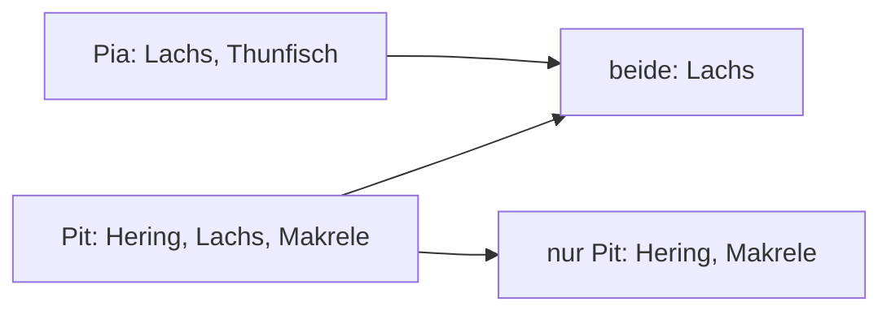

## Jeder nur einmal

```alltag
text: In einer Murmelschale liegt von jeder Farbe genau eine Murmel. Wirft man eine zweite rote hinein, springt sie wieder heraus, denn Rot ist schon da. Eine Menge in Python funktioniert genauso.
zeichnung: murmelschale
```

Eine Menge steht in geschweiften Klammern, aber ohne Doppelpunkte: `{1, 2, 3}`. Aus einer Liste macht `set(liste)` eine Menge, dabei fallen alle Doppelten heraus. `len` zählt dann, wie viele verschiedene Werte es gibt.

```beispiel
id: doppelte-weg
code: |
  faenge = [3, 1, 3, 2, 1, 3]
  verschiedene = set(faenge)
  print(verschiedene)
  print(len(faenge), len(verschiedene))
vorhersage:
  art: auswahl
  optionen:
    - text: |-
        {1, 2, 3}
        6 3
      richtig: true
      erklaerung: Richtig. Jede Zahl bleibt nur einmal übrig, also drei verschiedene von sechs Fängen.
    - text: |-
        {3, 1, 3, 2, 1, 3}
        6 6
      erklaerung: In einer Menge gibt es keine Doppelten, set wirft sie hinaus.
    - text: |-
        [1, 2, 3]
        6 3
      erklaerung: Eine Menge erscheint mit geschweiften Klammern, eine Liste mit eckigen.
```

```falle
titel: Leere Klammern sind ein Wörterbuch
text: "`{}` ist ein leeres Wörterbuch, keine leere Menge. Eine leere Menge entsteht mit `set()`."
```

```frage
frageart: auswahl
id: wie-viele-buchstaben
text: Was gibt `print(len(set("Banane")))` aus?
als_code: true
optionen:
  - text: "4"
    richtig: true
    erklaerung: Richtig. B, a, n und e; das zweite a und das zweite n fallen heraus.
  - text: "6"
    erklaerung: Das wäre die Länge des Wortes. set wirft doppelte Buchstaben hinaus.
  - text: "3"
    erklaerung: Groß und klein zählen getrennt; B und b wären zwei verschiedene.
```

## Füllen und nachschauen

Mit `add` kommt ein Wert dazu. Ist er schon drin, passiert einfach nichts, ganz ohne Fehler. Mit `in` schaut man nach, ob etwas drin ist; bei Mengen geht das besonders schnell, auch bei sehr vielen Werten.

```beispiel
id: gesehen
code: |
  gesehen = set()
  for fisch in ["Hering", "Lachs", "Hering", "Wels"]:
      if fisch in gesehen:
          print("Kenne ich schon:", fisch)
      else:
          gesehen.add(fisch)
  print(len(gesehen), "Arten")
vorhersage:
  art: auswahl
  optionen:
    - text: |-
        Kenne ich schon: Hering
        3 Arten
      richtig: true
      erklaerung: Richtig. Der zweite Hering ist schon in der Menge; am Ende sind es drei Arten.
    - text: |-
        Kenne ich schon: Hering
        4 Arten
      erklaerung: Der zweite Hering kommt nicht noch einmal hinein, es bleiben drei.
    - text: 3 Arten
      erklaerung: Beim zweiten Hering schlägt der Test mit in an.
```

```merke
text: "`set()` für eine leere Menge, `add` zum Hinzufügen, `in` zum Nachschauen. Doppelte stören nie, sie verschwinden einfach."
```

```frage
frageart: luecke
id: luecke-add
text: Ergänze, damit jeder Name in die Menge kommt.
code: |
  gaeste = set()
  for name in ["Pia", "Pit", "Pia"]:
      gaeste.___(name)
  print(len(gaeste))
antworten: [["add"]]
erklaerung: Richtig, add legt den Namen hinein; die zweite Pia stört nicht.
hinweis: Das englische Wort für "hinzufügen".
```

## Gemeinsam und verschieden

Zwei Mengen lassen sich vergleichen wie zwei Fanglisten. `a & b` ist, was in beiden steckt, `a | b` alles zusammen, `a - b` das, was nur in a vorkommt. Wer es ausgeschrieben mag: `intersection`, `union` und `difference` tun dasselbe.



```beispiel
id: vergleichen
code: |
  pit = {"Hering", "Lachs", "Makrele"}
  pia = {"Lachs", "Thunfisch"}
  print(sorted(pit & pia))
  print(sorted(pit | pia))
  print(sorted(pit - pia))
vorhersage:
  art: auswahl
  optionen:
    - text: |-
        ['Lachs']
        ['Hering', 'Lachs', 'Makrele', 'Thunfisch']
        ['Hering', 'Makrele']
      richtig: true
      erklaerung: Richtig. Gemeinsam ist nur der Lachs, zusammen sind es vier Arten, nur Pit hat Hering und Makrele.
    - text: |-
        ['Lachs']
        ['Hering', 'Lachs', 'Lachs', 'Makrele', 'Thunfisch']
        ['Hering', 'Makrele']
      erklaerung: Auch beim Zusammenlegen bleibt jeder Wert nur einmal.
    - text: |-
        ['Hering', 'Makrele', 'Thunfisch']
        ['Hering', 'Lachs', 'Makrele', 'Thunfisch']
        ['Hering', 'Makrele']
      erklaerung: "& liefert das Gemeinsame, nicht das Verschiedene."
```

```falle
titel: Mengen haben keine Reihenfolge
text: "Eine Menge merkt sich keine Plätze, darum gibt es kein `menge[0]`. Auch die Reihenfolge beim Ausgeben kann sich von Lauf zu Lauf ändern; wer sie fest braucht, gibt `sorted(menge)` aus."
```

```frage
frageart: fehlerstelle
id: fehler-index
text: Dieses Programm meldet TypeError. Welche Zeile?
code: |
  arten = {"Hering", "Lachs"}
  arten.add("Wels")
  print(len(arten))
  print(arten[0])
zeile: 4
erklaerung: Genau. Eine Menge hat keine Plätze, also auch keinen Index.
hinweis: Welche Zeile fragt nach einem Platz?
```

```frage
frageart: ordnen
id: ordnen-gemeinsam
text: Gib aus, welche Fische Pit und Pia beide gefangen haben. Bring die Zeilen in Reihenfolge.
zeilen:
  - pit = {"Hering", "Lachs"}
  - pia = {"Lachs", "Wels"}
  - beide = pit & pia
  - print(sorted(beide))
erklaerung: Richtig, erst die Mengen, dann das Gemeinsame, dann sortiert ausgeben.
hinweis: Was gebraucht wird, muss vorher da sein.
```

```augenzwinkern
text: Eine Menge ist der strengste Türsteher der Stadt. Wer schon drin ist, kommt nicht zweimal rein, auch nicht mit Sonnenbrille.
```
