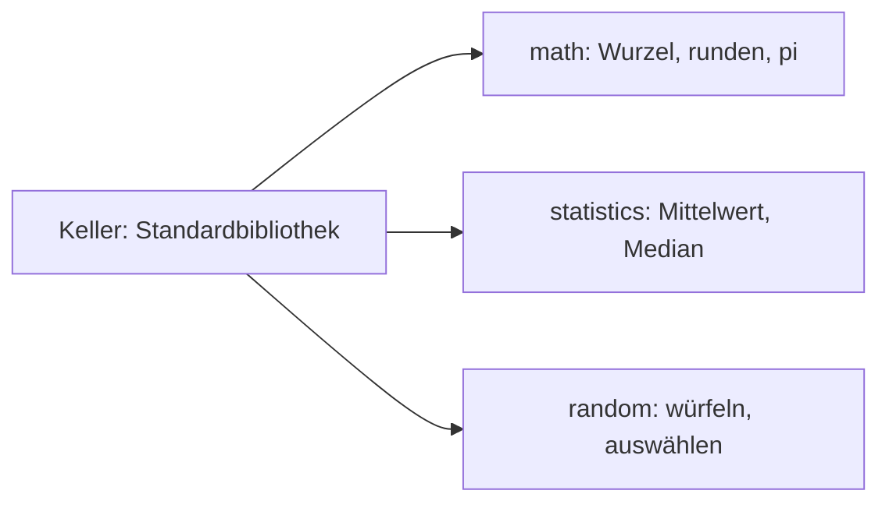

## Den Werkzeugkasten holen: import

```alltag
text: Niemand schmiedet sich für jede Schraube einen eigenen Schraubenzieher. Man holt den Werkzeugkasten aus dem Keller und nimmt, was drin ist. Python hat einen ganzen Keller voller Kästen, die Module.
zeichnung: werkzeugkasten
```

`import math` holt das Modul math. Seine Werkzeuge erreicht man mit Punkt: `math.sqrt` zieht die Wurzel, `math.ceil` rundet auf, `math.floor` rundet ab, `math.pi` ist die Kreiszahl. Imports stehen üblicherweise ganz oben im Programm.

```beispiel
id: math
code: |
  import math

  print(math.sqrt(16))
  print(math.ceil(2.1), math.floor(2.9))
  print(round(math.pi, 2))
vorhersage:
  art: auswahl
  optionen:
    - text: |-
        4.0
        3 2
        3.14
      richtig: true
      erklaerung: Richtig. sqrt liefert eine Kommazahl, ceil rundet immer auf, floor immer ab.
    - text: |-
        4
        2 3
        3.14
      erklaerung: sqrt gibt immer eine Kommazahl zurück, und ceil heißt aufrunden, floor abrunden.
    - text: |-
        4.0
        2 3
        3.141592653589793
      erklaerung: round(..., 2) lässt zwei Nachkommastellen übrig.
```

```falle
titel: Ohne Modulname geht es nicht
text: "Nach `import math` heißt die Wurzel `math.sqrt`, nicht `sqrt`. Ohne `math.` davor meldet Python `NameError`."
```

```frage
frageart: luecke
id: luecke-import
text: Ergänze, damit das Programm 5 ausgibt.
code: |
  ___ math
  print(math.ceil(4.2))
antworten: [["import"]]
erklaerung: Richtig, import holt das Modul.
hinweis: Das englische Wort für "einführen".
```

## Einzelne Werkzeuge: from ... import

Braucht man nur ein, zwei Werkzeuge, holt man sie mit `from modul import name` direkt heraus. Dann heißen sie ohne Modulnamen davor. Das Modul statistics zum Beispiel wertet Zahlenreihen aus: `mean` ist der Mittelwert, `median` der Wert in der Mitte der sortierten Reihe.

```beispiel
id: statistics
code: |
  from statistics import mean, median

  fische = [2, 9, 4]
  print(mean(fische))
  print(median(fische))
vorhersage:
  art: auswahl
  optionen:
    - text: |-
        5
        4
      richtig: true
      erklaerung: Richtig. (2 + 9 + 4) / 3 ist 5; sortiert steht 4 in der Mitte.
    - text: |-
        5
        9
      erklaerung: Der Median ist die Mitte der sortierten Reihe 2, 4, 9.
    - text: |-
        15
        4
      erklaerung: mean teilt die Summe durch die Anzahl.
```

```frage
frageart: auswahl
id: from-oder-import
text: Wie heißt die Wurzel nach `from math import sqrt`?
als_code: true
optionen:
  - text: sqrt(9)
    richtig: true
    erklaerung: Richtig, from holt den Namen direkt ins Programm.
  - text: math.sqrt(9)
    erklaerung: Das gilt nach import math; hier ist nur sqrt geholt.
  - text: math(sqrt(9))
    erklaerung: So ruft man kein Werkzeug auf.
```

## Zufall: random

Das Modul random würfelt: `random.randint(1, 6)` liefert eine ganze Zahl von 1 bis 6, beide eingeschlossen, `random.choice(liste)` ein zufälliges Element. Was genau herauskommt, weiß vorher niemand; sicher ist nur, in welchem Bereich es liegt.



```beispiel
id: random
code: |
  import random

  wurf = random.randint(1, 6)
  print(1 <= wurf <= 6)
  namen = ["Pia", "Pit", "Paul"]
  print(random.choice(namen) in namen)
vorhersage:
  art: auswahl
  optionen:
    - text: |-
        True
        True
      richtig: true
      erklaerung: Richtig. Welche Zahl und welcher Name es sind, ist Zufall, aber sie liegen immer im Bereich.
    - text: |-
        True
        False
      erklaerung: choice wählt immer eines der Elemente der Liste.
    - text: |-
        False
        True
      erklaerung: randint(1, 6) schließt 1 und 6 ein, die Zahl liegt immer dazwischen.
```

```merke
text: "import modul holt den ganzen Kasten (modul.werkzeug), from modul import werkzeug ein einzelnes Werkzeug. Gut zu kennen: math, statistics, random."
```

## Das eigene Programm als Modul

Jede Python-Datei kann selbst ein Modul sein, das andere Programme importieren. Damit beim Importieren nicht gleich alles losläuft, steht der Start oft unter `if __name__ == "__main__":`. Der besondere Name `__name__` ist `"__main__"`, wenn die Datei direkt gestartet wird, und beim Import der Name des Moduls.

```beispiel
id: main
code: |
  def gruessen(name):
      return f"Hallo {name}!"

  def main():
      print(gruessen("Polly"))

  if __name__ == "__main__":
      main()
vorhersage:
  art: auswahl
  optionen:
    - text: Hallo Polly!
      richtig: true
      erklaerung: Richtig. Das Programm wird direkt gestartet, also ist __name__ gleich "__main__" und main läuft.
    - text: (keine Ausgabe)
      erklaerung: Direkt gestartet ist die Bedingung erfüllt; nur beim Import liefe nichts.
    - text: Hallo name!
      erklaerung: In der geschweiften Klammer steht der Wert des Parameters.
```

```frage
frageart: fehlerstelle
id: fehler-werkzeug
text: Dieses Programm meldet AttributeError. Welche Zeile?
code: |
  import math

  print(math.sqrt(25))
  print(math.wurzel(36))
zeile: 4
erklaerung: Genau. Im Kasten math gibt es kein Werkzeug wurzel; es heißt sqrt.
hinweis: Welches Werkzeug gibt es in math nicht?
```

```augenzwinkern
text: Ein guter Programmierer ist faul auf die richtige Art. Er baut keinen Würfel, wenn im Keller schon einer liegt.
```
