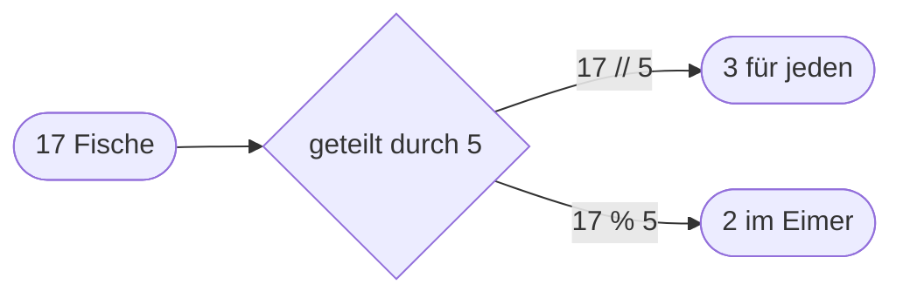

## Python als Taschenrechner

Python rechnet mit den üblichen Zeichen: `+` und `-`, `*` für mal und `/` für geteilt. Das Ergebnis gibt `print` aus, die Rechnung selbst erscheint nicht.

```beispiel
id: grundrechnen
code: |
  print(3 + 4)
  print(10 - 2.5)
  print(6 * 7)
  print(7 / 2)
vorhersage:
  art: auswahl
  optionen:
    - text: |-
        7
        7.5
        42
        3.5
      richtig: true
      erklaerung: Richtig. Und sobald eine Kommazahl mitspielt, kommt eine Kommazahl heraus.
    - text: |-
        3 + 4
        10 - 2.5
        6 * 7
        7 / 2
      erklaerung: Ohne Anführungszeichen ist das kein Text, sondern eine Rechnung. print gibt das Ergebnis aus.
    - text: |-
        7
        7.5
        42
        3
      erklaerung: Geteilt mit / rechnet genau, auch hinter dem Komma. 7 / 2 ergibt 3.5.
```

```frage
frageart: auswahl
id: geteilt-immer-komma
text: Was gibt `print(6 / 2)` aus?
als_code: true
optionen:
  - text: '3.0'
    richtig: true
    erklaerung: Richtig. Geteilt mit / liefert immer eine Kommazahl, auch wenn es aufgeht.
  - text: '3'
    erklaerung: Fast. Ein einfacher Schrägstrich liefert immer eine Kommazahl, auch wenn es glatt aufgeht.
  - text: '6 / 2'
    erklaerung: Ohne Anführungszeichen ist das eine Rechnung, keine Schrift.
```

## Teilen mit Rest

```alltag
text: 17 Fische sollen gerecht an 5 Pinguine gehen. Jeder bekommt 3, und 2 bleiben im Eimer. Genau das rechnen `//` und `%`.
zeichnung: fische-teilen
```

`//` teilt ganzzahlig: es zählt, wie oft die Zahl ganz hineinpasst. `%` liefert, was übrig bleibt, den Rest. Mit dem Rest prüft man später zum Beispiel, ob eine Zahl gerade ist: dann bleibt beim Teilen durch 2 nichts übrig.



```beispiel
id: rest
code: |
  fische = 17
  pinguine = 5
  print(fische // pinguine)
  print(fische % pinguine)
vorhersage:
  art: eintippen
  erklaerung: 17 // 5 ergibt 3, denn die 5 passt dreimal ganz hinein. 17 % 5 ergibt 2, das ist der Rest.
```

```frage
frageart: luecke
id: luecke-rest
text: Ergänze das Rechenzeichen, damit der Rest 2 herauskommt.
code: print(20 ___ 6)
antworten: [["%"]]
erklaerung: Richtig. 6 passt dreimal in 20, übrig bleiben 2.
hinweis: Gesucht ist das Zeichen für den Rest.
```

## Erst mal, dann plus

Wie in der Schule gilt Punkt vor Strich: `*`, `/`, `//` und `%` kommen vor `+` und `-`. Noch früher kommt `**`, das Hochrechnen: `2 ** 3` heißt 2 hoch 3, also 2 mal 2 mal 2. Was zuerst passieren soll, kommt in runde Klammern.

```beispiel
id: rangfolge
code: |
  print(2 + 3 * 4)
  print((2 + 3) * 4)
  print(2 ** 3)
vorhersage:
  art: auswahl
  optionen:
    - text: |-
        14
        20
        8
      richtig: true
      erklaerung: Richtig. Erst 3 * 4, dann plus 2; mit Klammern erst 2 + 3, dann mal 4; und 2 hoch 3 ist 8.
    - text: |-
        20
        20
        8
      erklaerung: Punkt vor Strich. Ohne Klammern wird erst multipliziert.
    - text: |-
        14
        20
        6
      erklaerung: "** ist nicht mal, sondern hoch. 2 ** 3 ist 2 mal 2 mal 2."
```

```frage
frageart: auswahl
id: punkt-vor-strich
text: Was ergibt `10 - 2 * 3`?
als_code: true
optionen:
  - text: '4'
    richtig: true
    erklaerung: Richtig, erst 2 * 3 = 6, dann 10 - 6.
  - text: '24'
    erklaerung: Das wäre (10 - 2) * 3. Ohne Klammern wird zuerst multipliziert.
  - text: '-4'
    erklaerung: Python rechnet von links, aber Punkt vor Strich. 10 - 6 ergibt 4.
```

## Rechnen mit Variablen

Statt Zahlen kannst du Namen verrechnen; Python setzt die Werte ein. Und weil ein Name einen neuen Wert bekommen kann, darf er auf beiden Seiten des `=` stehen: `konto = konto + 5` heißt *konto bekommt den alten Wert plus 5*. Kürzer geht es mit `+=`, ebenso `-=`, `*=` und `/=`.

```beispiel
id: konto
code: |
  preis = 3
  anzahl = 4
  gesamt = preis * anzahl
  konto = 20
  konto -= gesamt
  print("Kosten:", gesamt)
  print("Übrig:", konto)
vorhersage:
  art: auswahl
  optionen:
    - text: |-
        Kosten: 12
        Übrig: 8
      richtig: true
      erklaerung: Richtig. konto -= gesamt zieht die 12 vom alten Wert 20 ab.
    - text: |-
        Kosten: 12
        Übrig: 20
      erklaerung: Die fünfte Zeile verändert konto. Spiel den Ablauf ab und schau auf den Speicher.
    - text: |-
        Kosten: preis * anzahl
        Übrig: 8
      erklaerung: gesamt hat den berechneten Wert 12; die Rechnung selbst wird nicht gemerkt.
```

```falle
titel: Gerechnet, aber nicht gemerkt
text: "`punkte + 5` rechnet zwar, merkt sich das Ergebnis aber nirgends. Erst `punkte = punkte + 5` oder `punkte += 5` ändert den Wert."
```

```frage
frageart: fehlerstelle
id: fehler-nicht-gemerkt
text: Pit soll 5 Bonuspunkte bekommen, am Ende stehen aber immer noch 10 da. Welche Zeile ist schuld?
code: |
  punkte = 10
  punkte + 5
  print(punkte)
zeile: 2
erklaerung: Genau. Die Zeile rechnet 15 aus, merkt es sich aber nicht. Richtig wäre punkte += 5.
hinweise:
  1: Der Startwert 10 ist in Ordnung.
  3: print gibt nur aus, was in punkte steht. Warum ist das noch 10?
hinweis: Welche Zeile soll den Wert verändern?
```

```augenzwinkern
text: Kleiner Trost für alle, die Mathe nicht mögen; ab jetzt rechnet der Computer, du sagst nur, was.
```
