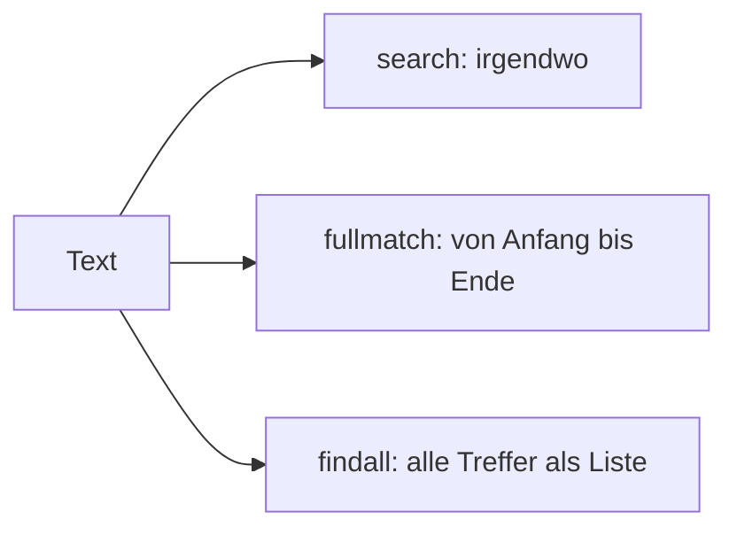

## Ein Muster suchen

```alltag
text: Eine Spürnase sucht nicht nach einem bestimmten Fußabdruck, sondern nach allem, was wie ein Pinguinfuß aussieht. Ein regulärer Ausdruck ist so eine Beschreibung, nicht "12", sondern "eine oder mehr Ziffern".
zeichnung: lupe
```

Das Modul `re` sucht nach Mustern. `\d` steht für eine Ziffer, `+` heißt "einmal oder öfter". `re.search(muster, text)` liefert den ersten Treffer oder `None`; den gefundenen Text holt `.group()`. Muster schreibt man als rohen Text mit `r` davor, damit Python die Rückstriche nicht selbst auswertet.

```beispiel
id: search
code: |
  import re

  treffer = re.search(r"\d+", "Pit fing 12 Heringe")
  print(treffer.group())
  print(re.search(r"\d+", "Pit fing nichts"))
vorhersage:
  art: auswahl
  optionen:
    - text: |-
        12
        None
      richtig: true
      erklaerung: Richtig. \d+ findet die zusammenhängenden Ziffern 12; im zweiten Text gibt es keine, also None.
    - text: |-
        1
        None
      erklaerung: Das + nimmt so viele Ziffern wie möglich, also beide.
    - text: |-
        12
        nichts
      erklaerung: Ohne Treffer liefert search nichts, und nichts heißt in Python None.
```

```falle
titel: Ohne r vor dem Muster
text: "In normalem Text hat der Rückstrich selbst eine Bedeutung (etwa `\\n`). Muster darum immer als `r\"...\"` schreiben, dann kommen sie unverändert bei re an."
```

```frage
frageart: auswahl
id: was-findet
text: 'Was liefert `re.search(r"\d+", "Raum 7, Platz 42").group()`?'
als_code: true
optionen:
  - text: "7"
    richtig: true
    erklaerung: Richtig, search liefert den ersten Treffer.
  - text: "42"
    erklaerung: search hört beim ersten Treffer auf, und der ist 7.
  - text: "742"
    erklaerung: Zwischen 7 und 42 stehen andere Zeichen, das sind zwei Treffer.
```

## Zeichenklassen und Wiederholung

Ein paar Bausteine reichen für viele Muster: `\d` Ziffer, `\w` Buchstabe, Ziffer oder Unterstrich, `\s` Leerraum, `[aeiou]` eines der Zeichen in der Klammer, `.` irgendein Zeichen. Dahinter sagt `+` "einmal oder öfter", `*` "beliebig oft, auch nie", `?` "vielleicht" und `{3}` "genau dreimal". `re.findall` sammelt alle Treffer in einer Liste.

```beispiel
id: findall
code: |
  import re

  text = "3 Heringe, 12 Lachse und 1 Wal"
  print(re.findall(r"\d+", text))
  print(re.findall(r"[A-Z]\w+", text))
vorhersage:
  art: auswahl
  optionen:
    - text: |-
        ['3', '12', '1']
        ['Heringe', 'Lachse', 'Wal']
      richtig: true
      erklaerung: Richtig. Alle Zahlen als Text, und alle Wörter, die mit einem Großbuchstaben beginnen.
    - text: |-
        [3, 12, 1]
        ['Heringe', 'Lachse', 'Wal']
      erklaerung: findall liefert immer Text; erst int macht Zahlen daraus.
    - text: |-
        ['3', '1', '2', '1']
        ['Heringe', 'Lachse', 'Wal']
      erklaerung: Das + hält zusammenhängende Ziffern zusammen.
```

```frage
frageart: luecke
id: luecke-findall
text: Ergänze, damit alle Treffer als Liste kommen.
code: |
  import re
  print(re.___(r"\d+", "1 und 2 und 3"))
antworten: [["findall"]]
erklaerung: Richtig, findall findet alle.
hinweis: Englisch für "finde alle", in einem Wort.
```

## Passt es ganz?

`search` findet ein Muster irgendwo im Text. Zum Prüfen einer Eingabe soll aber der ganze Text passen: eine Postleitzahl sind genau fünf Ziffern, nicht "irgendwo fünf Ziffern". Dafür gibt es `re.fullmatch`.



```beispiel
id: fullmatch
code: |
  import re

  for plz in ["48143", "4814", "48143a"]:
      if re.fullmatch(r"\d{5}", plz):
          print(plz, "passt")
      else:
          print(plz, "passt nicht")
vorhersage:
  art: auswahl
  optionen:
    - text: |-
        48143 passt
        4814 passt nicht
        48143a passt nicht
      richtig: true
      erklaerung: Richtig. Nur der erste Text besteht ganz aus genau fünf Ziffern.
    - text: |-
        48143 passt
        4814 passt nicht
        48143a passt
      erklaerung: Mit search würde 48143a passen; fullmatch verlangt, dass nichts übrig bleibt.
    - text: |-
        48143 passt
        4814 passt
        48143a passt nicht
      erklaerung: "{5} heißt genau fünfmal, vier Ziffern reichen nicht."
```

```merke
text: "search sucht irgendwo, fullmatch prüft den ganzen Text, findall sammelt alle Treffer. Ein Treffer gilt in if als wahr, None als falsch."
```

## Teile herausholen und ersetzen

Runde Klammern im Muster bilden Gruppen. `treffer.group(1)` ist dann der Text der ersten Klammer, `group(2)` der zweiten. Und `re.sub(muster, ersatz, text)` ersetzt jeden Treffer.

```beispiel
id: gruppen
code: |
  import re

  treffer = re.fullmatch(r"(\d+)\.(\d+)\.(\d+)", "24.12.2026")
  print(treffer.group(1), treffer.group(2), treffer.group(3))
  print(re.sub(r"\d", "#", "Ruf 0171 an"))
vorhersage:
  art: auswahl
  optionen:
    - text: |-
        24 12 2026
        Ruf #### an
      richtig: true
      erklaerung: Richtig. Drei Gruppen für Tag, Monat und Jahr; sub ersetzt jede einzelne Ziffer.
    - text: |-
        24.12.2026
        Ruf #### an
      erklaerung: Jede Gruppe liefert nur den Text ihrer eigenen Klammer.
    - text: |-
        24 12 2026
        Ruf # an
      erklaerung: \d ohne + trifft jede Ziffer einzeln, also vier Ersetzungen.
```

```frage
frageart: fehlerstelle
id: fehler-kein-treffer
text: Dieses Programm meldet AttributeError. Welche Zeile?
code: |
  import re

  a = re.search(r"\d+", "Tisch 4")
  print(a.group())
  b = re.search(r"\d+", "Tisch frei")
  print(b.group())
zeile: 6
erklaerung: Genau. Im zweiten Text gibt es keine Ziffer, b ist None, und None hat kein group. Vorher mit if prüfen.
hinweis: Welche Suche findet nichts?
```

```augenzwinkern
text: Reguläre Ausdrücke sehen aus, als wäre ein Pinguin über die Tastatur gewatschelt. Aber es ist ein sehr kluger Pinguin.
```
