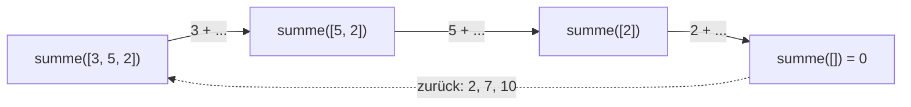

## Eine Funktion ruft sich selbst

```alltag
text: In einer Pinguin-Matroschka steckt eine kleinere Matroschka, in der wieder eine kleinere, bis die kleinste sich nicht mehr öffnen lässt. Wer alle zählen will, öffnet eine und zählt dann einfach die kleinere genauso weiter.
zeichnung: matroschka
```

Eine rekursive Funktion löst eine Aufgabe, indem sie sich selbst mit einer kleineren Aufgabe aufruft. Der Countdown von 3 ist: "3" sagen und dann den Countdown von 2 machen. Spiel das Beispiel im Ablauf ab: im Speicherbild stapeln sich die Rahmen von countdown, jeder mit seinem eigenen n.

```beispiel
id: countdown
code: |
  def countdown(n):
      if n == 0:
          print("Abtauchen!")
      else:
          print(n)
          countdown(n - 1)

  countdown(3)
vorhersage:
  art: auswahl
  optionen:
    - text: |-
        3
        2
        1
        Abtauchen!
      richtig: true
      erklaerung: Richtig. Jeder Aufruf gibt sein n aus und ruft den nächsten mit n - 1, bis n 0 ist.
    - text: |-
        3
        2
        1
        0
        Abtauchen!
      erklaerung: Bei n gleich 0 greift der erste Zweig; die 0 selbst wird nicht ausgegeben.
    - text: |-
        Abtauchen!
        1
        2
        3
      erklaerung: Ausgegeben wird vor dem nächsten Aufruf, also von oben nach unten.
```

```frage
frageart: auswahl
id: wie-viele-rahmen
text: Wie viele Rahmen von countdown liegen bei `countdown(3)` höchstens gleichzeitig übereinander?
optionen:
  - text: "4"
    richtig: true
    erklaerung: Richtig, für n gleich 3, 2, 1 und 0.
  - text: "3"
    erklaerung: Auch der Aufruf mit 0 bekommt einen Rahmen.
  - text: "1"
    erklaerung: Jeder Aufruf wartet auf den nächsten, darum liegen sie übereinander.
```

## Ohne Abbruch geht es nicht

Jede Rekursion braucht einen Abbruchfall: eine Aufgabe so klein, dass die Antwort ohne weiteren Aufruf feststeht. Bei der Fakultät `5! = 5 * 4 * 3 * 2 * 1` ist das `0! = 1`. Alles andere führt auf die kleinere Aufgabe zurück: `n! = n * (n - 1)!`.

```beispiel
id: fakultaet
code: |
  def fakultaet(n):
      if n == 0:
          return 1
      return n * fakultaet(n - 1)

  print(fakultaet(4))
  print(fakultaet(0))
vorhersage:
  art: auswahl
  optionen:
    - text: |-
        24
        1
      richtig: true
      erklaerung: Richtig. 4 * 3 * 2 * 1 * 1 ist 24, und 0! ist der Abbruchfall mit 1.
    - text: |-
        10
        1
      erklaerung: Multipliziert wird, nicht addiert.
    - text: |-
        24
        0
      erklaerung: Der Abbruchfall gibt 1 zurück.
```

```falle
titel: Endlos in die Tiefe
text: "Fehlt der Abbruchfall oder wird er nie erreicht, ruft die Funktion sich immer weiter auf. Nach etwa tausend Rahmen bricht Python mit `RecursionError` ab."
```

```frage
frageart: fehlerstelle
id: fehler-kein-abbruch
text: Dieses Programm meldet RecursionError. In welcher Zeile ruft sich die Funktion endlos selbst auf?
code: |
  def summe(n):
      return n + summe(n - 1)

  print(summe(3))
zeile: 2
erklaerung: Genau. Es fehlt ein Abbruchfall wie if n == 0, also geht es unter null immer weiter.
hinweis: Wo steht der Aufruf von summe in summe?
```

## Ergebnisse auf dem Rückweg

Der eigentliche Rechenweg einer Rekursion läuft oft rückwärts: erst steigen die Aufrufe bis zum Abbruchfall hinab, dann setzt jeder Rahmen beim Zurückkehren sein Stück zum Ergebnis zusammen.



```beispiel
id: rueckweg
code: |
  def summe(liste):
      if len(liste) == 0:
          return 0
      return liste[0] + summe(liste[1:])

  print(summe([3, 5, 2]))
vorhersage:
  art: auswahl
  optionen:
    - text: "10"
      richtig: true
      erklaerung: Richtig. Auf dem Rückweg wird 0 + 2, dann + 5, dann + 3 gerechnet.
    - text: "3"
      erklaerung: Das erste Element wird zum Ergebnis des Rests addiert, nicht allein zurückgegeben.
    - text: "0"
      erklaerung: Die 0 kommt nur aus dem innersten Aufruf; jeder Rahmen addiert sein Element dazu.
```

```frage
frageart: ordnen
id: ordnen-laenge
text: Baue eine rekursive Länge einer Liste. Bring die Zeilen in Reihenfolge.
zeilen:
  - "def laenge(liste):"
  - "    if liste == []:"
  - "        return 0"
  - "    return 1 + laenge(liste[1:])"
erklaerung: Richtig, erst der Abbruchfall, dann eins plus die Länge des Rests.
hinweis: Der Abbruchfall steht vor dem rekursiven Aufruf.
```

## Kisten in Kisten

Richtig stark wird Rekursion bei verschachtelten Dingen. Steckt in einer Kiste wieder eine Kiste, ruft man für die innere einfach dieselbe Funktion auf. `isinstance(x, list)` verrät, ob x selbst eine Liste ist. Mit Schleifen allein wüsste man nicht, wie tief man graben muss.

```beispiel
id: kisten
code: |
  def fische(kiste):
      anzahl = 0
      for ding in kiste:
          if isinstance(ding, list):
              anzahl += fische(ding)
          else:
              anzahl += ding
      return anzahl

  lager = [3, [2, [1, 4]], 5]
  print(fische(lager))
vorhersage:
  art: auswahl
  optionen:
    - text: "15"
      richtig: true
      erklaerung: Richtig. 3 + 2 + 1 + 4 + 5, egal wie tief die Kisten stecken.
    - text: "8"
      erklaerung: Auch die Fische in den inneren Kisten zählen, dafür sorgt der rekursive Aufruf.
    - text: TypeError
      erklaerung: Listen werden nicht addiert, sondern mit fische geöffnet.
```

```merke
text: "Rekursion: Abbruchfall zuerst, dann die Aufgabe auf eine kleinere derselben Art zurückführen. Ideal für Verschachteltes; für einfaches Zählen ist eine Schleife meist schlichter."
```

```augenzwinkern
text: Um Rekursion zu verstehen, muss man zuerst Rekursion verstehen. Zum Glück hat dieses Kapitel einen Abbruchfall.
```
