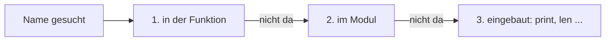

## Was drinnen bleibt

```alltag
text: Aus einem Iglu kann man durchs Fenster hinausschauen. Von draußen sieht man aber nicht, was drinnen auf dem Tisch liegt. Eine Funktion ist so ein Iglu für ihre Namen.
zeichnung: iglu
```

Jeder Aufruf einer Funktion bekommt einen eigenen Rahmen für seine Namen, lokale Namen genannt. Wird drinnen ein Name zugewiesen, entsteht er nur in diesem Rahmen, auch wenn draußen einer gleich heißt. Nach dem Aufruf ist der Rahmen weg. Spiel das Beispiel im Ablauf ab und schau auf die zwei Rahmen im Speicherbild.

```beispiel
id: zwei-x
code: |
  x = 1

  def innen():
      x = 99
      print("innen:", x)

  innen()
  print("außen:", x)
vorhersage:
  art: auswahl
  optionen:
    - text: |-
        innen: 99
        außen: 1
      richtig: true
      erklaerung: Richtig. Das x in der Funktion ist ein eigenes, das äußere bleibt 1.
    - text: |-
        innen: 99
        außen: 99
      erklaerung: Die Zuweisung in der Funktion legt ein lokales x an; das äußere ändert sie nicht.
    - text: |-
        innen: 1
        außen: 1
      erklaerung: Drinnen gilt das lokale x, und das ist 99.
```

```frage
frageart: fehlerstelle
id: fehler-name-weg
text: Dieses Programm meldet NameError. Welche Zeile?
code: |
  def rechnen():
      zwischen = 6 * 7
      print(zwischen)

  rechnen()
  print(zwischen)
zeile: 6
erklaerung: Genau. zwischen lebt nur im Rahmen von rechnen; draußen gibt es den Namen nicht.
hinweis: Wo ist zwischen entstanden, und wo wird es gelesen?
```

## Hinausschauen geht

Lesen darf eine Funktion auch Namen von außen. Python sucht einen Namen zuerst im eigenen Rahmen, dann draußen im Modul, zuletzt bei den eingebauten Namen wie `print` oder `len`.



```beispiel
id: lesen
code: |
  preis = 3

  def kosten(anzahl):
      return anzahl * preis

  print(kosten(4))
  preis = 5
  print(kosten(4))
vorhersage:
  art: auswahl
  optionen:
    - text: |-
        12
        20
      richtig: true
      erklaerung: Richtig. Die Funktion liest preis bei jedem Aufruf neu, beim zweiten ist er 5.
    - text: |-
        12
        12
      erklaerung: Gelesen wird beim Aufruf, nicht beim Anlegen; dann ist preis schon 5.
    - text: NameError
      erklaerung: Lesen von außen klappt, preis ist im Modul zu finden.
```

```falle
titel: Ändern ohne Erlaubnis
text: "Steht in einer Funktion `zaehler += 1` und zaehler ist außen angelegt, meldet Python `UnboundLocalError`. Wer drinnen zuweist, macht den Namen lokal, und lokal gibt es noch keinen Wert."
```

```frage
frageart: fehlerstelle
id: fehler-unbound
text: Dieses Programm meldet UnboundLocalError. Welche Zeile?
code: |
  punkte = 0

  def treffer():
      punkte += 10

  treffer()
  print(punkte)
zeile: 4
erklaerung: Genau. += weist punkte drinnen zu, also ist es lokal, hat aber noch keinen Wert.
hinweis: In welcher Zeile wird drinnen etwas zugewiesen?
```

## Mit global außen ändern

Soll eine Funktion wirklich einen Namen draußen ändern, sagt man es ihr mit `global name` in der ersten Zeile. Das ist praktisch für Zähler, macht Programme aber schwerer zu durchschauen: man sieht dem Aufruf nicht an, was er draußen verstellt. Meist ist es besser, den Wert hineinzugeben und mit `return` zurückzubekommen.

```beispiel
id: global
code: |
  punkte = 0

  def treffer():
      global punkte
      punkte += 10

  def mit_bonus(stand):
      return stand + 5

  treffer()
  treffer()
  punkte = mit_bonus(punkte)
  print(punkte)
vorhersage:
  art: auswahl
  optionen:
    - text: "25"
      richtig: true
      erklaerung: Richtig. Zweimal 10 über global, dann 5 über return.
    - text: "5"
      erklaerung: Mit global ändert treffer das äußere punkte, zweimal um 10.
    - text: "20"
      erklaerung: Der Bonus kommt per return zurück und wird punkte zugewiesen.
```

```merke
text: "global name erlaubt einer Funktion, einen Namen draußen neu zu belegen. Sparsam benutzen; Parameter und return sind meist klarer. Für Funktionen in Funktionen gibt es entsprechend nonlocal, das braucht man selten."
```

```frage
frageart: luecke
id: luecke-global
text: Ergänze, damit klick den Zähler draußen erhöht.
code: |
  zaehler = 0

  def klick():
      ___ zaehler
      zaehler += 1
antworten: [["global"]]
erklaerung: Richtig, global zaehler erlaubt das Ändern des äußeren Namens.
hinweis: Das englische Wort für "weltweit".
```

## Listen und Wörterbücher brauchen kein global

Eine Liste oder ein Wörterbuch von außen kann eine Funktion verändern, ohne `global`: `fang.append(...)` weist keinen Namen neu zu, es ändert nur, was im Behälter liegt. Der Name zeigt danach auf denselben Behälter wie vorher.

```beispiel
id: behaelter
code: |
  fang = []

  def fangen(fisch):
      fang.append(fisch)

  fangen("Hering")
  fangen("Lachs")
  print(fang)
vorhersage:
  art: auswahl
  optionen:
    - text: "['Hering', 'Lachs']"
      richtig: true
      erklaerung: Richtig. append verändert die Liste draußen, ganz ohne global.
    - text: "[]"
      erklaerung: Die Funktion legt keine neue Liste an, sie füllt die von draußen.
    - text: UnboundLocalError
      erklaerung: Es wird nichts zugewiesen, nur hineingelegt; dafür braucht es kein global.
```

```frage
frageart: auswahl
id: wann-global
text: Welche Funktion braucht `global vorrat`, wenn vorrat draußen angelegt ist?
optionen:
  - text: Eine, die `vorrat = vorrat - 1` schreibt
    richtig: true
    erklaerung: Richtig, hier wird der Name neu belegt.
  - text: Eine, die `print(vorrat)` schreibt
    erklaerung: Nur lesen geht ohne global.
  - text: Eine, die `vorrat.append(3)` schreibt, wenn vorrat eine Liste ist
    erklaerung: append ändert den Inhalt, nicht den Namen; das geht ohne global.
```

```augenzwinkern
text: Mit global aus der Funktion heraus Dinge zu verstellen ist wie aus dem Iglu heraus den Schneemann umzudekorieren. Geht schon, aber hinterher weiß keiner, wer es war.
```
