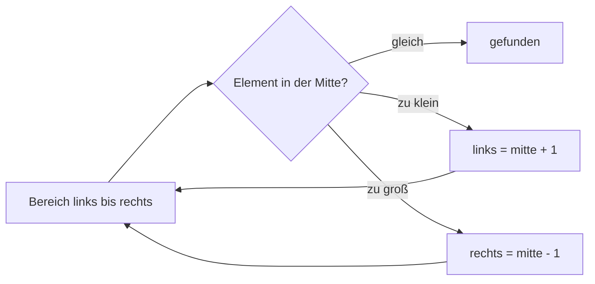

## Der Reihe nach suchen

```alltag
text: Wer in einer ungeordneten Reihe Pinguine den Pinguin Paul sucht, schaut einen nach dem anderen an, bis er ihn hat. Das ist die einfachste Suche, und oft reicht sie völlig.
zeichnung: reihe
```

Ein Algorithmus ist ein genaues Rezept zum Lösen einer Aufgabe. Die lineare Suche geht die Liste vom Anfang an durch und gibt die Stelle des ersten Treffers zurück; gibt es keinen, liefert sie `-1`. Wie viele Vergleiche sie braucht, hängt davon ab, wo das Gesuchte steht.

```beispiel
id: linear
code: |
  def suche(liste, ziel):
      for i in range(len(liste)):
          if liste[i] == ziel:
              return i
      return -1

  reihe = ["Pia", "Pit", "Paul", "Polly"]
  print(suche(reihe, "Paul"))
  print(suche(reihe, "Bodo"))
vorhersage:
  art: auswahl
  optionen:
    - text: |-
        2
        -1
      richtig: true
      erklaerung: Richtig. Paul steht an Stelle 2 (gezählt ab 0); Bodo ist nicht dabei.
    - text: |-
        3
        -1
      erklaerung: Stellen zählen ab 0, Paul ist das dritte Element, also Stelle 2.
    - text: |-
        2
        None
      erklaerung: Ohne Treffer läuft die Schleife durch, dann kommt return -1.
```

```frage
frageart: auswahl
id: wie-viele-vergleiche
text: Wie viele Vergleiche braucht die lineare Suche höchstens in einer Liste mit 1000 Elementen?
optionen:
  - text: "1000"
    richtig: true
    erklaerung: Richtig, im schlimmsten Fall jedes Element einmal.
  - text: "10"
    erklaerung: So wenige schafft nur die binäre Suche, und die braucht eine sortierte Liste.
  - text: "500"
    erklaerung: Im Mittel ja, höchstens aber 1000.
```

## Halbieren: binäre Suche

Ist die Liste sortiert, geht es viel schneller. Man schaut in die Mitte: ist das Gesuchte größer, kann die ganze linke Hälfte weg, sonst die rechte. Mit jedem Schritt halbiert sich der Bereich. So findet man in 1000 sortierten Zahlen jede in höchstens zehn Schritten, wie beim Zahlenraten mit "größer" und "kleiner".



```beispiel
id: binaer
code: |
  def binaer(liste, ziel):
      links, rechts = 0, len(liste) - 1
      schritte = 0
      while links <= rechts:
          schritte += 1
          mitte = (links + rechts) // 2
          if liste[mitte] == ziel:
              return mitte, schritte
          if liste[mitte] < ziel:
              links = mitte + 1
          else:
              rechts = mitte - 1
      return -1, schritte

  zahlen = [2, 5, 8, 12, 16, 23, 38, 56, 72, 91]
  print(binaer(zahlen, 23))
vorhersage:
  art: auswahl
  optionen:
    - text: (5, 3)
      richtig: true
      erklaerung: Richtig. Erst die Mitte 16, dann 56, dann 23 an Stelle 5; drei Schritte.
    - text: (5, 6)
      erklaerung: So viele bräuchte die lineare Suche; halbieren spart Schritte.
    - text: (6, 3)
      erklaerung: Stellen zählen ab 0, die 23 ist das sechste Element.
```

```falle
titel: Nur in sortierten Listen
text: "Die binäre Suche verlässt sich darauf, dass links alles kleiner und rechts alles größer ist. In einer unsortierten Liste findet sie Vorhandenes manchmal nicht."
```

```frage
frageart: luecke
id: luecke-mitte
text: Ergänze die Berechnung der Mitte.
code: mitte = (links + rechts) // ___
antworten: [["2"]]
erklaerung: Richtig, die ganzzahlige Hälfte der Summe.
hinweis: Die Mitte liegt bei der Hälfte.
```

## Selbst sortieren

Python sortiert mit `sorted` und `sort`. Wie das gehen kann, zeigt das Auswahlsortieren: Suche das Kleinste und tausche es nach vorn an Platz 0; dann das Kleinste vom Rest an Platz 1, und so weiter. Spiel das Beispiel im Ablauf ab und verfolge im Speicherbild, wie die Liste Runde für Runde sortierter wird.

```beispiel
id: auswahl
code: |
  zahlen = [5, 2, 8, 1]
  for i in range(len(zahlen)):
      kleinste = i
      for j in range(i + 1, len(zahlen)):
          if zahlen[j] < zahlen[kleinste]:
              kleinste = j
      zahlen[i], zahlen[kleinste] = zahlen[kleinste], zahlen[i]
      print(zahlen)
vorhersage:
  art: auswahl
  optionen:
    - text: |-
        [1, 2, 8, 5]
        [1, 2, 8, 5]
        [1, 2, 5, 8]
        [1, 2, 5, 8]
      richtig: true
      erklaerung: Richtig. Runde 1 tauscht die 1 nach vorn, Runde 2 lässt die 2 stehen, Runde 3 tauscht 5 und 8.
    - text: |-
        [1, 5, 2, 8]
        [1, 2, 5, 8]
        [1, 2, 5, 8]
        [1, 2, 5, 8]
      erklaerung: Getauscht werden nur zwei Plätze, das Kleinste und der vorderste ungeordnete.
    - text: "[1, 2, 5, 8]"
      erklaerung: print steht in der äußeren Schleife und läuft jede Runde.
```

```frage
frageart: ordnen
id: ordnen-auswahl
text: Bring die innere Suche nach dem Kleinsten in Reihenfolge.
zeilen:
  - kleinste = i
  - "for j in range(i + 1, len(zahlen)):"
  - "    if zahlen[j] < zahlen[kleinste]:"
  - "        kleinste = j"
erklaerung: Richtig, erst die Annahme, dann jeden Rest vergleichen.
hinweis: Bevor verglichen wird, braucht es einen Kandidaten.
```

## Wie viel Arbeit?

Algorithmen vergleicht man daran, wie die Arbeit mit der Größe der Liste wächst. Lineare Suche: so viele Vergleiche wie Elemente. Binäre Suche: so oft, wie man die Zahl halbieren kann, bei 1000 also etwa 10. Auswahlsortieren vergleicht jedes mit jedem Rest, bei 1000 Elementen fast eine halbe Million Mal. Das eingebaute `sorted` ist viel schlauer gebaut; im Alltag nimmt man das.

```beispiel
id: aufwand
code: |
  n = 1000
  halbieren = 0
  rest = n
  while rest > 1:
      rest = rest // 2
      halbieren += 1
  print("linear:", n)
  print("binär:", halbieren)
  print("Auswahlsortieren:", n * (n - 1) // 2)
vorhersage:
  art: auswahl
  optionen:
    - text: |-
        linear: 1000
        binär: 9
        Auswahlsortieren: 499500
      richtig: true
      erklaerung: Richtig. 1000 lässt sich neunmal ganzzahlig halbieren, bis 1 übrig ist; mit dem letzten Blick sind es höchstens zehn Schritte.
    - text: |-
        linear: 1000
        binär: 500
        Auswahlsortieren: 499500
      erklaerung: Halbieren wird sehr schnell klein, nicht nur einmal durch zwei.
    - text: |-
        linear: 1000
        binär: 9
        Auswahlsortieren: 1000000
      erklaerung: Jedes Paar wird nur einmal verglichen, also n mal (n - 1) durch 2.
```

```merke
text: "Lineare Suche: jede Liste, bis zu n Vergleiche. Binäre Suche: nur sortiert, etwa so viele Schritte, wie man n halbieren kann. Auswahlsortieren: etwa n mal n durch 2 Vergleiche; im Alltag sorted benutzen."
```

```frage
frageart: fehlerstelle
id: fehler-zu-weit
text: Dieses Programm meldet IndexError. Welche Zeile?
code: |
  reihe = [4, 7, 1]
  gesucht = 9
  for i in range(len(reihe) + 1):
      if reihe[i] == gesucht:
          print("gefunden an", i)
zeile: 4
erklaerung: Genau. range(len(reihe) + 1) läuft bis 3, die letzte Stelle ist aber 2; gelesen wird in Zeile 4.
hinweis: Welche Zeile liest aus der Liste?
```

```augenzwinkern
text: Pinguine sortieren sich in der Kolonie übrigens ganz ohne Algorithmus. Wer friert, drängelt nach innen.
```
