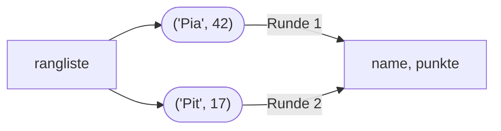

## Feste Gruppen: Tupel

```alltag
text: Eine Brotdose mit festen Fächern, links das Brot, rechts der Apfel. Man kann hineinschauen, aber die Fächer lassen sich nicht umbauen. Ein Tupel ist so eine Dose für Werte.
zeichnung: brotdose
```

Ein Tupel steht in runden Klammern, die Werte durch Kommas getrennt. Wie bei Listen gibt es Index, `len`, `in` und Schleifen. Anders als Listen lässt es sich nicht verändern: kein `append`, kein neuer Wert in einem Fach. Man nimmt es für Dinge, die zusammengehören und fest bleiben, etwa eine Position `(x, y)`.

```beispiel
id: tupel
code: |
  ort = (3, 7)
  print(ort)
  print(ort[0], ort[1])
  print(len(ort))
vorhersage:
  art: auswahl
  optionen:
    - text: |-
        (3, 7)
        3 7
        2
      richtig: true
      erklaerung: Richtig. print zeigt das Tupel mit runden Klammern; der Index funktioniert wie bei Listen.
    - text: |-
        [3, 7]
        3 7
        2
      erklaerung: Ein Tupel erscheint mit runden Klammern, eine Liste mit eckigen.
    - text: |-
        (3, 7)
        (3, 7)
        2
      erklaerung: ort[0] und ort[1] holen die einzelnen Werte heraus.
```

```falle
titel: Ein Tupel lässt sich nicht ändern
text: "`ort[0] = 5` meldet `TypeError`. Wer etwas ändern muss, baut ein neues Tupel oder nimmt eine Liste."
```

```frage
frageart: auswahl
id: tupel-oder-liste
text: Was passt besser in ein Tupel als in eine Liste?
optionen:
  - text: Länge und Breite einer Eisscholle
    richtig: true
    erklaerung: Richtig, zwei Werte, die fest zusammengehören.
  - text: Die Einkaufsliste, auf die noch Dinge kommen
    erklaerung: Was wachsen soll, gehört in eine Liste.
  - text: Die Fänge, die jeden Tag dazukommen
    erklaerung: Auch das wächst; eine Liste mit append passt besser.
```

## Entpacken

Steht links vom `=` mehr als ein Name, packt Python die Werte rechts der Reihe nach aus. So lassen sich auch zwei Werte in einer Zeile tauschen, ganz ohne Zwischenablage wie in Kapitel 2.

```beispiel
id: entpacken
code: |
  x, y = (3, 7)
  print(x, y)
  links, rechts = "Paul", "Pia"
  links, rechts = rechts, links
  print(links, rechts)
vorhersage:
  art: auswahl
  optionen:
    - text: |-
        3 7
        Pia Paul
      richtig: true
      erklaerung: Richtig. Erst wird rechts ein Paar gebildet, dann links ausgepackt; so tauschen die beiden.
    - text: |-
        3 7
        Paul Pia
      erklaerung: Die vierte Zeile tauscht die beiden Werte.
    - text: |-
        (3, 7)
        Pia Paul
      erklaerung: Mit zwei Namen links wird das Tupel ausgepackt; x bekommt 3, y bekommt 7.
```

```frage
frageart: luecke
id: luecke-tauschen
text: Ergänze die rechte Seite, sodass a und b ihre Werte tauschen.
code: a, b = ___
antworten: [["b, a", "(b, a)"]]
erklaerung: Richtig, rechts in umgekehrter Reihenfolge.
hinweis: Rechts stehen dieselben Namen, nur andersherum.
```

## Mit Nummer und paarweise

`enumerate(liste)` liefert zu jedem Element auch seine Nummer; im for stehen dann zwei Namen. `zip(a, b)` geht zwei Listen gleichzeitig durch und liefert Paare.

```beispiel
id: nummer-und-paare
code: |
  sieger = ["Pia", "Pit", "Paul"]
  for platz, name in enumerate(sieger, 1):
      print(platz, name)
  fische = [5, 3, 2]
  for name, f in zip(sieger, fische):
      print(name, "fing", f)
vorhersage:
  art: auswahl
  optionen:
    - text: |-
        1 Pia
        2 Pit
        3 Paul
        Pia fing 5
        Pit fing 3
        Paul fing 2
      richtig: true
      erklaerung: Richtig. enumerate mit Start 1 zählt ab 1, zip bildet Paare aus beiden Listen.
    - text: |-
        0 Pia
        1 Pit
        2 Paul
        Pia fing 5
        Pit fing 3
        Paul fing 2
      erklaerung: Die 1 in enumerate(sieger, 1) gibt den Startwert an.
    - text: |-
        1 Pia
        2 Pit
        3 Paul
        Pia fing [5, 3, 2]
      erklaerung: zip geht beide Listen Schritt für Schritt durch und liefert je ein Paar.
```

```frage
frageart: ordnen
id: ordnen-zip
text: Gib zu jedem Fach den Inhalt aus. Bring die Zeilen in Reihenfolge.
zeilen:
  - faecher = ["oben", "unten"]
  - inhalt = ["Eis", "Fisch"]
  - "for fach, ding in zip(faecher, inhalt):"
  - "    print(fach, ding)"
erklaerung: Richtig, erst beide Listen, dann zip.
hinweis: Die Listen müssen da sein, bevor zip sie zusammenbringt.
```

## Listen aus Paaren

Tupel stecken oft in Listen: eine Rangliste aus Paaren `(name, punkte)`. In der Schleife lassen sie sich sofort entpacken, so liest sich der Code fast wie ein Satz.



```beispiel
id: paare-in-liste
code: |
  rangliste = [("Pia", 42), ("Pit", 17), ("Paul", 8)]
  for name, punkte in rangliste:
      print(f"{name}: {punkte} Punkte")
vorhersage:
  art: eintippen
  erklaerung: "In jeder Runde wird ein Paar ausgepackt: Pia: 42 Punkte, Pit: 17 Punkte, Paul: 8 Punkte."
```

```frage
frageart: fehlerstelle
id: fehler-zu-viele-namen
text: Dieses Programm meldet ValueError. Welche Zeile?
code: |
  punkt = (2, 5)
  x, y, z = punkt
  print(x + y)
zeile: 2
erklaerung: Genau. Das Tupel hat zwei Werte, links stehen drei Namen; das passt nicht zusammen.
hinweis: Zähle die Werte rechts und die Namen links.
```

```augenzwinkern
text: Tupel sind wie Pinguinpaare. Die bleiben ein Leben lang zusammen und lassen sich auch nicht umbauen.
```
