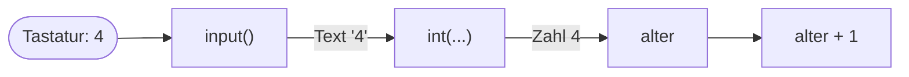

## Text oder Zahl?

`"4"` und `4` sehen in der Ausgabe gleich aus, sind für Python aber zwei verschiedene Dinge: das eine ist Text, das andere eine Zahl. Und `+` macht mit beiden etwas anderes.

```beispiel
id: text-oder-zahl
code: |
  print("4" + "4")
  print(4 + 4)
vorhersage:
  art: auswahl
  optionen:
    - text: |-
        44
        8
      richtig: true
      erklaerung: Richtig. Text wird aneinandergeklebt, Zahlen werden zusammengezählt.
    - text: |-
        8
        8
      erklaerung: Mit Anführungszeichen ist die 4 Text, und + klebt Text nur aneinander.
    - text: |-
        44
        44
      erklaerung: Ohne Anführungszeichen ist 4 eine Zahl, und Zahlen werden zusammengezählt.
```

```frage
frageart: auswahl
id: text-oder-zahl-frage
text: Was gibt `print("7" * 2)` aus?
als_code: true
optionen:
  - text: '77'
    richtig: true
    erklaerung: Richtig, "7" ist Text, und * wiederholt ihn.
  - text: '14'
    erklaerung: Das wäre 7 * 2 ohne Anführungszeichen.
  - text: Fehler
    erklaerung: Text mal Zahl ist erlaubt; der Text wird wiederholt.
```

## Umwandeln mit int, float und str

```alltag
text: Eine Verwandlungsmaschine nimmt oben einen Zettel mit einer aufgemalten 42 und wirft unten einen Holzklotz mit 42 Kerben aus, mit dem man rechnen kann. Genauso arbeiten `int`, `float` und `str`.
zeichnung: maschine
```

`int(...)` macht eine ganze Zahl, `float(...)` eine Kommazahl, `str(...)` Text. Aus einer Kommazahl macht `int` eine ganze Zahl, indem es den Teil hinter dem Punkt abschneidet, ohne zu runden.

```beispiel
id: umwandeln
code: |
  print(int("42") + 1)
  print(float("3.5") * 2)
  print(str(10) + "0")
  print(int(3.9))
vorhersage:
  art: auswahl
  optionen:
    - text: |-
        43
        7.0
        100
        3
      richtig: true
      erklaerung: Richtig. Und int(3.9) schneidet ab, es rundet nicht auf 4.
    - text: |-
        43
        7.0
        10
        4
      erklaerung: str(10) ist Text, also klebt + eine 0 dran; und int schneidet ab statt zu runden.
    - text: |-
        421
        7.0
        100
        3
      erklaerung: int("42") ist schon eine Zahl, also rechnet + und klebt nicht.
```

```falle
titel: Nicht jeder Text ist eine Zahl
text: "`int(\"zwei\")` oder `int(\"3.5\")` gehen schief, Python meldet `ValueError`. Für Kommazahlen gibt es float."
```

```frage
frageart: luecke
id: luecke-int
text: Ergänze, damit 50 ausgegeben wird.
code: print(___("25") * 2)
antworten: [["int", "float"]]
erklaerung: Richtig. Aus dem Text "25" wird eine Zahl, und die lässt sich verdoppeln. (Mit float käme 50.0 heraus.)
hinweis: Gesucht ist die Verwandlung von Text in eine ganze Zahl.
```

## Nachfragen mit input

`input(...)` stellt eine Frage und wartet auf eine Antwort. Was in den Klammern steht, erscheint als Frage in der Ausgabe; die Antwort bekommst du als Wert zurück. Hier im Kurs tippt nicht wirklich jemand: die Eingaben stehen neben dem Beispiel und werden der Reihe nach gelesen.

```beispiel
id: nachfragen
code: |
  name = input("Wie heißt du? ")
  print("Hallo", name)
eingabe: [Pia]
vorhersage:
  art: auswahl
  optionen:
    - text: Wie heißt du? Hallo Pia
      richtig: true
      erklaerung: Richtig. Die Frage steht in der Ausgabe, die Antwort Pia nicht, die tippt man ja. Darum geht es in derselben Zeile weiter.
    - text: |-
        Wie heißt du?
        Hallo Pia
      erklaerung: input setzt nach der Frage keinen Zeilenumbruch; den setzt beim Tippen erst die Eingabetaste.
    - text: Hallo name
      erklaerung: name ohne Anführungszeichen ist ein Name, und dahinter steht die Antwort Pia.
```

```merke
text: "`input` liefert immer Text, auch wenn jemand eine Zahl eintippt."
```

```frage
frageart: auswahl
id: input-immer-text
text: Jemand tippt bei `zahl = input()` die 5 ein. Was steckt danach in zahl?
optionen:
  - text: der Text "5"
    richtig: true
    erklaerung: Richtig. input liefert immer Text; zum Rechnen muss er erst umgewandelt werden.
  - text: die Zahl 5
    erklaerung: input weiß nicht, was du vorhast, und liefert immer Text.
  - text: nichts, input gibt nur aus
    erklaerung: input fragt und liefert die Antwort zurück; die steckt danach in zahl.
```

## Eingaben umwandeln und rechnen

Wer mit einer Eingabe rechnen will, wandelt sie gleich um: `alter = int(input("Wie alt bist du? "))`. Die innere Klammer fragt, die äußere verwandelt die Antwort in eine Zahl.



```beispiel
id: rechnen-mit-eingabe
code: |
  alter = int(input("Wie alt bist du? "))
  print("Nächstes Jahr bist du", alter + 1)
eingabe: ["4"]
vorhersage:
  art: eintippen
  erklaerung: "Die Frage erscheint, die Antwort 4 wird zur Zahl, und alter + 1 ergibt 5: Wie alt bist du? Nächstes Jahr bist du 5"
```

```falle
titel: Vergessen umzuwandeln
text: "`alter = input()` und danach `alter + 1` meldet `TypeError`, denn Text und Zahl lassen sich nicht zusammenzählen."
```

```frage
frageart: fehlerstelle
id: fehler-nicht-umgewandelt
text: Das Programm soll die Eingabe verdoppeln, bricht aber ab. Welche Zeile ist schuld?
code: |
  zahl = input("Zahl? ")
  doppelt = zahl * 2
  print(doppelt + 1)
zeile: 1
erklaerung: Genau. zahl ist Text; zahl * 2 klebt den Text doppelt, und + 1 scheitert. Richtig wäre zahl = int(input("Zahl? ")).
hinweise:
  2: Diese Zeile läuft sogar, macht aber aus "5" den Text "55". Woran liegt das?
  3: Hier knallt es, aber die Ursache steckt früher.
hinweis: Was liefert input, Text oder Zahl?
```

```augenzwinkern
text: Dein Programm kann jetzt zuhören. Das ist mehr, als man von manchem Eisbären behaupten kann.
```
