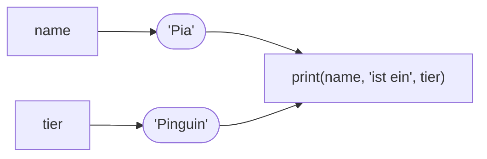

## Ein Name für einen Wert

```alltag
text: Beim Umzug klebt man Etiketten auf die Kartons. Wer später "Küche" sucht, muss nicht jeden Karton aufmachen, das Etikett reicht. Eine Variable ist so ein Etikett für einen Wert.
zeichnung: kartons
```

Mit dem Gleichheitszeichen bekommt ein Wert einen Namen. Links steht der Name, rechts der Wert. Danach kannst du den Namen überall dort schreiben, wo du den Wert brauchst.

```beispiel
id: erster-name
code: |
  pinguin = "Pit"
  print(pinguin)
vorhersage:
  art: auswahl
  optionen:
    - text: Pit
      richtig: true
      erklaerung: Genau. print schaut im Speicher nach, was hinter dem Namen pinguin steht, und gibt das aus.
    - text: pinguin
      erklaerung: Ohne Anführungszeichen ist pinguin kein Text, sondern ein Name. Ausgegeben wird, was dahinter steht.
    - text: '"Pit"'
      erklaerung: Die Anführungszeichen markieren nur den Text im Code; in der Ausgabe erscheinen sie nie.
```

```merke
text: "`=` heißt in Python nicht \"ist gleich\", sondern \"bekommt\": `pinguin = \"Pit\"` liest sich als *pinguin bekommt Pit*."
```

```frage
frageart: auswahl
id: was-macht-gleich
text: Was passiert bei `fische = 3`?
optionen:
  - text: Der Name fische bekommt den Wert 3.
    richtig: true
    erklaerung: Richtig. Links der Name, rechts der Wert, und von jetzt an steht fische für 3.
  - text: Python prüft, ob fische gleich 3 ist.
    erklaerung: Vergleichen kommt in Kapitel 6 und hat ein eigenes Zeichen. Ein einzelnes = vergibt einen Namen.
  - text: Python gibt fische und 3 aus.
    erklaerung: Ausgegeben wird nur mit print. Die Zeile merkt sich den Wert nur.
```

## Werte lassen sich ersetzen

Ein Name kann im Lauf des Programms einen neuen Wert bekommen. Der alte ist dann weg, das Etikett klebt jetzt auf dem neuen Karton. Spiele das Beispiel in der Werkbank Schritt für Schritt ab und schau dir den Speicher an.

```beispiel
id: neuer-wert
code: |
  fische = 3
  print(fische)
  fische = 5
  print(fische)
vorhersage:
  art: auswahl
  optionen:
    - text: |-
        3
        5
      richtig: true
      erklaerung: Richtig. Jede Zeile läuft zu ihrer Zeit; beim ersten print steht noch die 3 hinter fische.
    - text: |-
        5
        5
      erklaerung: Python schaut nicht in die Zukunft. Beim ersten print hat fische noch den Wert 3.
    - text: |-
        3
        3
      erklaerung: Die dritte Zeile ersetzt den Wert. Danach steht fische für 5.
```

```falle
titel: Erst benutzen, dann anlegen
text: "Ein Name muss einen Wert haben, bevor er benutzt wird. Steht `print(fische)` vor `fische = 3`, meldet Python `NameError`."
```

```frage
frageart: luecke
id: luecke-zuweisung
text: Ergänze das Zeichen, mit dem punkte den Wert 10 bekommt.
code: punkte ___ 10
antworten: [["="]]
erklaerung: Genau, ein einzelnes Gleichheitszeichen.
hinweis: Gesucht ist das Zeichen für "bekommt".
```

## Gute Namen

Namen bestehen aus Buchstaben, Ziffern und dem Unterstrich `_`. Sie dürfen nicht mit einer Ziffer anfangen und keine Leerzeichen enthalten. Groß- und Kleinschreibung zählt: `Fisch` und `fisch` sind zwei verschiedene Namen. Üblich sind kleine Buchstaben und Unterstriche zwischen Wörtern, etwa `anzahl_fische`.

```merke
text: Ein guter Name sagt, was drinsteckt. `anzahl_fische` verrät mehr als `x`, auch dir selbst in drei Wochen.
```

```frage
frageart: auswahl
id: erlaubte-namen
text: Welche Namen sind in Python erlaubt?
als_code: true
optionen:
  - text: anzahl_fische
    richtig: true
    erklaerung: anzahl_fische ist erlaubt und dazu noch sprechend.
  - text: 2fische
    erklaerung: 2fische beginnt mit einer Ziffer, das ist nicht erlaubt.
  - text: Fische
    richtig: true
    erklaerung: Fische ist erlaubt, nur ungewöhnlich, weil Namen meist klein geschrieben werden.
  - text: fische zahl
    erklaerung: fische zahl enthält ein Leerzeichen; Python sieht darin zwei Namen.
```

## Namen und Text zusammen ausgeben

Namen und Text lassen sich in einem `print` mischen, durch Kommas getrennt. So entstehen Sätze mit wechselndem Inhalt.



```beispiel
id: satz-bauen
code: |
  name = "Pia"
  tier = "Pinguin"
  print(name, "ist ein", tier)
vorhersage:
  art: eintippen
  erklaerung: "print setzt die Werte hinter den Namen ein und je ein Leerzeichen dazwischen: Pia ist ein Pinguin."
```

```frage
frageart: ordnen
id: ordnen-erst-pia
text: Die Ausgabe soll erst Pia und dann Paul zeigen. Bring die Zeilen in Reihenfolge.
zeilen:
  - name = "Pia"
  - print(name)
  - name = "Paul"
  - print(name)
erklaerung: Richtig. Jedes print zeigt den Wert, den name in diesem Moment hat.
hinweis: Ein Name braucht seinen Wert, bevor print ihn ausgibt.
```

```augenzwinkern
text: Ab jetzt hat dein Programm ein Gedächtnis. Besser als der Papagei, der vergisst alles nach dem Satz.
```
