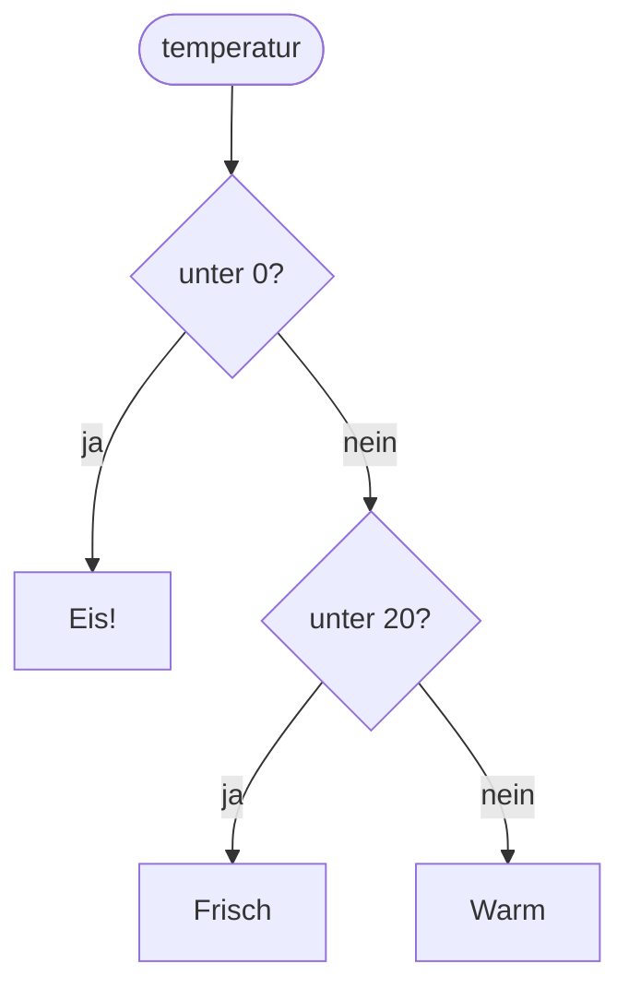

## Nur wenn: if

```alltag
text: An einer Weiche entscheidet sich, welches Gleis der Zug nimmt. Steht die Weiche auf links, fährt er links, sonst geradeaus weiter. Ein `if` ist so eine Weiche für dein Programm.
zeichnung: weiche
```

Hinter `if` steht eine Bedingung und ein Doppelpunkt. Darunter, um vier Leerzeichen eingerückt, folgt der Block, der nur läuft, wenn die Bedingung wahr ist. Was nicht mehr eingerückt ist, läuft in jedem Fall.

```beispiel
id: nur-wenn
code: |
  fische = 5
  if fische > 3:
      print("Satt!")
      print("Zeit für ein Nickerchen.")
  print("Fertig.")
vorhersage:
  art: auswahl
  optionen:
    - text: |-
        Satt!
        Zeit für ein Nickerchen.
        Fertig.
      richtig: true
      erklaerung: Richtig. 5 > 3 ist wahr, also läuft der eingerückte Block, und Fertig. kommt ohnehin.
    - text: Fertig.
      erklaerung: Die Bedingung 5 > 3 ist wahr, also läuft auch der eingerückte Block.
    - text: |-
        Satt!
        Fertig.
      erklaerung: Beide eingerückten Zeilen gehören zum Block, also laufen beide.
```

```merke
text: Doppelpunkt am Ende der if-Zeile, darunter vier Leerzeichen Einrückung. Die Einrückung zeigt, was dazugehört.
```

```frage
frageart: auswahl
id: was-laeuft
text: Was gibt das Programm aus, wenn `fische = 1` ist?
code: |
  if fische > 3:
      print("Satt!")
  print("Fertig.")
optionen:
  - text: Fertig.
    richtig: true
    erklaerung: Richtig. 1 > 3 ist falsch, der Block wird übersprungen.
  - text: |-
      Satt!
      Fertig.
    erklaerung: Der Block läuft nur, wenn die Bedingung wahr ist; 1 ist nicht größer als 3.
  - text: nichts
    erklaerung: Die letzte Zeile ist nicht eingerückt und läuft immer.
als_code: true
```

## Sonst: else

Mit `else` bekommt der andere Fall seinen eigenen Block. Genau einer der beiden läuft, nie beide und nie keiner. `else` steht auf derselben Höhe wie `if` und hat keine Bedingung.

```beispiel
id: sonst
code: |
  taler = int(input())
  if taler >= 3:
      print("Ein Eis, bitte!")
  else:
      print("Nur gucken.")
eingabe: ["2"]
vorhersage:
  art: auswahl
  optionen:
    - text: Nur gucken.
      richtig: true
      erklaerung: Richtig. Mit 2 Talern ist die Bedingung falsch, also läuft der else-Block.
    - text: Ein Eis, bitte!
      erklaerung: 2 ist nicht größer oder gleich 3.
    - text: |-
        Ein Eis, bitte!
        Nur gucken.
      erklaerung: Bei if und else läuft immer genau einer der beiden Blöcke.
```

```frage
frageart: luecke
id: luecke-else
text: Ergänze das Wort für den anderen Fall.
code: |
  if wetter == "Sonne":
      print("Raus!")
  ___:
      print("Drinbleiben.")
antworten: [["else"]]
erklaerung: Richtig, else ohne Bedingung, aber mit Doppelpunkt.
hinweis: Das englische Wort für "sonst".
```

## Mehrere Fälle: elif

Für mehr als zwei Wege gibt es `elif`, kurz für "else if". Python prüft von oben nach unten, und der erste wahre Fall gewinnt; alle weiteren werden nicht mehr angeschaut. Ein `else` am Ende fängt alles auf, was übrig bleibt.



```beispiel
id: mehrere-faelle
code: |
  temperatur = int(input())
  if temperatur < 0:
      print("Eis!")
  elif temperatur < 20:
      print("Frisch")
  else:
      print("Warm")
eingabe: ["-5"]
vorhersage:
  art: auswahl
  optionen:
    - text: Eis!
      richtig: true
      erklaerung: Richtig. -5 ist kleiner als 0; der erste Fall gewinnt, die anderen werden nicht mehr geprüft.
    - text: |-
        Eis!
        Frisch
      erklaerung: -5 ist zwar auch kleiner als 20, aber nach dem ersten wahren Fall ist Schluss.
    - text: Frisch
      erklaerung: Python prüft von oben nach unten, und schon der erste Fall passt.
```

```falle
titel: Die Reihenfolge zählt
text: "Steht `elif temperatur < 20` vor `if temperatur < 0`, landet auch -5 bei Frisch. Den engsten Fall zuerst prüfen."
```

```frage
frageart: ordnen
id: ordnen-noten
text: Bring die Zeilen so in Reihenfolge, dass 95 Punkte "super" und 60 Punkte "ok" ergeben.
zeilen:
  - "if punkte >= 90:"
  - '    print("super")'
  - "elif punkte >= 50:"
  - '    print("ok")'
  - "else:"
  - '    print("nochmal")'
erklaerung: Richtig. Erst der engste Fall, dann der weitere, am Ende alles Übrige.
hinweis: if kommt zuerst, else zuletzt, und jeder Fall hat seine eingerückte Zeile direkt darunter.
```

## Einrückung und Verschachteln

Ein Block darf selbst wieder ein `if` enthalten; dann rückt dessen Block noch weiter ein. Python liest die Einrückung genau: Was falsch eingerückt ist, gehört zu einem anderen Block oder ist ein Fehler.

```beispiel
id: verschachtelt
code: |
  hunger = True
  fische = 0
  if hunger:
      if fische > 0:
          print("Futter!")
      else:
          print("Ab zum Fischen.")
  print("Tschüss.")
vorhersage:
  art: eintippen
  erklaerung: "hunger ist True, also geht es hinein; fische ist 0, also läuft das innere else: Ab zum Fischen. Danach kommt Tschüss., das zu keinem Block gehört."
```

```frage
frageart: fehlerstelle
id: fehler-einrueckung
text: Dieses Programm meldet IndentationError. Welche Zeile?
code: |
  alter = 12
  if alter >= 10:
  print("Großer Pinguin")
  print("Ende")
zeile: 3
erklaerung: Genau. Der Block unter dem if muss eingerückt sein.
hinweise:
  2: Die if-Zeile mit Doppelpunkt stimmt; was muss darunter passieren?
  4: Ende soll in jedem Fall kommen, das passt.
hinweis: Was gehört zum if, und wie zeigt man das?
```

```augenzwinkern
text: Glückwunsch, dein Programm trifft jetzt Entscheidungen. Hoffentlich bessere als ein Pinguin vor dem Fischbuffet.
```
