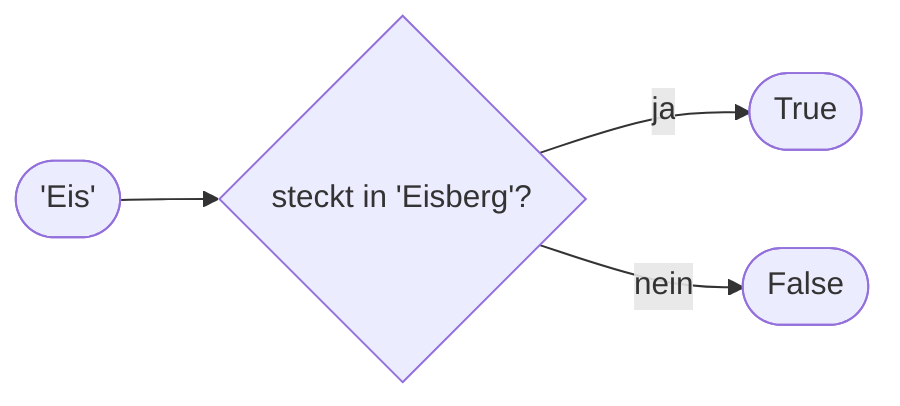

## True und False

Neben Text und Zahlen kennt Python eine dritte Sorte Werte, die nur zwei Möglichkeiten hat: `True` (wahr) und `False` (falsch). Sie entstehen, wenn Python etwas vergleicht. Groß geschrieben, ohne Anführungszeichen.

```beispiel
id: wahr-falsch
code: |
  print(3 > 2)
  print(5 < 1)
  hungrig = True
  print(hungrig)
vorhersage:
  art: auswahl
  optionen:
    - text: |-
        True
        False
        True
      richtig: true
      erklaerung: Richtig. 3 ist größer als 2, 5 ist nicht kleiner als 1, und hungrig hat den Wert True.
    - text: |-
        Ja
        Nein
        True
      erklaerung: Python antwortet nicht mit Ja und Nein, sondern mit True und False.
    - text: |-
        3 > 2
        5 < 1
        hungrig
      erklaerung: Ohne Anführungszeichen ist das kein Text, sondern ein Vergleich, und der ergibt True oder False.
```

```frage
frageart: auswahl
id: wahr-schreiben
text: Wie schreibt man "wahr" in Python?
als_code: true
optionen:
  - text: 'True'
    richtig: true
    erklaerung: Richtig, mit großem T und ohne Anführungszeichen.
  - text: 'true'
    erklaerung: Python unterscheidet Groß und Klein; true kennt es nicht.
  - text: '"True"'
    erklaerung: Mit Anführungszeichen wäre es nur ein Text, der so aussieht.
```

## Vergleichen

Verglichen wird mit `==` (gleich), `!=` (ungleich), `<`, `<=`, `>` und `>=`. Das klappt auch mit Text: dort zählt die Schreibweise genau, und `<` vergleicht nach dem Alphabet.

```beispiel
id: vergleichen
code: |
  fische = 7
  print(fische == 7)
  print(fische != 7)
  print(fische >= 10)
  print("Pia" == "pia")
vorhersage:
  art: auswahl
  optionen:
    - text: |-
        True
        False
        False
        False
      richtig: true
      erklaerung: Richtig. Und "Pia" ist nicht "pia", denn Groß und Klein zählen.
    - text: |-
        True
        False
        False
        True
      erklaerung: Beim Vergleich von Text zählt jeder Buchstabe genau, auch groß und klein.
    - text: |-
        7
        False
        False
        False
      erklaerung: == fragt, ob beide Seiten gleich sind, und antwortet mit True oder False.
```

```falle
titel: = und == verwechselt
text: "Ein einzelnes `=` vergibt einen Namen, das doppelte `==` vergleicht. `if fische = 7` ist ein Syntaxfehler."
```

```frage
frageart: luecke
id: luecke-ungleich
text: Ergänze das Zeichen für "ungleich", damit True herauskommt.
code: print(3 ___ 4)
antworten: [["!="]]
erklaerung: Richtig, 3 ist ungleich 4.
hinweis: Zwei Zeichen, ein Ausrufezeichen ist dabei.
```

## Und, oder, nicht

```alltag
text: Eine Lampe mit zwei Schaltern hintereinander leuchtet nur, wenn beide an sind. Liegen die Schalter nebeneinander, reicht einer. So arbeiten `and` und `or`.
zeichnung: schalter
```

`and` ist nur wahr, wenn beide Seiten wahr sind. `or` ist wahr, wenn mindestens eine Seite wahr ist. `not` dreht um.

| a | b | a and b | a or b | not a |
|---|---|---|---|---|
| True | True | True | True | False |
| True | False | False | True | False |
| False | True | False | True | True |
| False | False | False | False | True |

```beispiel
id: verknuepfen
code: |
  offen = True
  taler = 2
  print(offen and taler >= 3)
  print(offen or taler >= 3)
  print(not offen)
vorhersage:
  art: auswahl
  optionen:
    - text: |-
        False
        True
        False
      richtig: true
      erklaerung: Richtig. Die Eisdiele hat offen, aber 2 Taler reichen nicht; für or genügt offen; not dreht True zu False.
    - text: |-
        True
        True
        False
      erklaerung: and braucht beide Seiten. taler >= 3 ist bei 2 Talern falsch.
    - text: |-
        False
        False
        True
      erklaerung: or reicht eine wahre Seite, und offen ist True.
```

```frage
frageart: auswahl
id: und-oder
text: Welcher Ausdruck ist True?
als_code: true
optionen:
  - text: 3 > 1 or 2 > 5
    richtig: true
    erklaerung: Richtig, die linke Seite ist wahr, und or reicht eine.
  - text: 3 > 1 and 2 > 5
    erklaerung: and braucht beide Seiten; 2 > 5 ist falsch.
  - text: not 3 > 1
    erklaerung: 3 > 1 ist wahr, not macht daraus False.
```

## Nachschauen mit in

`in` schaut nach, ob ein Text in einem anderen steckt. `not in` fragt das Gegenteil. Auch hier zählt Groß und Klein.



```beispiel
id: steckt-drin
code: |
  wort = "Eisberg"
  print("Eis" in wort)
  print("eis" in wort)
  print("Fisch" not in wort)
vorhersage:
  art: eintippen
  erklaerung: "Eis steckt drin (True), eis mit kleinem e nicht (False), und Fisch steckt tatsächlich nicht drin (True)."
```

```frage
frageart: ordnen
id: ordnen-bedingung
text: Erst die Eingabe anlegen, dann prüfen, dann ausgeben. Bring die Zeilen in Reihenfolge.
zeilen:
  - satz = "Pinguine lieben Fisch"
  - mag_fisch = "Fisch" in satz
  - print(mag_fisch)
erklaerung: Richtig. Das Ergebnis von in ist ein Wahrheitswert und lässt sich wie jeder Wert unter einem Namen ablegen.
hinweis: Was geprüft wird, muss vorher da sein.
```

```augenzwinkern
text: True oder False, dazwischen gibt es nichts. Python ist da strenger als jeder Schiedsrichter.
```
