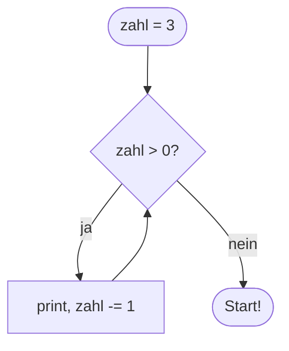

## Solange: while

```alltag
text: Ein Hamster rennt in seinem Laufrad, solange er Lust hat. Klingelt der Wecker, steigt er aus. `while` funktioniert genauso, es wiederholt einen Block, solange eine Bedingung wahr ist.
zeichnung: hamster
```

Vor jedem Durchlauf prüft Python die Bedingung hinter `while`. Ist sie wahr, läuft der eingerückte Block, danach wird wieder geprüft. Ist sie falsch, geht es hinter der Schleife weiter. Spiel das Beispiel in der Werkbank ab und schau, wie `zahl` kleiner wird.

```beispiel
id: countdown
code: |
  zahl = 3
  while zahl > 0:
      print(zahl)
      zahl -= 1
  print("Start!")
vorhersage:
  art: auswahl
  optionen:
    - text: |-
        3
        2
        1
        Start!
      richtig: true
      erklaerung: Richtig. Bei zahl = 0 ist die Bedingung falsch, die Schleife endet, und Start! kommt.
    - text: |-
        3
        2
        1
        0
        Start!
      erklaerung: Bei 0 ist zahl > 0 schon falsch; der Block läuft nicht mehr.
    - text: |-
        3
        Start!
      erklaerung: Nach jedem Durchlauf prüft Python die Bedingung erneut und wiederholt den Block.
```



```frage
frageart: auswahl
id: wie-oft
text: Wie oft wird "Hupf" ausgegeben?
code: |
  sprung = 0
  while sprung < 4:
      print("Hupf")
      sprung += 1
optionen:
  - text: 4 Mal
    richtig: true
    erklaerung: Richtig, für sprung = 0, 1, 2 und 3.
  - text: 5 Mal
    erklaerung: Bei sprung = 4 ist sprung < 4 schon falsch.
  - text: 3 Mal
    erklaerung: Es geht bei 0 los, also 0, 1, 2, 3; das sind vier Durchläufe.
```

## Zählen und sammeln

Schleifen brauchen fast immer einen Zähler, der sich bei jedem Durchlauf ändert. Oft kommt ein Sammler dazu, etwa eine Summe, die vor der Schleife bei 0 anfängt und in jedem Durchlauf wächst.

```beispiel
id: summe
code: |
  summe = 0
  tag = 1
  while tag <= 4:
      summe += tag
      tag += 1
  print("Fische in vier Tagen:", summe)
vorhersage:
  art: eintippen
  erklaerung: "Am ersten Tag 1 Fisch, dann 2, 3, 4; zusammen 10. Im Speicherbild siehst du summe und tag wachsen: Fische in vier Tagen: 10"
```

```frage
frageart: ordnen
id: ordnen-summe
text: Bring die Zeilen so in Reihenfolge, dass am Ende 6 ausgegeben wird (1 + 2 + 3).
zeilen:
  - summe = 0
  - i = 1
  - "while i <= 3:"
  - "    summe += i"
  - "    i += 1"
  - print(summe)
erklaerung: Richtig. Sammler und Zähler vor der Schleife, beides wird im Block verändert, ausgeben danach.
hinweis: Die Summe beginnt vor der Schleife, die Ausgabe kommt erst danach.
```

## Rechtzeitig aufhören: break

Ändert sich in der Schleife nichts an der Bedingung, läuft sie ewig. Manchmal will man das sogar: `while True` läuft so lange, bis ein `break` die Schleife sofort verlässt. So liest man zum Beispiel Eingaben, bis jemand `ende` schreibt.

```falle
titel: Die ewige Schleife
text: "Wer vergisst, den Zähler zu ändern, baut eine Endlosschleife: `while zahl > 0:` mit unveränderter zahl läuft und läuft. Hier im Kurs bricht die Sandbox nach ein paar Sekunden ab."
```

```beispiel
id: bis-ende
code: |
  anzahl = 0
  while True:
      eingabe = input()
      if eingabe == "ende":
          break
      anzahl += 1
  print("Gelesen:", anzahl)
eingabe: [Pit, Pia, Paul, ende]
vorhersage:
  art: auswahl
  optionen:
    - text: 'Gelesen: 3'
      richtig: true
      erklaerung: Richtig. Bei ende verlässt break die Schleife, bevor anzahl erhöht wird.
    - text: 'Gelesen: 4'
      erklaerung: Bei ende greift break, bevor die Zeile mit anzahl += 1 dran ist.
    - text: nichts, die Schleife endet nie
      erklaerung: while True läuft zwar ewig, aber break beendet sie, sobald ende kommt.
```

```frage
frageart: fehlerstelle
id: fehler-endlos
text: Dieses Programm hört nie auf. In welcher Zeile steht die Bedingung, die nie falsch wird?
code: |
  zahl = 5
  while zahl > 0:
      print(zahl)
  print("fertig")
zeile: 2
erklaerung: Genau. Die Schleife prüft zahl > 0, aber im Block ändert sich zahl nie. Es fehlt zahl -= 1 im Block.
hinweise:
  1: Der Startwert ist in Ordnung.
  3: Die Ausgabe ist nicht das Problem; was fehlt im Block, damit sich die Bedingung ändert?
  4: Diese Zeile wird nie erreicht. Warum?
hinweis: Was müsste sich ändern, damit zahl > 0 irgendwann falsch wird?
```

## Einen Durchlauf überspringen: continue

`continue` springt sofort zur nächsten Prüfung der Bedingung; der Rest des Blocks wird für diesen Durchlauf ausgelassen. Damit lassen sich einzelne Fälle überspringen.

```beispiel
id: ueberspringen
code: |
  zahl = 0
  while zahl < 6:
      zahl += 1
      if zahl % 2 == 0:
          continue
      print(zahl)
vorhersage:
  art: auswahl
  optionen:
    - text: |-
        1
        3
        5
      richtig: true
      erklaerung: Richtig. Gerade Zahlen springen mit continue zurück zur Bedingung, nur die ungeraden kommen bis print.
    - text: |-
        2
        4
        6
      erklaerung: Bei geraden Zahlen greift continue und überspringt das print.
    - text: '1'
      erklaerung: continue beendet die Schleife nicht, das täte break. Es geht mit der nächsten Runde weiter.
```

```frage
frageart: luecke
id: luecke-break
text: Ergänze das Wort, mit dem die Schleife sofort verlassen wird, sobald "stopp" eingegeben wird.
code: |
  while True:
      wort = input()
      if wort == "stopp":
          ___
      print(wort)
antworten: [["break"]]
erklaerung: Richtig, break verlässt die Schleife.
hinweis: Das englische Wort für "abbrechen".
```

```augenzwinkern
text: Ein Computer langweilt sich nie. Er würde auch eine Milliarde Fische zählen, ohne zu gähnen.
```
