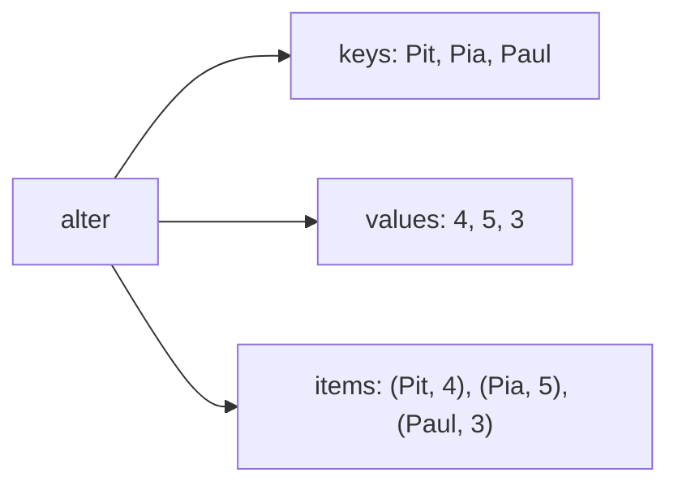

## Schubladen mit Etikett

```alltag
text: In einem Schubladenschrank hat jede Schublade ein Etikett. Wer Socken sucht, öffnet die Schublade "Socken" und muss nicht zählen, die wievielte es ist. Ein Wörterbuch funktioniert genauso.
zeichnung: schubladen
```

Ein Wörterbuch steht in geschweiften Klammern und besteht aus Paaren `schluessel: wert`. Den Wert holt man mit dem Schlüssel in eckigen Klammern, nicht mit einer Nummer.

```beispiel
id: anlegen
code: |
  alter = {"Pit": 4, "Pia": 5, "Paul": 3}
  print(alter["Pia"])
  print(len(alter))
  print(alter)
vorhersage:
  art: auswahl
  optionen:
    - text: |-
        5
        3
        {'Pit': 4, 'Pia': 5, 'Paul': 3}
      richtig: true
      erklaerung: Richtig. Über den Schlüssel Pia kommt die 5, len zählt die Paare.
    - text: |-
        4
        3
        {'Pit': 4, 'Pia': 5, 'Paul': 3}
      erklaerung: Gesucht wird über den Schlüssel, nicht über die Stelle; Pia hat die 5.
    - text: |-
        5
        6
        {'Pit': 4, 'Pia': 5, 'Paul': 3}
      erklaerung: len zählt Paare aus Schlüssel und Wert, nicht Schlüssel und Werte einzeln.
```

```frage
frageart: luecke
id: luecke-schluessel
text: Ergänze, damit der Lieblingsfisch von Pit ausgegeben wird.
code: |
  lieblingsfisch = {"Pit": "Hering", "Pia": "Lachs"}
  print(lieblingsfisch[___])
antworten: [['"Pit"', "'Pit'"]]
erklaerung: Richtig, der Schlüssel ist der Text "Pit".
hinweis: Der Schlüssel ist ein Text und braucht Anführungszeichen.
```

## Ändern und eintragen

Mit `=` bekommt ein Schlüssel einen neuen Wert. Gibt es den Schlüssel noch nicht, entsteht ein neues Paar. Spiel das Beispiel ab: im Speicherbild siehst du die Schubladen.

```beispiel
id: aendern
code: |
  vorrat = {"Hering": 3}
  vorrat["Hering"] = 5
  vorrat["Lachs"] = 2
  vorrat["Hering"] += 1
  print(vorrat)
vorhersage:
  art: auswahl
  optionen:
    - text: "{'Hering': 6, 'Lachs': 2}"
      richtig: true
      erklaerung: Richtig. Hering wird erst 5, dann 6, und Lachs kommt neu dazu.
    - text: "{'Hering': 3, 'Lachs': 2}"
      erklaerung: Die Zuweisung ändert den Wert der vorhandenen Schublade.
    - text: "{'Hering': 6}"
      erklaerung: Ein neuer Schlüssel legt eine neue Schublade an.
```

```falle
titel: Schublade gibt es nicht
text: "`vorrat[\"Wal\"]` meldet `KeyError`, wenn es den Schlüssel nicht gibt. Vorher mit `in` nachschauen oder `get` benutzen."
```

```frage
frageart: auswahl
id: neu-oder-alt
text: Was passiert bei `alter["Bodo"] = 2`, wenn es Bodo noch nicht gibt?
optionen:
  - text: Ein neues Paar Bodo mit 2 entsteht.
    richtig: true
    erklaerung: Richtig. Beim Schreiben legt ein neuer Schlüssel eine neue Schublade an.
  - text: Python meldet KeyError.
    erklaerung: KeyError kommt nur beim Lesen eines fehlenden Schlüssels.
  - text: Nichts, die Zeile wird übersprungen.
    erklaerung: Doch, die Schublade wird angelegt.
```

## Vorsichtig nachschauen mit get

`get(schluessel)` liefert den Wert oder `None`, wenn es den Schlüssel nicht gibt. Mit einem zweiten Wert gibt man einen Ersatz an: `get(schluessel, 0)`. Damit lässt sich wunderbar zählen.

```beispiel
id: zaehlen
code: |
  wort = "Pinguin"
  anzahl = {}
  for b in wort:
      anzahl[b] = anzahl.get(b, 0) + 1
  print(anzahl)
vorhersage:
  art: eintippen
  erklaerung: "Jeder Buchstabe bekommt eine Schublade, die bei jedem Treffen um 1 wächst: {'P': 1, 'i': 2, 'n': 2, 'g': 1, 'u': 1}"
```

```merke
text: "`d.get(k, 0) + 1` ist der klassische Zähler: gibt es k noch nicht, beginnt er bei 0."
```

## Durch alle Schubladen

`for k in d` geht die Schlüssel durch. `d.values()` liefert die Werte, `d.items()` Paare aus Schlüssel und Wert, die sich in der Schleife sofort entpacken lassen.



```beispiel
id: durchgehen
code: |
  alter = {"Pit": 4, "Pia": 5, "Paul": 3}
  for name, jahre in alter.items():
      print(f"{name} ist {jahre}")
  print(sum(alter.values()))
vorhersage:
  art: auswahl
  optionen:
    - text: |-
        Pit ist 4
        Pia ist 5
        Paul ist 3
        12
      richtig: true
      erklaerung: Richtig. items liefert die Paare in der Reihenfolge, in der sie eingetragen wurden; values die Zahlen zum Zusammenzählen.
    - text: |-
        Pit ist 4
        Pia ist 5
        Paul ist 3
        3
      erklaerung: sum zählt die Werte zusammen, es zählt nicht die Paare.
    - text: |-
        ('Pit', 4) ist 4
        12
      erklaerung: In der Schleife werden die Paare in name und jahre ausgepackt.
```

```frage
frageart: fehlerstelle
id: fehler-keyerror
text: Dieses Programm meldet KeyError. Welche Zeile?
code: |
  punkte = {"Pia": 3}
  punkte["Pia"] += 2
  punkte["Pit"] += 1
  print(punkte)
zeile: 3
erklaerung: Genau. Pit gibt es noch nicht; += muss erst lesen. Besser punkte["Pit"] = punkte.get("Pit", 0) + 1.
hinweise:
  2: Pia gibt es schon, das klappt.
hinweis: Welcher Schlüssel wird gelesen, obwohl es ihn noch nicht gibt?
```

```augenzwinkern
text: Ein Wörterbuch vergisst nie, wo es etwas hingelegt hat. Damit ist es jedem Eichhörnchen überlegen.
```
