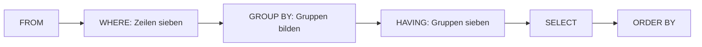

## Je Kolonie eine Zeile

```alltag
text: Zum Zählen schickt der Pfleger jede Kolonie auf ihre eigene Eisscholle. Dann muss er nicht acht Pinguine zählen, sondern nur noch je Scholle nachsehen, wie viele draufstehen. GROUP BY verteilt die Zeilen auf Schollen.
zeichnung: eisschollen
```

Im letzten Kapitel wurde alles zu einer einzigen Zeile. Mit `GROUP BY spalte` legt die Datenbank vorher alle Zeilen mit gleichem Wert in dieser Spalte zusammen, und jede Gruppe wird zu einer eigenen Ergebniszeile. COUNT, SUM und Co. rechnen dann je Gruppe. Spiel das Beispiel ab: im Schritt GROUP BY sind die Gruppen farbig abgesetzt.

```beispiel
id: je-kolonie
code: |
  SELECT kolonie, COUNT(*) AS anzahl
  FROM pinguine
  GROUP BY kolonie;
vorhersage:
  art: auswahl
  optionen:
    - text: |-
        Nord | 4
        Ost | 2
        Süd | 2
      richtig: true
      erklaerung: Richtig. Drei Kolonien haben Pinguine, also drei Gruppen und drei Zeilen.
    - text: "8"
      erklaerung: Das wäre COUNT(*) ohne GROUP BY. Mit GROUP BY gibt es eine Zeile je Kolonie.
    - text: |-
        Nord | 4
        Süd | 2
        Ost | 2
        West | 0
      erklaerung: Gruppen entstehen nur aus Zeilen, die es gibt. Im Westen wohnt kein Pinguin, also gibt es dort keine Gruppe.
```

```frage
frageart: luecke
id: luecke-group
text: Ergänze, damit für jeden Tag herauskommt, wie viele Fische es gab.
code: |
  SELECT tag, SUM(menge) AS fische
  FROM fuetterungen
  GROUP BY ___;
antworten: [["tag"]]
erklaerung: Richtig, je Tag eine Gruppe.
hinweis: Wonach soll gruppiert werden?
```

## Was neben GROUP BY stehen darf

Hinter SELECT dürfen jetzt zwei Arten von Spalten stehen: die Spalten aus GROUP BY, denn die haben in jeder Gruppe denselben Wert, und Zusammenfassungen wie COUNT oder SUM. Eine gewöhnliche Spalte wie name passt nicht, denn in der Gruppe Nord stehen vier verschiedene Namen.

```beispiel
id: je-fisch
code: |
  SELECT fisch, COUNT(*) AS mal, SUM(menge) AS fische
  FROM fuetterungen
  GROUP BY fisch;
vorhersage:
  art: auswahl
  frage: Wie viele Zeilen hat das Ergebnis?
  vergleich: zeilen
  optionen:
    - text: 4 Zeilen
      richtig: true
      erklaerung: Richtig. Hering, Lachs, Makrele und Sardine, je eine Zeile.
    - text: 12 Zeilen
      erklaerung: Zwölf Fütterungen gibt es, aber GROUP BY macht aus jeder Fischsorte eine Zeile.
    - text: 1 Zeile
      erklaerung: Ohne GROUP BY wäre es eine Zeile. Hier gibt es eine je Fisch.
```

```falle
titel: NULL ist auch eine Gruppe
text: "Bei `GROUP BY lieblingsfisch` landen Pina und Pünktchen zusammen in einer Gruppe NULL. Beim Gruppieren gelten alle NULL als gleich, auch wenn ein Vergleich mit = NULL sonst nie stimmt."
```

## Gruppen aussieben: HAVING

WHERE siebt einzelne Zeilen, bevor gruppiert wird. Ob eine ganze Gruppe ins Ergebnis kommt, entscheidet `HAVING`, und das darf nach Zusammenfassungen fragen: `HAVING COUNT(*) >= 2` oder `HAVING AVG(gewicht_kg) > 4`. WHERE kann das nicht, denn beim Aussieben der Zeilen gibt es noch gar keine Gruppen.



```beispiel
id: schwere-kolonien
code: |
  SELECT kolonie, ROUND(AVG(gewicht_kg), 2) AS schnitt
  FROM pinguine
  GROUP BY kolonie
  HAVING AVG(gewicht_kg) > 4;
vorhersage:
  art: auswahl
  optionen:
    - text: |-
        Nord | 4.35
        Süd | 4.35
      richtig: true
      erklaerung: Richtig. Im Osten wiegen die Pinguine im Schnitt nur 3,45 Kilo, diese Gruppe fällt heraus.
    - text: |-
        Nord | 4.35
        Ost | 3.45
        Süd | 4.35
      erklaerung: HAVING siebt die Gruppe Ost aus, ihr Durchschnitt liegt unter 4.
    - text: |-
        Pit | 4.2
        Paul | 5.1
        Pepe | 4.9
        Polly | 4.6
      erklaerung: HAVING prüft Gruppen, nicht einzelne Pinguine; heraus kommt eine Zeile je Kolonie.
```

Beides geht auch zusammen: erst WHERE für die Zeilen, dann GROUP BY, dann HAVING für die Gruppen, und am Ende darf ORDER BY sortieren.

```beispiel
id: vielfresser
code: |
  SELECT pinguin_id, SUM(menge) AS fische
  FROM fuetterungen
  WHERE fisch <> 'Sardine'
  GROUP BY pinguin_id
  HAVING SUM(menge) >= 10
  ORDER BY fische DESC;
vorhersage:
  art: auswahl
  optionen:
    - text: |-
        3 | 15
        1 | 11
      richtig: true
      erklaerung: Richtig. Ohne Sardinen bekam Pinguin 1 nur noch 11 Fische, Pinguin 3 behält seine 15.
    - text: |-
        3 | 15
        1 | 14
      erklaerung: WHERE nimmt vorher die Sardinen heraus, bei Pinguin 1 waren das 3 Stück.
    - text: |-
        1 | 11
        3 | 15
      erklaerung: ORDER BY fische DESC stellt die größere Summe nach oben.
```

```merke
text: "GROUP BY bildet Gruppen gleicher Werte, jede wird eine Zeile. Im SELECT stehen nur Gruppenspalten und Zusammenfassungen. WHERE siebt Zeilen vor dem Gruppieren, HAVING siebt Gruppen danach."
```

```frage
frageart: fehlerstelle
id: fehler-having
text: Diese Abfrage meldet "misuse of aggregate". In welcher Zeile?
code: |
  SELECT pinguin_id,
         COUNT(*) AS mahlzeiten
  FROM fuetterungen
  WHERE COUNT(*) > 1
  GROUP BY pinguin_id;
zeile: 4
erklaerung: Genau. Beim Sieben der Zeilen gibt es noch keine Gruppen zum Zählen; richtig ist `HAVING COUNT(*) > 1` nach GROUP BY.
hinweis: Wo steht eine Zusammenfassung an einer Stelle, an der es noch keine Gruppen gibt?
```

```frage
frageart: ordnen
id: ordnen-gruppen
text: Bring die Zeilen in Reihenfolge, damit je Tag die Fische gezählt werden, aber nur Tage mit mehr als 17 Fischen kommen.
zeilen:
  - SELECT tag, SUM(menge) AS fische
  - FROM fuetterungen
  - GROUP BY tag
  - HAVING SUM(menge) > 17;
erklaerung: Richtig. HAVING steht direkt hinter GROUP BY.
hinweis: Erst gruppieren, dann die Gruppen sieben.
```

```augenzwinkern
text: Die Ostkolonie hat gegen HAVING Beschwerde eingelegt. Pünktchen sei eben noch im Wachstum.
```
