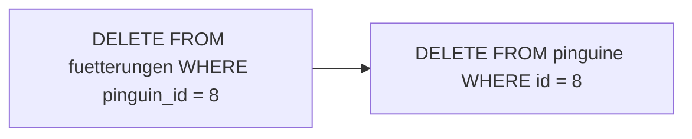

## Ausmisten

```alltag
text: Die Fütterungen vom 20. Oktober sind abgerechnet. Der Pfleger zieht genau diese Karten aus dem Kasten und wirft sie in den Papierkorb. Alle anderen bleiben, wo sie sind. DELETE ist das Herausziehen, WHERE sagt, welche Karten.
zeichnung: papierkorb
```

`DELETE FROM tabelle WHERE bedingung` löscht alle Zeilen, für die die Bedingung stimmt. Es gibt keine Spaltenliste, denn gelöscht wird immer die ganze Zeile. Spiel das Beispiel ab: im Schritt DELETE sind die gelöschten Zeilen durchgestrichen.

```beispiel
id: abgerechnet
code: |
  DELETE FROM fuetterungen
  WHERE tag = '2026-10-20';

  SELECT COUNT(*) AS uebrig FROM fuetterungen;
vorhersage:
  art: auswahl
  optionen:
    - text: "8"
      richtig: true
      erklaerung: Richtig. Vier Fütterungen gab es am 20. Oktober, zwölf waren es vorher.
    - text: "4"
      erklaerung: Vier werden gelöscht, übrig bleiben die anderen acht.
    - text: "0"
      erklaerung: Mit WHERE verschwinden nur die passenden Zeilen.
```

```frage
frageart: auswahl
id: spalten-loeschen
text: "Warum steht bei DELETE keine Spaltenliste wie `DELETE name FROM pinguine`?"
optionen:
  - text: Weil DELETE immer ganze Zeilen löscht
    richtig: true
    erklaerung: Richtig. Einen einzelnen Wert leert man mit UPDATE ... SET spalte = NULL.
  - text: Weil DELETE immer alle Spalten einer Tabelle löscht, die Zeilen aber bleiben
    erklaerung: Es ist umgekehrt, die Zeilen verschwinden ganz.
  - text: Weil die Datenbank die Spalten selbst errät
    erklaerung: Da gibt es nichts zu raten, es geht immer um ganze Zeilen.
```

## Ohne WHERE ist alles weg

Wie bei UPDATE gilt: ohne WHERE trifft es jede Zeile. Die Tabelle selbst bleibt bestehen, mit ihren Spalten, nur ohne Inhalt. Wer die ganze Tabelle loswerden will, braucht DROP TABLE aus dem nächsten Kapitel.

```beispiel
id: alles-weg
code: |
  DELETE FROM pfleger;

  SELECT COUNT(*) AS pfleger FROM pfleger;
vorhersage:
  art: auswahl
  optionen:
    - text: "0"
      richtig: true
      erklaerung: Richtig, die Tabelle ist leer. Dass die Abfrage überhaupt läuft, zeigt aber, dass es sie noch gibt.
    - text: "4"
      erklaerung: Ohne WHERE löscht DELETE jede Zeile.
    - text: Fehler, die Tabelle gibt es nicht mehr
      erklaerung: DELETE leert die Tabelle nur; sie bleibt bestehen.
```

```falle
titel: Kein Papierkorb
text: "Anders als am Rechner gibt es nach einem DELETE keinen Papierkorb. Was gelöscht ist, ist weg. Darum auch hier: erst `SELECT * FROM ... WHERE ...` laufen lassen, prüfen, dann SELECT * durch DELETE ersetzen."
```

```frage
frageart: luecke
id: luecke-from
text: Ergänze, damit alle Sardinen-Fütterungen gelöscht werden.
code: |
  DELETE ___ fuetterungen
  WHERE fisch = 'Sardine';
antworten: [["FROM", "from"]]
erklaerung: Richtig, DELETE FROM und dann die Tabelle.
hinweis: Löschen aus ...
```

## Verwaiste Zeilen

In fuetterungen steht zu jeder Fütterung die Nummer des Pinguins. Wird der Pinguin gelöscht, zeigen seine Fütterungen ins Leere: sie sind verwaist. Viele Datenbanken verbieten so ein Löschen; SQLite tut es nur, wenn man die Prüfung von Verweisen ausdrücklich einschaltet. Sauber ist es, zuerst die Zeilen zu löschen, die auf den Pinguin zeigen, und dann den Pinguin.



```beispiel
id: verwaist
code: |
  DELETE FROM pinguine WHERE id = 8;

  SELECT COUNT(*) AS verwaist
  FROM fuetterungen
  WHERE pinguin_id NOT IN (SELECT id FROM pinguine);
vorhersage:
  art: auswahl
  frage: Pünktchen (Nummer 8) wird gelöscht, seine Fütterungen nicht. Wie viele Fütterungen sind danach verwaist?
  optionen:
    - text: "1"
      richtig: true
      erklaerung: Richtig. Pünktchen hatte eine Fütterung, die zeigt jetzt ins Leere. Erst die Fütterungen löschen, dann den Pinguin.
    - text: "0"
      erklaerung: DELETE auf pinguine löscht nur dort; die Fütterung bleibt in ihrer Tabelle stehen.
    - text: "12"
      erklaerung: Nur Pünktchens Fütterung zeigt auf eine Nummer, die es nicht mehr gibt.
```

## Wen es trifft, entscheidet eine Abfrage

Auch im WHERE eines DELETE darf eine Unterabfrage stehen. So verschwinden alle Fütterungen der Ostkolonie, obwohl in fuetterungen gar keine Kolonie steht.

```beispiel
id: osten
code: |
  DELETE FROM fuetterungen
  WHERE pinguin_id IN (SELECT id FROM pinguine WHERE kolonie = 'Ost');

  SELECT COUNT(*) AS uebrig FROM fuetterungen;
vorhersage:
  art: eintippen
  frage: Pablo und Pünktchen haben je eine Fütterung. Wie viele Fütterungen bleiben übrig? Tipp die Zahl ein.
  erklaerung: Zwei Fütterungen der Ostkolonie verschwinden, von zwölf bleiben zehn.
```

```merke
text: "DELETE FROM tabelle WHERE bedingung löscht ganze Zeilen; ohne WHERE alle, die Tabelle bleibt leer bestehen. Vor dem Löschen mit SELECT prüfen. Erst die Zeilen löschen, die auf etwas zeigen, dann das, worauf sie zeigen."
```

```frage
frageart: ordnen
id: ordnen-reihenfolge
text: Pepe (Nummer 5) zieht in einen anderen Zoo. Bring die Zeilen in Reihenfolge, erst nachsehen, dann so löschen, dass keine Fütterung verwaist.
zeilen:
  - SELECT * FROM fuetterungen WHERE pinguin_id = 5;
  - DELETE FROM fuetterungen WHERE pinguin_id = 5;
  - DELETE FROM pinguine WHERE id = 5;
erklaerung: Richtig. Erst nachsehen, dann die Fütterungen, die auf Pepe zeigen, zuletzt Pepe selbst.
hinweis: Was zeigt worauf?
```

```augenzwinkern
text: Pünktchen ist nach diesem Kapitel ziemlich oft gelöscht worden. Es nimmt das sportlich, beim nächsten Ausführen ist es ja wieder da.
```
