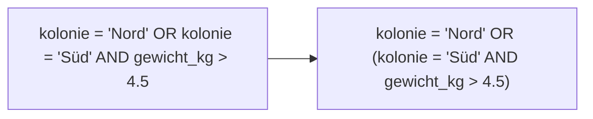

## Beides muss stimmen: AND

```alltag
text: Vor dem Iglu steht ein Pinguin mit Klemmbrett. Rein darf nur, wer aus der Nordkolonie kommt und über vier Kilo wiegt. Fehlt eines der beiden Häkchen, bleibt die Tür zu. So arbeitet AND.
zeichnung: tuersteher
```

Mit `AND` verbindet man zwei Bedingungen. Eine Zeile kommt nur dann ins Ergebnis, wenn beide stimmen. Man kann beliebig viele Bedingungen mit AND aneinanderhängen.

```beispiel
id: und
code: |
  SELECT name, kolonie, gewicht_kg
  FROM pinguine
  WHERE kolonie = 'Nord' AND gewicht_kg > 4;
vorhersage:
  art: auswahl
  frage: Wie viele Zeilen hat das Ergebnis?
  vergleich: zeilen
  optionen:
    - text: 3 Zeilen
      richtig: true
      erklaerung: Richtig. Im Norden wohnen vier Pinguine; Pina wiegt nur 3,5 Kilo und bleibt draußen.
    - text: 4 Zeilen
      erklaerung: Vier wohnen im Norden, aber Pina wiegt nicht mehr als vier Kilo.
    - text: 7 Zeilen
      erklaerung: Das wäre eine der beiden Bedingungen allein; AND verlangt beide.
```

```frage
frageart: auswahl
id: und-oder-sieb
text: 'Eine Zeile erfüllt die erste Bedingung, die zweite nicht. Kommt sie bei `WHERE erste AND zweite` ins Ergebnis?'
optionen:
  - text: Nein
    richtig: true
    erklaerung: Richtig, bei AND müssen beide stimmen.
  - text: Ja
    erklaerung: Das wäre OR. AND braucht beide Häkchen.
  - text: Es kommt darauf an, welche zuerst steht
    erklaerung: Die Reihenfolge der beiden Bedingungen ändert nichts am Ergebnis.
```

## Eine reicht: OR

Mit `OR` reicht es, wenn eine der Bedingungen stimmt; stimmen beide, ist die Zeile natürlich auch dabei. `NOT` dreht eine Bedingung um: `NOT kolonie = 'Nord'` holt alle, die nicht im Norden wohnen.

```beispiel
id: oder
code: |
  SELECT name, kolonie
  FROM pinguine
  WHERE kolonie = 'Süd' OR kolonie = 'Ost';
vorhersage:
  art: auswahl
  optionen:
    - text: |-
        Pia | Süd
        Pepe | Süd
        Pablo | Ost
        Pünktchen | Ost
      richtig: true
      erklaerung: Richtig. Wer im Süden oder im Osten wohnt, kommt durch; die Reihenfolge bleibt die der Tabelle.
    - text: "(keine Zeile)"
      erklaerung: Das wäre AND; niemand wohnt im Süden und im Osten zugleich. OR braucht nur eine der beiden.
    - text: |-
        Pia | Süd
        Pepe | Süd
      erklaerung: OR lässt auch die Ostkolonie durch.
```

```falle
titel: Und heißt hier oder
text: "Im Alltag sagt man \"die Pinguine aus dem Süden und dem Osten\". In SQL ist das `OR`: `kolonie = 'Süd' AND kolonie = 'Ost'` findet niemanden, denn keine Zeile hat zwei Kolonien zugleich."
```

```frage
frageart: luecke
id: luecke-oder
text: Ergänze, damit alle Kolonien kommen, deren Wasser unter null Grad oder über neun Grad hat.
code: |
  SELECT name
  FROM kolonien
  WHERE wassertemperatur < 0 ___ wassertemperatur > 9;
antworten: [["OR", "or"]]
erklaerung: Richtig, eine der beiden Bedingungen reicht.
hinweis: Kein Wasser ist zugleich unter null und über neun Grad.
```

## Klammern: AND geht vor OR

Wie Punkt vor Strich gilt in SQL: `AND` bindet stärker als `OR`. Ohne Klammern verbindet die Datenbank zuerst die Bedingungen links und rechts des AND und erst dann mit OR. Wer etwas anderes meint, setzt Klammern.



```beispiel
id: klammern
code: |
  SELECT name
  FROM pinguine
  WHERE kolonie = 'Nord' OR kolonie = 'Süd'
    AND gewicht_kg > 4.5;
vorhersage:
  art: auswahl
  frage: Wie viele Zeilen hat das Ergebnis?
  vergleich: zeilen
  optionen:
    - text: 5 Zeilen
      richtig: true
      erklaerung: Richtig, und wohl nicht so gemeint. AND bindet zuerst, also kommen alle vier aus dem Norden und dazu Pepe, der schwere aus dem Süden.
    - text: 3 Zeilen
      erklaerung: So viele wären es mit Klammern um das OR. Ohne Klammern gilt die Gewichtsgrenze nur für den Süden.
    - text: 6 Zeilen
      erklaerung: Pia aus dem Süden wiegt nur 3,8 Kilo; für den Süden gilt die Gewichtsgrenze.
```

```merke
text: "AND: beide Bedingungen müssen stimmen. OR: eine reicht. NOT dreht um. AND bindet stärker als OR; im Zweifel Klammern setzen, das liest sich auch besser."
```

```frage
frageart: fehlerstelle
id: fehler-klammer
text: "Die Abfrage soll die schweren Pinguine (über 4,5 Kilo) aus Nord und Süd holen, liefert aber auch leichte. In welcher Zeile fehlen Klammern?"
code: |
  SELECT name,
         gewicht_kg
  FROM pinguine
  WHERE kolonie = 'Nord' OR kolonie = 'Süd' AND gewicht_kg > 4.5;
zeile: 4
erklaerung: "Genau. Richtig wäre `WHERE (kolonie = 'Nord' OR kolonie = 'Süd') AND gewicht_kg > 4.5`."
hinweis: Wo stehen AND und OR ohne Klammern nebeneinander?
```

## Kürzer mit IN und BETWEEN

Lange OR-Ketten mit derselben Spalte schreibt man kürzer mit `IN`: `kolonie IN ('Süd', 'Ost')` heißt dasselbe wie `kolonie = 'Süd' OR kolonie = 'Ost'`. Für Bereiche gibt es `BETWEEN`: `geburtsjahr BETWEEN 2019 AND 2021` prüft von 2019 bis 2021, beide Grenzen gehören dazu. Davor kann wieder NOT stehen: `NOT IN`, `NOT BETWEEN`.

```beispiel
id: zwischen
code: |
  SELECT name, geburtsjahr
  FROM pinguine
  WHERE geburtsjahr BETWEEN 2019 AND 2021;
vorhersage:
  art: auswahl
  optionen:
    - text: |-
        Pit | 2019
        Pia | 2020
        Polly | 2019
        Pablo | 2021
      richtig: true
      erklaerung: Richtig. Beide Grenzen gehören dazu, auch 2019 und 2021.
    - text: Pia | 2020
      erklaerung: BETWEEN schließt die Grenzen mit ein, 2019 und 2021 sind also dabei.
    - text: |-
        Pit | 2019
        Polly | 2019
        Pablo | 2021
      erklaerung: Pia ist 2020 geboren, das liegt mitten im Bereich.
```

```beispiel
id: in-liste
code: |
  SELECT name, lieblingsfisch
  FROM pinguine
  WHERE lieblingsfisch IN ('Lachs', 'Makrele');
vorhersage:
  art: eintippen
  frage: Wie viele Zeilen hat das Ergebnis? Schau in die Tabelle pinguine.
  vergleich: zeilen
  erklaerung: Pia und Polly mögen Lachs, Pepe Makrele.
```

```frage
frageart: ordnen
id: ordnen-in
text: Bring die Zeilen in Reihenfolge, damit die Abfrage die Pinguine holt, die weder im Norden noch im Süden wohnen.
zeilen:
  - SELECT name
  - FROM pinguine
  - WHERE kolonie NOT IN ('Nord', 'Süd');
erklaerung: Richtig, NOT IN schließt alle Werte der Liste aus.
hinweis: Die Reihenfolge beim Schreiben ist immer SELECT, FROM, WHERE.
```

```augenzwinkern
text: Der Türsteher hat es aufgegeben, Ausnahmen zu machen. Seit er Klammern kennt, gibt es keine Diskussionen mehr.
```
