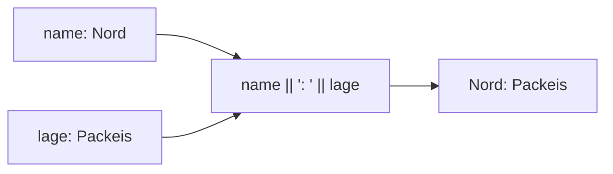

## Neue Namen mit AS

```alltag
text: Auf der Karteikarte steht "gewicht_kg", auf der Besuchertafel soll aber "Gewicht" stehen. Man schreibt nicht die Karte um, sondern nur das Schild darüber. AS ist so ein neues Schild für eine Spalte im Ergebnis.
zeichnung: rechenmaschine
```

`SELECT name AS kolonie` holt die Spalte name, im Ergebnis heißt sie aber kolonie. Die Tabelle selbst bleibt, wie sie ist; der neue Name gilt nur für dieses eine Ergebnis.

```beispiel
id: as
code: |
  SELECT name AS kolonie, lage AS wo
  FROM kolonien;
vorhersage:
  art: auswahl
  frage: Wie viele Zeilen hat das Ergebnis?
  vergleich: zeilen
  optionen:
    - text: 4 Zeilen
      richtig: true
      erklaerung: Richtig. Neue Namen ändern nichts an den Zeilen; es sind die vier Kolonien.
    - text: 2 Zeilen
      erklaerung: Zwei sind es bei den Spalten. Schau nach dem Ausführen auf die Kopfzeile des Ergebnisses.
    - text: 0 Zeilen
      erklaerung: Eine Spalte kolonie gibt es in der Tabelle nicht, aber AS sucht keine Spalte, es vergibt nur einen Namen.
```

```frage
frageart: auswahl
id: kopfzeile
text: 'Wie heißen die Spalten im Ergebnis von `SELECT name AS pinguin, kolonie FROM pinguine`?'
optionen:
  - text: pinguin und kolonie
    richtig: true
    erklaerung: Richtig. Nur name bekommt einen neuen Namen, kolonie behält seinen.
  - text: name und kolonie
    erklaerung: Mit AS heißt die erste Spalte im Ergebnis pinguin.
  - text: pinguin und pinguin
    erklaerung: AS gilt nur für die Spalte direkt davor.
```

## Rechnen mit Spalten

Hinter SELECT darf auch eine Rechnung stehen: `+`, `-`, `*` und `/` wie beim Taschenrechner, mit Spalten und festen Zahlen. Die Datenbank rechnet für jede Zeile einzeln. Ohne AS hieße die neue Spalte so wie die Rechnung, darum gibt man ihr fast immer einen Namen.

```beispiel
id: rechnen
code: |
  SELECT name, wassertemperatur * 2 AS doppelt
  FROM kolonien;
vorhersage:
  art: auswahl
  optionen:
    - text: |-
        Nord | -3.0
        Süd | 8.0
        Ost | 19.0
        West | -1.0
      richtig: true
      erklaerung: Richtig. Jede Zeile wird für sich verdoppelt, auch die Minusgrade.
    - text: |-
        Nord | -1.5
        Süd | 4.0
        Ost | 9.5
        West | -0.5
      erklaerung: Das wären die Werte ohne Rechnung; * 2 verdoppelt sie.
    - text: "doppelt | 23.0"
      erklaerung: Gerechnet wird je Zeile, nicht über alle Zeilen zusammen.
```

```frage
frageart: luecke
id: luecke-gramm
text: Ergänze, damit das Gewicht in Gramm in einer Spalte gramm steht.
code: |
  SELECT name, gewicht_kg * 1000 ___ gramm
  FROM pinguine;
antworten: [["AS", "as"]]
erklaerung: Richtig, AS gibt der Rechnung ihren Namen.
hinweis: Das Wort für einen neuen Spaltennamen.
```

## Vorsicht beim Teilen

Teilt man zwei ganze Zahlen, liefert die Datenbank wieder eine ganze Zahl und schneidet den Rest einfach ab: `7 / 2` ist 3. Ist eine der Zahlen eine Kommazahl, rechnet sie genau: `7 / 2.0` ist 3.5. `ROUND(wert, 2)` rundet auf zwei Stellen. SELECT geht übrigens auch ganz ohne Tabelle, als Taschenrechner.

```beispiel
id: teilen
code: SELECT 7 / 2, 7 / 2.0, ROUND(10 / 3.0, 2);
vorhersage:
  art: auswahl
  optionen:
    - text: 3 | 3.5 | 3.33
      richtig: true
      erklaerung: Richtig. Ganze durch ganze Zahl bleibt ganz, mit 2.0 wird es genau, ROUND kürzt auf zwei Stellen.
    - text: 3.5 | 3.5 | 3.33
      erklaerung: 7 / 2 sind zwei ganze Zahlen, da fällt der Rest weg.
    - text: 3 | 3 | 3
      erklaerung: Mit 2.0 ist eine Kommazahl dabei, dann rechnet die Datenbank genau.
```

```falle
titel: Der verschwundene Rest
text: "`menge / 2` mit einer ganzen Zahl in menge verliert die Hälfte von ungeraden Mengen. Wer Kommastellen will, schreibt `menge / 2.0`."
```

## Text zusammenkleben

Zwei senkrechte Striche `||` kleben Texte aneinander, auch mit Werten aus Spalten. So entsteht aus mehreren Spalten ein Satz für die Besuchertafel. Leerzeichen muss man selbst mit in die Hochkommas schreiben.



```beispiel
id: verbinden
code: |
  SELECT name || ': ' || lage AS schild
  FROM kolonien;
vorhersage:
  art: auswahl
  optionen:
    - text: |-
        Nord: Packeis
        Süd: Felsenküste
        Ost: Sandstrand
        West: Eishöhle
      richtig: true
      erklaerung: Richtig. Je Zeile ein Text aus Name, Doppelpunkt mit Leerzeichen und Lage.
    - text: |-
        Nord | Packeis
        Süd | Felsenküste
        Ost | Sandstrand
        West | Eishöhle
      erklaerung: "|| macht aus zwei Spalten eine; das Ergebnis hat nur die Spalte schild."
    - text: |-
        Nord:Packeis
        Süd:Felsenküste
        Ost:Sandstrand
        West:Eishöhle
      erklaerung: Das Leerzeichen steht mit in den Hochkommas, also erscheint es auch.
```

```falle
titel: Kleben geht vor Rechnen
text: "`||` bindet stärker als `*`: `'Gewicht ' || gewicht_kg * 1000` klebt erst und rechnet dann mit Text, heraus kommt Unsinn. Rechnungen in einem Text gehören in Klammern: `'Gewicht ' || (gewicht_kg * 1000)`."
```

```merke
text: "AS gibt einer Spalte im Ergebnis einen Namen. Rechnen mit + - * /, ganze durch ganze Zahl bleibt ganz, ROUND(wert, stellen) rundet. || klebt Texte zusammen."
```

```frage
frageart: fehlerstelle
id: fehler-hochkomma
text: Diese Abfrage meldet einen Fehler. In welcher Zeile?
code: |
  SELECT name,
         name || ' wohnt in ' || kolonie AS satz,
         gewicht_kg * 1000 AS gramm,
         name || ist da AS gruss
  FROM pinguine;
zeile: 4
erklaerung: Genau. Der Text "ist da" braucht Hochkommas, sonst sucht die Datenbank Spalten namens ist und da.
hinweis: Wo steht ein Text ohne Hochkommas?
```

```augenzwinkern
text: Die Datenbank rechnet schneller als jeder Pinguin. Dafür kann sie nicht auf dem Bauch rutschen.
```
