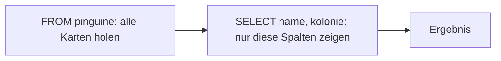

## Tabellen sind Karteikästen

```alltag
text: Im Pinguinzoo gibt es einen Karteikasten. Auf jeder Karte steht ein Pinguin mit Name, Kolonie, Gewicht und Lieblingsfisch. Eine Datenbanktabelle ist genau so ein Kasten, nur dass niemand mehr blättern muss.
zeichnung: karteikasten
```

Eine Tabelle hat Spalten (was auf jeder Karte steht) und Zeilen (je Pinguin eine Karte). Die Sprache, mit der man eine Datenbank fragt, heißt SQL. Die einfachste Frage lautet: zeig mir alles aus der Tabelle pinguine. `SELECT *` heißt "alle Spalten", `FROM pinguine` sagt, aus welcher Tabelle.

```beispiel
id: alles
code: |
  SELECT *
  FROM pinguine;
vorhersage:
  art: auswahl
  frage: Wie viele Zeilen hat das Ergebnis? Schau zur Not in die Karteikarten oben.
  vergleich: zeilen
  optionen:
    - text: 8 Zeilen
      richtig: true
      erklaerung: Richtig. Ohne weitere Angabe kommt jede Zeile der Tabelle, also jeder der acht Pinguine.
    - text: 6 Zeilen
      erklaerung: Sechs sind es bei den Spalten. Zeilen gibt es eine je Pinguin.
    - text: 1 Zeile
      erklaerung: SELECT * holt nicht einen Pinguin, sondern alle.
```

```frage
frageart: auswahl
id: zeile-oder-spalte
text: Was ist in der Tabelle pinguine eine Zeile?
optionen:
  - text: Alles über einen einzelnen Pinguin
    richtig: true
    erklaerung: Richtig, eine Zeile ist eine Karteikarte.
  - text: Die Namen aller Pinguine
    erklaerung: Das wäre die Spalte name, sie läuft von oben nach unten.
  - text: Der Name der Tabelle
    erklaerung: Der steht hinter FROM und ist der Name des ganzen Kastens.
```

## Nur bestimmte Spalten

Meist will man nicht alles wissen. Statt `*` stehen hinter SELECT die Spalten, die man sehen möchte, durch Kommas getrennt und in der Reihenfolge, in der sie im Ergebnis erscheinen sollen. Die Tabelle kolonien kennt zu jeder Kolonie ihre Lage und die Wassertemperatur.

```beispiel
id: spalten
code: |
  SELECT lage, name
  FROM kolonien;
vorhersage:
  art: auswahl
  optionen:
    - text: |-
        Packeis | Nord
        Felsenküste | Süd
        Sandstrand | Ost
        Eishöhle | West
      richtig: true
      erklaerung: Richtig. Zuerst lage, dann name, genau wie hinter SELECT; die Wassertemperatur bleibt weg.
    - text: |-
        Nord | Packeis
        Süd | Felsenküste
        Ost | Sandstrand
        West | Eishöhle
      erklaerung: Die Spalten erscheinen in der Reihenfolge hinter SELECT, nicht in der der Tabelle.
    - text: |-
        Packeis | Nord | -1.5
        Felsenküste | Süd | 4.0
        Sandstrand | Ost | 9.5
        Eishöhle | West | -0.5
      erklaerung: Nur die genannten Spalten kommen ins Ergebnis, die Wassertemperatur nicht.
```

```frage
frageart: luecke
id: luecke-spalten
text: Ergänze, damit Name und Gewicht aller Pinguine kommen.
code: |
  SELECT ___
  FROM pinguine;
antworten: [["name, gewicht_kg", "name,gewicht_kg"]]
erklaerung: Richtig, zwei Spalten mit Komma dazwischen.
hinweis: Die Spalten heißen name und gewicht_kg, getrennt durch ein Komma.
```

## So liest die Datenbank

Spiel das Beispiel ab: Unter dem Ergebnis siehst du, wie die Datenbank arbeitet. Obwohl SELECT vorn steht, holt sie zuerst mit FROM die ganze Tabelle und streicht erst danach mit SELECT die Spalten, die keiner wollte.



```beispiel
id: reihenfolge
code: |
  SELECT name, kolonie
  FROM pinguine;
vorhersage:
  art: auswahl
  frage: Wie viele Zeilen hat das Ergebnis?
  vergleich: zeilen
  optionen:
    - text: 8 Zeilen
      richtig: true
      erklaerung: Richtig. SELECT wählt Spalten, nicht Zeilen; alle acht Pinguine bleiben.
    - text: 2 Zeilen
      erklaerung: Zwei sind es bei den Spalten. Zeilen fallen durch SELECT keine weg.
    - text: 3 Zeilen
      erklaerung: Es gibt drei verschiedene Kolonien, aber jede Karte bleibt eine eigene Zeile.
```

```merke
text: "SELECT spalten FROM tabelle; Spalten mit Komma trennen, * heißt alle. Die Datenbank liest erst FROM, dann SELECT."
```

## Schreibweise und Fehler

Groß und klein ist der Datenbank bei den Wörtern von SQL egal: `select` geht genauso wie `SELECT`. Üblich ist, SQL-Wörter groß und Namen klein zu schreiben und jede Klausel in eine eigene Zeile zu setzen. Das Semikolon am Ende schließt die Abfrage ab. Vertippt man sich bei einem Spaltennamen, meldet die Datenbank `no such column`.

```falle
titel: Namen genau so wie in der Tabelle
text: "Spalten und Tabellen heißen genau so, wie sie angelegt wurden: `gewicht_kg`, nicht `gewicht`, und `pinguine`, nicht `pinguin`. Die Spaltennamen zeigt die Vorschau des Datensatzes."
```

```frage
frageart: fehlerstelle
id: fehler-spalte
text: Diese Abfrage meldet "no such column". In welcher Zeile steckt der Fehler?
code: |
  SELECT name,
         gewicht,
         kolonie
  FROM pinguine;
zeile: 2
erklaerung: Genau. Die Spalte heißt gewicht_kg.
hinweis: Vergleiche jeden Namen mit den Spalten der Tabelle pinguine.
```

```augenzwinkern
text: Eine Datenbank ist wie ein sehr fleißiger Archivar ohne Humor. Sie bringt alles, worum du bittest, aber nur, wenn du es ganz genau so nennst.
```
