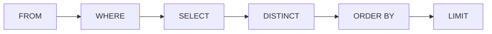

## In Reihe und Glied: ORDER BY

```alltag
text: Zum Wiegen stellen sich die Pinguine in einer Reihe auf, vom leichtesten bis zum schwersten. Ohne Ansage stehen sie, wie sie gerade angewatschelt kommen. ORDER BY ist die Ansage.
zeichnung: aufstellung
```

Ohne `ORDER BY` liefert die Datenbank die Zeilen in irgendeiner Reihenfolge, oft so, wie sie gespeichert sind, aber versprochen ist das nicht. `ORDER BY spalte` sortiert aufsteigend: kleine Zahlen zuerst, Texte nach dem Alphabet, frühe Tage vor späten. Mit `DESC` dahinter geht es absteigend. ORDER BY steht ganz am Ende der Abfrage.

```beispiel
id: leicht-zuerst
code: |
  SELECT name, gewicht_kg
  FROM pinguine
  ORDER BY gewicht_kg;
vorhersage:
  art: auswahl
  frage: Wer steht ganz oben im Ergebnis?
  vergleich: anfang
  optionen:
    - text: Pünktchen | 2.9
      richtig: true
      erklaerung: Richtig. Aufsteigend heißt, der leichteste kommt zuerst.
    - text: Paul | 5.1
      erklaerung: Paul ist der schwerste; der stünde bei ORDER BY gewicht_kg DESC oben.
    - text: Pit | 4.2
      erklaerung: Pit steht in der Tabelle vorn, aber ORDER BY sortiert neu.
```

```frage
frageart: luecke
id: luecke-desc
text: Ergänze, damit die wärmste Kolonie zuerst kommt.
code: |
  SELECT name, wassertemperatur
  FROM kolonien
  ORDER BY wassertemperatur ___;
antworten: [["DESC", "desc"]]
erklaerung: Richtig, DESC sortiert absteigend.
hinweis: Das Wort für absteigend.
```

## Gleichstand auflösen

Hinter ORDER BY dürfen mehrere Spalten stehen, mit Komma getrennt. Die zweite entscheidet nur, wo die erste gleich ist, die dritte, wo auch die zweite gleich ist. DESC gilt immer nur für die Spalte direkt davor.

```beispiel
id: zwei-schluessel
code: |
  SELECT name, kolonie, geburtsjahr
  FROM pinguine
  ORDER BY kolonie, geburtsjahr DESC;
vorhersage:
  art: auswahl
  frage: Wie lauten die ersten drei Zeilen?
  vergleich: anfang
  optionen:
    - text: |-
        Pina | Nord | 2022
        Pit | Nord | 2019
        Polly | Nord | 2019
      richtig: true
      erklaerung: Richtig. Erst nach Kolonie, Nord kommt im Alphabet vor Ost und Süd; im Norden die Jüngsten zuerst.
    - text: |-
        Paul | Nord | 2017
        Pit | Nord | 2019
        Polly | Nord | 2019
      erklaerung: DESC gilt für geburtsjahr; die späten Jahre kommen zuerst.
    - text: |-
        Pünktchen | Ost | 2023
        Pina | Nord | 2022
        Pablo | Ost | 2021
      erklaerung: Zuerst wird nach kolonie sortiert, das Geburtsjahr entscheidet nur innerhalb einer Kolonie.
```

```falle
titel: Umlaute ganz hinten
text: "SQLite sortiert Texte nach ihren Zeichencodes. Großbuchstaben kommen vor Kleinbuchstaben, und ü steht hinter z: Pünktchen landet bei ORDER BY name hinter Polly. NULL kommt beim Sortieren ganz nach vorn."
```

## Nur die ersten: LIMIT

`LIMIT 3` behält nur die ersten drei Zeilen. Zusammen mit ORDER BY entstehen so Ranglisten: die drei schwersten, die zwei jüngsten. `LIMIT 3 OFFSET 3` überspringt erst drei Zeilen und nimmt dann drei, wie Seite zwei einer Liste.

Die Datenbank sortiert erst, nachdem SELECT die Spalten gebaut hat. Darum darf ORDER BY auch einen Namen benutzen, den erst AS vergeben hat, anders als WHERE.



```beispiel
id: rangliste
code: |
  SELECT name, gewicht_kg
  FROM pinguine
  ORDER BY gewicht_kg DESC
  LIMIT 3;
vorhersage:
  art: auswahl
  optionen:
    - text: |-
        Paul | 5.1
        Pepe | 4.9
        Polly | 4.6
      richtig: true
      erklaerung: Richtig. Erst absteigend sortieren, dann die ersten drei nehmen.
    - text: |-
        Pit | 4.2
        Pia | 3.8
        Paul | 5.1
      erklaerung: Das wären die ersten drei der Tabelle. LIMIT kommt nach ORDER BY dran.
    - text: |-
        Pünktchen | 2.9
        Pina | 3.5
        Pia | 3.8
      erklaerung: DESC sortiert absteigend, die schweren kommen zuerst.
```

```falle
titel: Gleichstand an der Grenze
text: "Pit und Polly sind beide 2019 geboren. Bei `ORDER BY geburtsjahr LIMIT 3` ist nicht festgelegt, wer von beiden vorn steht. Wer eine eindeutige Rangliste will, sortiert mit einer zweiten Spalte weiter, zum Beispiel `ORDER BY geburtsjahr, name`."
```

## Doppelte weg: DISTINCT

`SELECT DISTINCT` streicht Zeilen, die schon einmal im Ergebnis stehen. So erfährt man, welche Werte es überhaupt gibt, ohne jeden einzeln zu sehen.

```beispiel
id: kolonien
code: |
  SELECT DISTINCT kolonie
  FROM pinguine;
vorhersage:
  art: eintippen
  frage: Wie viele Zeilen hat das Ergebnis?
  vergleich: zeilen
  erklaerung: Nord, Süd und Ost. Die Westkolonie hat keine Pinguine, also taucht sie in der Tabelle pinguine nicht auf.
```

```merke
text: "ORDER BY sortiert am Ende, DESC dreht um, weitere Spalten lösen Gleichstände. LIMIT nimmt die ersten Zeilen, OFFSET überspringt welche. DISTINCT streicht Doppelte. Ohne ORDER BY gibt es keine versprochene Reihenfolge."
```

```frage
frageart: fehlerstelle
id: fehler-reihenfolge
text: Diese Abfrage meldet einen Fehler. In welcher Zeile?
code: |
  SELECT name, gewicht_kg
  FROM pinguine
  ORDER BY gewicht_kg
  WHERE kolonie = 'Nord';
zeile: 4
erklaerung: Genau. WHERE muss vor ORDER BY stehen; beim Schreiben kommt ORDER BY zuletzt.
hinweis: Welche Klausel steht nicht an ihrem Platz?
```

```frage
frageart: ordnen
id: ordnen-klauseln
text: Bring die Zeilen in Reihenfolge, damit die Abfrage die zwei schwersten Pinguine des Nordens holt.
zeilen:
  - SELECT name, gewicht_kg
  - FROM pinguine
  - WHERE kolonie = 'Nord'
  - ORDER BY gewicht_kg DESC
  - LIMIT 2;
erklaerung: Richtig. Geschrieben wird SELECT, FROM, WHERE, ORDER BY, LIMIT.
hinweis: LIMIT steht ganz am Ende, ORDER BY direkt davor.
```

```augenzwinkern
text: Paul steht bei jeder Wiegerangliste ganz oben. Er behauptet, das liege an seinen schweren Knochen.
```
