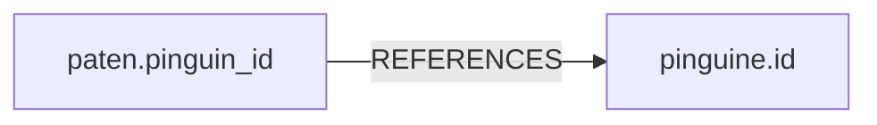

## Ein eigener Kasten

```alltag
text: Der Zoo will seine Besucher erfassen, aber dafür gibt es noch keinen Kasten. Also baut der Pfleger einen und druckt die Felder (Name und Alter) auf die Karten vor. Erst danach kann er Karten einstecken. CREATE TABLE baut den Kasten.
zeichnung: werkbank
```

`CREATE TABLE name (spalte typ, ...)` legt eine neue, leere Tabelle an. Jede Spalte bekommt einen Namen und einen Datentyp: `INTEGER` für ganze Zahlen, `REAL` für Kommazahlen, `TEXT` für Texte. Danach füllt INSERT die Tabelle wie jede andere.

```beispiel
id: besucher
code: |
  CREATE TABLE besucher (
    id INTEGER PRIMARY KEY,
    name TEXT NOT NULL,
    jahre INTEGER
  );
  INSERT INTO besucher (name, jahre) VALUES ('Mia', 8), ('Ole', 35);
  SELECT * FROM besucher;
vorhersage:
  art: auswahl
  optionen:
    - text: |-
        1 | Mia | 8
        2 | Ole | 35
      richtig: true
      erklaerung: Richtig. Die id zählt die Datenbank selbst hoch, ab 1.
    - text: |-
        NULL | Mia | 8
        NULL | Ole | 35
      erklaerung: Eine Spalte INTEGER PRIMARY KEY füllt die Datenbank selbst.
    - text: "(keine Zeile)"
      erklaerung: Die Tabelle ist nach CREATE TABLE leer, aber das INSERT danach füllt sie.
```

```frage
frageart: auswahl
id: datentyp
text: Welcher Datentyp passt zur Spalte gewicht_kg mit Werten wie 4.2?
optionen:
  - text: REAL
    richtig: true
    erklaerung: Richtig, REAL ist für Kommazahlen.
  - text: INTEGER
    erklaerung: INTEGER ist für ganze Zahlen.
  - text: TEXT
    erklaerung: Als Text ließe sich mit dem Gewicht nicht mehr rechnen.
```

## Regeln für Spalten

Hinter dem Datentyp dürfen Regeln stehen, die die Datenbank bei jedem INSERT und UPDATE durchsetzt:

- `PRIMARY KEY`: der Wert ist in jeder Zeile anders; bei INTEGER zählt die Datenbank selbst weiter
- `NOT NULL`: hier muss etwas stehen
- `DEFAULT wert`: das steht da, wenn beim Einfügen nichts angegeben ist
- `CHECK (bedingung)`: nur Werte, für die die Bedingung stimmt

```beispiel
id: eintritt
code: |
  CREATE TABLE eintritt (
    id INTEGER PRIMARY KEY,
    besucher TEXT NOT NULL,
    preis REAL NOT NULL DEFAULT 12.5 CHECK (preis >= 0)
  );
  INSERT INTO eintritt (besucher) VALUES ('Mia');
  INSERT INTO eintritt (besucher, preis) VALUES ('Ole', 0);
  SELECT besucher, preis FROM eintritt;
vorhersage:
  art: auswahl
  optionen:
    - text: |-
        Mia | 12.5
        Ole | 0.0
      richtig: true
      erklaerung: Richtig. Mia bekommt den Vorgabepreis, Ole darf umsonst rein, 0 erfüllt CHECK (preis >= 0).
    - text: |-
        Mia | NULL
        Ole | 0.0
      erklaerung: Wer beim Einfügen nichts angibt, bekommt den DEFAULT, hier 12,5.
    - text: Fehler
      erklaerung: Beide Zeilen halten alle Regeln ein, auch der Preis 0.
```

```falle
titel: Regeln sagen Nein
text: "`INSERT INTO eintritt (besucher, preis) VALUES ('Ole', -3)` scheitert mit `CHECK constraint failed: preis >= 0`. Die Zeile kommt nicht in die Tabelle, und ein Skript bricht an dieser Stelle ab; was davor stand, ist aber schon passiert."
```

```frage
frageart: fehlerstelle
id: fehler-regel
text: Dieses Skript bricht ab. In welcher Zeile?
code: |
  CREATE TABLE besucher (
    id INTEGER PRIMARY KEY,
    name TEXT NOT NULL
  );
  INSERT INTO besucher (name) VALUES ('Mia');
  INSERT INTO besucher (id) VALUES (7);
zeile: 6
erklaerung: Genau. Der Name fehlt, aber die Spalte name ist NOT NULL.
hinweis: Welche Zeile lässt eine Pflichtspalte weg?
```

## Worauf eine Spalte zeigt

Eine neue Tabelle hängt oft an einer alten. Paten übernehmen Pinguine: in der Tabelle paten steht deshalb die Nummer des Pinguins. `REFERENCES pinguine(id)` hält fest, worauf die Spalte zeigt. Über einen JOIN kommen die Namen zusammen.



```beispiel
id: paten
code: |
  CREATE TABLE paten (
    id INTEGER PRIMARY KEY,
    name TEXT NOT NULL,
    pinguin_id INTEGER NOT NULL REFERENCES pinguine(id)
  );
  INSERT INTO paten (name, pinguin_id)
  VALUES ('Familie Kim', 8), ('Klasse 5b', 3), ('Oma Erna', 8);
  SELECT p.name AS pinguin, COUNT(*) AS paten
  FROM paten pa
  JOIN pinguine p ON p.id = pa.pinguin_id
  GROUP BY p.name
  ORDER BY paten DESC;
vorhersage:
  art: auswahl
  frage: Wer steht ganz oben?
  vergleich: anfang
  optionen:
    - text: Pünktchen | 2
      richtig: true
      erklaerung: Richtig. Pünktchen (Nummer 8) hat zwei Paten, Paul einen.
    - text: Paul | 1
      erklaerung: ORDER BY paten DESC stellt die meisten Paten nach oben, das ist Pünktchen.
    - text: Familie Kim | 8
      erklaerung: Gezählt wird je Pinguin, und der Name kommt über den JOIN aus pinguine.
```

## Umbauen und wegwerfen

`ALTER TABLE tabelle ADD COLUMN spalte typ` hängt einer vorhandenen Tabelle eine Spalte an; in den vorhandenen Zeilen steht dort NULL, bis ein UPDATE etwas einträgt. `DROP TABLE tabelle` wirft die Tabelle samt allen Zeilen weg, nicht nur den Inhalt wie DELETE.

```beispiel
id: telefon
code: |
  ALTER TABLE pfleger ADD COLUMN telefon TEXT;
  UPDATE pfleger SET telefon = '0815' WHERE name = 'Greta';
  SELECT name, telefon FROM pfleger;
vorhersage:
  art: auswahl
  optionen:
    - text: |-
        Greta | 0815
        Hannes | NULL
        Ida | NULL
        Jonas | NULL
      richtig: true
      erklaerung: Richtig. Die neue Spalte ist überall NULL, bis das UPDATE Greta eine Nummer gibt.
    - text: |-
        Greta | 0815
        Hannes | 0815
        Ida | 0815
        Jonas | 0815
      erklaerung: Das UPDATE hat ein WHERE und trifft nur Greta.
    - text: Greta | 0815
      erklaerung: Die Abfrage hat kein WHERE, sie zeigt alle Pfleger, auch die ohne Nummer.
```

```falle
titel: DROP ist endgültig
text: "Nach `DROP TABLE pfleger` meldet jede Abfrage auf pfleger `no such table: pfleger`. Tabelle und Inhalt sind weg, und anders als hier im Kurs gibt es im echten Betrieb keine frische Kopie. Vorher eine Sicherung machen."
```

```merke
text: "CREATE TABLE name (spalte TYP regeln, ...) legt eine Tabelle an: INTEGER, REAL, TEXT; PRIMARY KEY, NOT NULL, DEFAULT, CHECK, REFERENCES. ALTER TABLE ... ADD COLUMN ergänzt eine Spalte, DROP TABLE wirft die Tabelle samt Inhalt weg."
```

```frage
frageart: ordnen
id: ordnen-create
text: Bring die Zeilen in Reihenfolge, damit eine Tabelle für Fischlieferungen entsteht.
zeilen:
  - CREATE TABLE lieferungen (
  - "  id INTEGER PRIMARY KEY,"
  - "  fisch TEXT NOT NULL,"
  - "  kilo REAL CHECK (kilo > 0)"
  - );
erklaerung: Richtig. Die Spalten stehen in Klammern, durch Kommas getrennt, nach der letzten kommt kein Komma.
hinweis: Die Klammer öffnet hinter dem Tabellennamen und schließt ganz am Ende.
```

```augenzwinkern
text: Die Pinguine haben vorgeschlagen, auch eine Tabelle für Möwen anzulegen. Mit der Regel CHECK (darf_fische_klauen = 0).
```
