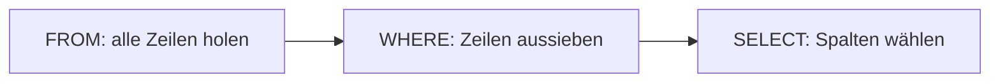

## Nicht alle Zeilen, bitte

```alltag
text: Wer nur die Pinguine der Nordkolonie sucht, kippt den Karteikasten über ein Sieb, das nur Karten mit "Nord" durchlässt. WHERE ist dieses Sieb.
zeichnung: sieb
```

Hinter `WHERE` steht eine Bedingung. Die Datenbank prüft sie für jede Zeile einzeln; nur Zeilen, für die sie stimmt, kommen ins Ergebnis. WHERE steht nach FROM.

```beispiel
id: nord
code: |
  SELECT name, kolonie
  FROM pinguine
  WHERE kolonie = 'Nord';
vorhersage:
  art: auswahl
  frage: Wie viele Zeilen hat das Ergebnis?
  vergleich: zeilen
  optionen:
    - text: 4 Zeilen
      richtig: true
      erklaerung: Richtig. Pit, Paul, Pina und Polly wohnen im Norden.
    - text: 8 Zeilen
      erklaerung: So viele hat die ganze Tabelle; WHERE lässt nur die Nordkolonie durch.
    - text: 1 Zeile
      erklaerung: WHERE holt alle passenden Zeilen, nicht nur die erste.
```

```frage
frageart: auswahl
id: wo-steht-where
text: Wo steht WHERE in einer Abfrage?
optionen:
  - text: Nach FROM
    richtig: true
    erklaerung: Richtig, erst kommt die Tabelle, dann die Bedingung.
  - text: Vor SELECT
    erklaerung: SELECT steht immer vorn.
  - text: Zwischen SELECT und FROM
    erklaerung: Dort stehen die Spalten.
```

## Vergleichen mit = und Co.

Zum Vergleichen gibt es `=` (gleich), `<>` (ungleich), `<` und `>` (kleiner, größer) sowie `<=` und `>=` (kleiner oder gleich, größer oder gleich). Zahlen schreibt man einfach hin, mit Punkt als Komma.

```beispiel
id: schwer
code: |
  SELECT name, gewicht_kg
  FROM pinguine
  WHERE gewicht_kg > 4.5;
vorhersage:
  art: auswahl
  optionen:
    - text: |-
        Paul | 5.1
        Pepe | 4.9
        Polly | 4.6
      richtig: true
      erklaerung: Richtig. Nur wer mehr als 4,5 Kilo wiegt, kommt durch; die Reihenfolge bleibt die der Tabelle.
    - text: |-
        Pit | 4.2
        Paul | 5.1
        Pepe | 4.9
        Polly | 4.6
      erklaerung: Pit wiegt 4,2 Kilo, das ist weniger als 4,5.
    - text: |-
        Paul | 5.1
        Pepe | 4.9
      erklaerung: Polly wiegt 4,6 Kilo und ist damit schwerer als 4,5.
```

```frage
frageart: luecke
id: luecke-vergleich
text: Ergänze, damit alle Kolonien mit Wasser unter null Grad kommen.
code: |
  SELECT name
  FROM kolonien
  WHERE wassertemperatur ___ 0;
antworten: [["<"]]
erklaerung: Richtig, kleiner als null.
hinweis: Gesucht ist das Zeichen für "kleiner als".
```

## Text in Hochkommas

Texte stehen in einfachen Hochkommas: `'Nord'`, `'Hering'`. Ohne Hochkommas hält die Datenbank das Wort für den Namen einer Spalte. Und anders als bei den SQL-Wörtern zählt bei Texten die Schreibweise: `'hering'` ist nicht `'Hering'`.

```beispiel
id: hering
code: |
  SELECT name, lieblingsfisch
  FROM pinguine
  WHERE lieblingsfisch = 'Hering';
vorhersage:
  art: auswahl
  optionen:
    - text: |-
        Pit | Hering
        Paul | Hering
        Pablo | Hering
      richtig: true
      erklaerung: Richtig. Drei Pinguine lieben Hering.
    - text: |-
        Pit | Hering
        Paul | Hering
      erklaerung: Auch Pablo aus der Ostkolonie mag Hering am liebsten.
    - text: "(keine Zeile)"
      erklaerung: "'Hering' ist genau so geschrieben wie in der Tabelle, also gibt es Treffer."
```

```falle
titel: Hochkommas vergessen
text: "`WHERE kolonie = Nord` sucht eine Spalte namens Nord und meldet `no such column: Nord`. Richtig ist `WHERE kolonie = 'Nord'`."
```

```frage
frageart: fehlerstelle
id: fehler-hochkommas
text: Diese Abfrage meldet "no such column". In welcher Zeile?
code: |
  SELECT name,
         gewicht_kg
  FROM pinguine
  WHERE kolonie = Süd;
zeile: 4
erklaerung: Genau. Süd ist ein Text und braucht Hochkommas.
hinweis: Wo steht ein Text ohne Hochkommas?
```

## Die Datenbank liest anders, als du schreibst

Beim Pizzabestellen sagst du zuerst, was du willst. Der Pizzabäcker fängt aber mit dem Teig an und schneidet erst ganz am Ende. Mit SQL ist es genauso: du schreibst SELECT nach vorn, die Datenbank arbeitet erst FROM ab, dann WHERE und erst danach SELECT. Spiel das Beispiel ab und klick dich durch die Zwischentabellen.



```beispiel
id: reihenfolge
code: |
  SELECT name
  FROM pinguine
  WHERE gewicht_kg < 4;
vorhersage:
  art: auswahl
  frage: Wie viele Zeilen hat das Ergebnis?
  vergleich: zeilen
  optionen:
    - text: 3 Zeilen
      richtig: true
      erklaerung: Richtig. Pia, Pina und Pünktchen wiegen weniger als 4 Kilo; Pablo wiegt genau 4 und fällt heraus.
    - text: 4 Zeilen
      erklaerung: Pablo wiegt genau 4,0 Kilo; kleiner als 4 ist das nicht.
    - text: 0 Zeilen
      erklaerung: WHERE darf gewicht_kg benutzen, auch wenn es nicht im Ergebnis steht, denn WHERE arbeitet vor SELECT.
```

```merke
text: "WHERE sortiert Zeilen aus, bevor SELECT die Spalten wählt. Darum darf WHERE auch Spalten benutzen, die am Ende gar nicht im Ergebnis stehen."
```

```frage
frageart: ordnen
id: ordnen-abarbeitung
text: In welcher Reihenfolge arbeitet die Datenbank die Klauseln ab? Bring sie in Reihenfolge.
zeilen:
  - FROM
  - WHERE
  - SELECT
erklaerung: Richtig, erst die Tabelle, dann das Sieb, zuletzt die Spalten.
hinweis: Erst muss es Zeilen geben, bevor man sie aussieben kann.
```

```augenzwinkern
text: Die Südkolonie ist nicht beleidigt, dass sie herausgefiltert wurde. Sie hat ihre eigene Abfrage.
```
